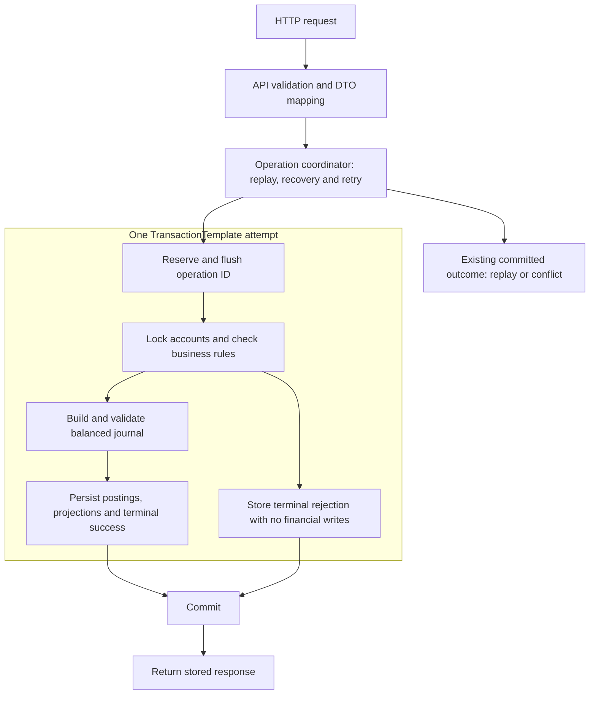

> Current CBS13 update, 2026-10-25: [Durable debit](Debit-execution.md) and opt-in credit are verified with 351 portable and 134 SQL Server tests, zero failures/errors/skips. Transfer remains unavailable until CBS14. Earlier implementation-status statements below retain their historical scope.

# Accepted application architecture

[فارسی](../fa/Architecture.md) · [ADR-008](../adr/ADR-008-application-architecture.en.md) · [Ledger](Ledger.md) · [Transaction protocol](Transaction-protocol.md)

[Tutorial: hexagonal architecture, ports and adapters](Hexagonal-architecture.md)

Accepted by the project owner on 2026-10-23. This records the architecture and examples requested in the discussion. Package names, responsibilities and dependency direction are the accepted blueprint; the listed future class names are illustrative targets, not an instruction to generate empty layers. Current implementation consists of the bootstrap, unimplemented BalanceService scaffold, tested Money value/arithmetic and immutable Account/AccountId with AccountCategory balance-sign policy. Persistence, financial endpoints and modular-boundary enforcement remain unimplemented.

## Current operation packages

The original flat folders made request parsing, response mapping and credit execution difficult to browse. For example, `StrictAmountDeserializer` belongs with request DTOs, while `CreditStore` belongs with the credit use case. The implementation now groups those responsibilities under the existing operation feature.

| Package under `operation` | Responsibility |
| --- | --- |
| `web` | `BalanceController`, the entry point for the four HTTP routes |
| `web.request` | Request DTOs, strict JSON deserializers and HTTP field conversion |
| `web.response` | Response DTOs, the sealed body family, outcome mapping and retained credit/debit JSON encoding |
| `web.error` | Global exception advice and problem detail construction |
| `web.configuration` | Strict JSON configuration and staged application wiring |
| `application` | `BalanceOperations` public boundary and the original `BalanceService` scaffold |
| `application.command` | Credit/debit/transfer intent and structural command validation |
| `application.credit` | Credit handler, attempt context, store port and response encoder port |
| `application.debit` | Debit handler, attempt context, store port and response encoder port |
| `application.identity` | Canonical caller intent and versioned fingerprint encoding |
| `application.policy` | Currency and amount policy, retained funding selection and policy identity validation |
| `application.execution` | Transaction ownership and duplicate-operation signal |
| `application.result` | Mutation outcome, retained response and application failure |

Tests follow the corresponding responsibility packages. SQL Server integration tests remain together under `infrastructure.sqlserver` because they verify complete persistence flows. The sealed response interface and all its implementations remain in `web.response`, as required for sealed types in this unnamed Java module. Small helpers used across these packages expose their existing methods explicitly; constructors stay private. This is a source-package refactor, with no endpoint, JSON, transaction or schema changes. See [implementation status](Implementation-status.md) for current behavior and evidence. The tree below is the original architectural blueprint, rather than an inventory of current files.


## Shape and consistency boundary

One modular Spring Boot application, organized by business feature, with domain rules separated from use-case coordination, HTTP and persistence adapters. One SQL Server database initially contains accounts, operations, journals and postings. One local transaction commits the operation outcome with all successful financial writes. Controllers, account repositories and ledger repositories do not commit separate pieces of a transfer.

TransactionTemplate and the no-ambient-transaction coordinator boundary are accepted. This architecture does not accept all remaining CBS03–04 SQL/isolation/settings proposals, choose a numerical business cap, or certify runtime behavior. Read the linked protocols before migration.



Replay returns the original terminal response without running the posting path. A committed business rejection has an operation but no journal/postings or projection changes. An uncertain commit uses same-ID recovery; a technical failure does not become a fabricated rejection.

## Features

| Feature | Responsibility | Stage |
| --- | --- | --- |
| money | Amount/currency, matching-currency checked arithmetic and comparison | Money implemented |
| account | Identity, currency, category and balance rules; account lookup/locking and persistence | Immutable account model and sign policy implemented; persistence planned |
| operation | Credit/debit/transfer coordination, identity, fingerprints, outcomes, replay and retry | Typed command validation implemented; handlers/persistence planned |
| ledger | Complete balanced journal construction, posting sides, immutable accounting history and persistence | Posting validation and net projection preparation implemented; persistence planned |
| reconciliation | Independent history reconstruction, mismatch detection and controlled repair boundary | Core correctness work, planned |
| confirmation | Immutable intents, OTP lifecycle and confirmation | Later stage |
| security | Authentication, ownership and privileged operations | Before shared/external access |
| replaycache | Redis copies of committed original responses | Later stage |
| event | Outbox publication and duplicate-safe reporting consumers | Later stage |

Initial API access is local/trusted. No generic shared/common/utils dumping ground, separate ledger service or multi-module Maven build is required. Money is a small shared domain value in its own feature package. Add later packages only with their task.

## Java layout

Except for the explicitly marked existing files, this is the target layout:

```text
src/main/java/dev/kavrin/balance/
├── ConcurrentBalanceServiceApplication.java
├── money/
│   └── Money.java                         # implemented
├── account/
│   ├── domain/
│   │   ├── Account.java                    # implemented
│   │   ├── AccountId.java                  # implemented
│   │   └── AccountCategory.java            # implemented
│   ├── application/
│   │   ├── AccountLockOrder.java           # implemented comparator only
│   │   ├── GetBalanceHandler.java
│   │   └── port/AccountRepository.java
│   ├── api/
│   │   ├── BalanceController.java
│   │   └── BalanceResponse.java
│   └── persistence/
│       ├── AccountEntity.java
│       └── JpaAccountRepositoryAdapter.java
├── operation/
│   ├── domain/
│   │   ├── TransactionId.java             # implemented
│   │   ├── OperationType.java             # implemented
│   │   ├── RejectionReason.java           # implemented
│   │   └── OperationOutcome.java          # implemented business values
│   ├── application/
│   │   ├── BalanceService.java             # existing scaffold
│   │   ├── CreditCommand.java              # implemented
│   │   ├── DebitCommand.java               # implemented
│   │   ├── TransferCommand.java            # implemented
│   │   ├── CommandValidation.java          # package-private helper
│   │   ├── SupportedCurrencies.java        # supplied policy snapshot
│   │   ├── OperationCoordinator.java
│   │   ├── CreditHandler.java
│   │   ├── DebitHandler.java
│   │   ├── TransferHandler.java
│   │   ├── RequestFingerprint.java
│   │   └── port/OperationRepository.java
│   ├── api/
│   │   ├── CreditRequest.java
│   │   ├── DebitRequest.java
│   │   ├── TransferRequest.java
│   │   ├── OperationController.java
│   │   └── OperationResponseMapper.java
│   └── persistence/
│       ├── OperationEntity.java
│       └── JpaOperationRepositoryAdapter.java
├── ledger/
│   ├── domain/
│   │   ├── Journal.java                    # implemented posting set
│   │   ├── Posting.java                    # implemented
│   │   └── PostingSide.java                # implemented
│   ├── application/
│   │   └── port/JournalRepository.java
│   └── persistence/
│       ├── JournalEntity.java
│       ├── PostingEntity.java
│       └── JpaJournalRepositoryAdapter.java
├── reconciliation/                       # added in its task
└── configuration/
    └── TransactionConfiguration.java
```

## Responsibilities and dependencies

- domain contains financial values and rules, without Spring, HTTP or JPA dependencies. Account policy governs category-specific signs; Money alone permits signed values.
- application coordinates a use case and calls domain rules and required ports. OperationCoordinator owns attempt/recovery orchestration; a handler participates in the supplied transaction and does not start an independent commit.
- api validates transport shape and maps DTOs/results. HTTP DTOs are not JPA entities. HTTP error mapping happens after the attempt completes.
- persistence implements required ports and maps domain values to JPA entities. Repository interfaces are introduced where they express a real capability, not mechanically for every class.
- configuration wires technical components. Cross-feature dependencies use explicit application contracts or intentionally shared domain values, never another feature's JPA entities or repository implementation.

Keep operation dependent on the account and ledger contracts it coordinates; account and ledger must not depend back on operation orchestration. A domain journal can carry an operation identifier without importing an operation application service. Domain validation does not perform network or database calls. The database adapter must not reach an alternate datasource/transaction manager for a subset of financial writes.

Money and the account snapshot/sign policy are implemented. Journal posting-set validation is also implemented; repository persistence and coordination remain planned:

```text
Money                  -> safe amount arithmetic
Account                -> category-specific balance rules
Journal                -> validate the complete balanced posting set
Repository adapters    -> load locked state and persist mapped records
Coordinator + template -> own commit, rollback and recovery
```

## Transfer example

For transfer A to B, A = 10000000-0000-4000-8000-000000000001 and B = f0000000-0000-4000-8000-000000000002. Account IDs wrap UUID and the implemented AccountLockOrder.DESCENDING compares both halves unsigned. Actual locking SQL remains CBS04 review work.

```text
Outside transaction:
    Validate immutable request shape and current access
    Canonicalize command and resolve a committed replay

Inside one TransactionTemplate attempt:
    Reserve and flush the operation ID
    Lock account B, then account A
    Read and validate locked accounts
    Calculate every resulting balance with checked arithmetic
    Construct and validate the complete balanced journal
    Persist journal + postings + projections + success response
    Commit all together

Business rejection:
    Persist rejection response; commit with no journal or balance changes
Technical failure:
    Roll back the entire attempt; recover/retry outside it with the same ID
```

The reverse direction also locks B then A. Credit/debit must include the server-selected funding account in the same order. Order reduces account-order deadlocks; it does not eliminate every SQL Server deadlock. All calculated balances and complete journal checks pass before projection mutation. Persistence failure still rolls back every write.

Money usage is direct and implemented:

```java
var hundredRials = new Money(100, Currency.getInstance("IRR"));
var fiftyRials = new Money(50, Currency.getInstance("IRR"));
var total = hundredRials.add(fiftyRials); // 150 IRR
```

Customer nonnegativity and positive command/posting rules belong to their respective domain objects, not Money. Ledger examples remain in Ledger.md: a credit of 100 debits funding and credits the customer; a customer transfer debits the source liability and credits the destination liability. These are planned accounting operations, not implemented handlers.

## Resources and tests

```text
src/main/resources/
├── application.yaml
├── application-redis.yaml
├── application-kafka.yaml
├── application-security.yaml
└── db/migration/                         # no business migration yet

src/test/java/dev/kavrin/balance/
├── ConcurrentBalanceServiceApplicationTests.java  # implemented
├── money/MoneyTests.java                          # implemented
├── account/                              # implemented domain/command tests
├── operation/                            # planned
├── ledger/                               # planned
├── reconciliation/                       # planned
└── testsupport/                          # planned fixture helpers

src/test/resources/
└── application-smoke.yaml

docs/
├── en/
├── fa/
└── adr/
```

Flyway business migrations wait for the constraint/transaction review. Java package structure does not require matching SQL schemas; one SQL namespace is sufficient. Unit tests mirror features. Real HTTP-to-SQL Server, direct-SQL and failure tests establish persistence/concurrency evidence; smoke and Money tests do not. Build verification currently passed 150 portable tests, as recorded in Requirements.md.

## Pattern choices and remaining recommendations

These patterns answer different questions and can be combined:

| Pattern | Application here | Recommendation |
| --- | --- | --- |
| Modular monolith | One deployment, explicit feature boundaries, one financial database transaction | Accepted baseline |
| Layered design inside features | api/application/domain/persistence | Accepted baseline |
| Ports and adapters | Application-required interfaces, HTTP and JPA adapters, framework-free domain | Accepted dependency direction; keep interfaces selective |
| Domain model / DDD tactical ideas | Money, Account, Journal and explicit invariants | Use selectively; package names alone do not establish bounded contexts or aggregate transactions |
| Vertical slices | Implement each use case through HTTP/domain/SQL/tests | Preserve the existing delivery plan within feature boundaries |
| Single-database CQRS | Different command and query models/handlers, sharing SQL Server | Accepted 2026-10-23 under ADR-009; no framework or second datastore needed |
| Asynchronous CQRS/read stores | Reporting model fed through outbox/Kafka | Later only for named reporting needs and measured workloads |
| Event sourcing | Authoritative event streams and replay-based aggregate rehydration | Do not add as a V1 requirement |
| Microservices / saga | Independent services and distributed workflow/compensation | Defer; splitting current financial commit creates new consistency requirements |
| Transaction script | Simple use-case procedure | Useful orchestration, but keep reusable money/account/journal rules in domain values |

For the single-database CQRS variant accepted on 2026-10-23, credit/debit/transfer use command models and return operation results. GetBalanceHandler returns a BalanceResponse projection directly from committed accounts data without reconstructing the write-domain model. Both use the same database and immediate committed projection; no asynchronous balance update or mandatory command bus. Merely naming classes CommandHandler and QueryHandler is insufficient: the read representation and logic must be deliberately separated. The earlier tree already has room for this, so do not add top-level command/query silos across all features.

CQRS requires a deliberate read/write model separation; separate databases are optional. Separate stores introduce synchronization/lag concerns. Kafka reporting history may be eventually consistent later, but customer available-funds checks and authoritative balance reads stay on committed synchronous account projections. Command responses may return useful outcome data; they need not be void.

Our immutable postings and reconstructable balance have event-sourcing-like properties, but that does not establish a general event-sourced aggregate implementation. Do not add an event-store dependency, event-stream loading for every command or Kafka execution of customer transfers on the strength of that analogy. Outbox integration events are distinct from authoritative accounting postings.

Optional future enforcement: evaluate ArchUnit or compatible Spring Modulith structural checks when packages grow. Spring Modulith is tooling for logical modules; adopting a modular monolith does not mean its dependency is installed or its default module-interface rules already match this tree. No new framework dependency is accepted by this document.

## Sources for pattern review

Consulted 2026-10-23: [Microsoft CQRS](https://learn.microsoft.com/en-us/azure/architecture/patterns/cqrs) describes separate models sharing a datastore and more complex separate-store variants. [Fowler on CQRS](https://martinfowler.com/bliki/CQRS.html) discusses selective use and added complexity. [Microsoft event sourcing](https://learn.microsoft.com/en-us/azure/architecture/patterns/event-sourcing) explains event streams as authoritative state. [Spring Modulith fundamentals](https://docs.spring.io/spring-modulith/reference/fundamentals.html) describes module APIs and structural validation. These references inform recommendations, not acceptance or application test evidence.

[ADR-009](../adr/ADR-009-single-database-cqrs.en.md) records acceptance of this bounded CQRS choice. Advanced asynchronous stores, event sourcing and extra frameworks remain outside that acceptance.

[UUID bits and lock-order guide](UUID-lock-order.md) explains hexadecimal, two’s complement, both unsigned halves, comparator result signs and each test with a runnable example.

Currency support is an immutable set-based application policy; command constructors validate shape and positive amounts only. Configuration/database adapters will supply SupportedCurrencies in future wiring. See Decisions.md for replay ordering and the policy-loading boundary.

[Business outcomes and commit boundary](Operation-outcomes.md)
