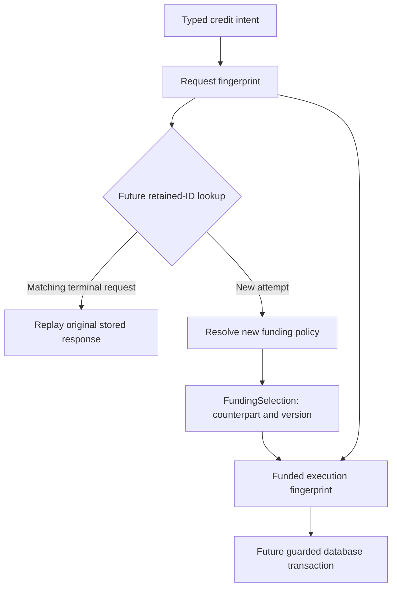

# Why canonical requests, fingerprints and funding selections are separate

[فارسی](../fa/Canonical-design.md) · [Exact encoding reference](Canonical-request.md) · [Operation walkthrough](Operation-flow.md) · [Identity protocol](Idempotency-protocol.md)

This is the reasoning companion to CBS06, based on the current code on 2026-10-23. Start here for the system-design concepts; use Canonical-request.md for the precise byte layout. “Funding selection” means the `FundingSelection` record: the server's selected funding counterpart and its policy version.

The three value types and their portable comparisons exist. The HTTP controller does not yet call them. SQL Server storage, reservations, policy loading, transaction coordination and replay remain future work. A financial request still gets the explicit unavailable fallback. All database timelines below illustrate the intended protocol, not measured runtime guarantees.

## 1. The problem starts with a missing response

Suppose A contains 1,000 rials and B contains 300. A client sends Tx-001 to transfer 100 from A to B. The server might commit A=900 and B=400, then lose the response because the connection breaks. The client sees a timeout and cannot distinguish these cases:

| What actually happened | What the client knows |
| --- | --- |
| Request never reached the service | No response |
| Transaction rolled back | No response |
| Transaction committed, response was lost | No response |

Retrying is useful for availability, but a naive retry could transfer another 100. We need a contract that lets the client repeat the same attempt safely. The AWS Builders' Library describes caller-supplied request identifiers and detecting changed parameters under an existing identifier; our retained-ID and mismatch rules apply that general pattern to this project's reviewed scope. [Primary source](https://builder.aws.com/content/3Ev0BENTyBr0XxzRk5FDZzgNYos/m).

Our design asks three separate questions:

| Question | Representation |
| --- | --- |
| Which attempt is being retried? | TransactionId, the future durable lookup key |
| Does this attempt still request the same thing? | CanonicalRequest and its request fingerprint |
| Which server-selected counterpart/policy belonged to its execution? | FundingSelection and the funded fingerprint |

None of these objects independently guarantees that money moves only once. That needs durable identity, concurrency control and atomic database commit together.

## 2. Canonicalization means choosing one representation

**Canonical** means a chosen standard form. **Canonicalization** is converting accepted semantic values into that form. **Semantic equality** means the values express the same request, even if their original text differs.

These accepted request bodies differ in JSON formatting and field order:

```json
{"transactionId":"Tx-001","amountRial":100,"currency":"IRR"}
```

```json
{
  "currency": "IRR",
  "amountRial": 100,
  "transactionId": "Tx-001"
}
```

At the same credit route/account, they produce the same typed command. CanonicalRequest starts with that command rather than raw JSON, so formatting does not affect identity. Full UUIDs with uppercase versus lowercase hexadecimal also parse to the same UUID and get the same UUID.toString representation.

Canonicalization does not mean accepting arbitrary input and cleaning it up. Our HTTP parser rejects 100.0, 1e2 and numeric strings for amountRial. Transaction IDs are never trimmed or case-folded. Actor identities preserve case, whitespace around nonblank text and Unicode spelling exactly. Only equivalences already defined by the type/contract are canonicalized.

Sorting transfer accounts would be a mistake. A→B and B→A move money in different directions and must differ. Lock acquisition order is a concurrency mechanism; source/destination order is business meaning. They solve different problems.

## 3. Why three types instead of one large object?

[CanonicalRequest](../../src/main/java/dev/kavrin/balance/operation/application/identity/CanonicalRequest.java) translates typed intent into a fixed schema. It knows the operation type and account roles. It does not query accounts, authenticate an actor or choose a funding policy.

[CanonicalFingerprint](../../src/main/java/dev/kavrin/balance/operation/application/identity/CanonicalFingerprint.java) owns the immutable representation: format version, canonical bytes, SHA-256 digest and equality. It does not decide whether a transfer is affordable or reserve an ID.

[FundingSelection](../../src/main/java/dev/kavrin/balance/operation/application/policy/FundingSelection.java) records a server decision that may change over time. It contains exactly:

```java
public record FundingSelection(
        AccountId counterpartAccountId,
        String policyVersion) {
    // Constructor validation is in the source file.
}
```

| Field | Meaning | What it does not prove |
| --- | --- | --- |
| counterpartAccountId | The actual internal account selected as the other posting participant | Account exists, has the right category or represents real external liquidity |
| policyVersion | Exact nonblank label for the selection rule, such as funding-v1 | Policy has been loaded, is a Git commit or follows semantic versioning |

FundingSelection requires a non-null account and a nonblank valid-Unicode version. CanonicalRequest additionally rejects a counterpart equal to its target. There is no policy resolver in the record: construction captures a decision; it does not make the decision.

This is **separation of concerns**. Caller intent, encoding mechanics and mutable execution policy have different reasons to change. The types keep those responsibilities visible and testable without Spring or a database. They are local value objects within the modular monolith; they are not separate microservices.

## 4. Attempt identity and content identity are different

Compare these future submissions:

| Transaction ID | Intent | Required interpretation |
| --- | --- | --- |
| Tx-001 | A→B, 100 IRR | First attempt |
| Tx-001 | A→B, 100 IRR | Retry of the same attempt |
| Tx-001 | A→B, 200 IRR | Conflict with retained intent |
| Tx-002 | A→B, 100 IRR | A separate attempt with identical content |

TransactionId is excluded from the canonical payload because it is the lookup key. Equal payload fingerprints across Tx-001 and Tx-002 do not make the second attempt a duplicate. This is not content-addressed execution where “same content” automatically means “execute only once.” Clients may legitimately repeat the same payment instruction with new IDs.

**Idempotency** here is the planned behavior that repeated delivery of the same retained attempt does not add another committed financial effect. **Deduplication** is recognizing duplicate deliveries under that identity. **Replay** returns the retained original result. **Conflict** means the ID is reused for different semantic input. These terms describe related parts of the protocol, not synonyms for hashing.

## 5. What goes into request identity?

The version-1 request schema has these fields after its version/count headers:

| Field | Why it matters |
| --- | --- |
| request namespace tag | Separates this encoding purpose from funded-execution bytes |
| operation type | Credit 100 and debit 100 must differ |
| target account | Identifies the customer for credit/debit/internal opening |
| source account | Transfer sender, with an explicit role |
| destination account | Transfer recipient, with an explicit role |
| positive amount | 100 and 200 are different instructions |
| currency | Equal numbers in different currencies are different instructions |
| optional actor binding | Distinguishes the authenticated principal when that boundary exists |

The current trusted local path uses Optional.empty for actor. It does not invent a user named “system.” Future actor input must come from trusted authentication, not a client-controlled body field. Fingerprinting an actor does not authorize that actor; ownership and current permission must still be checked before execution or replay.

We exclude request timing, trace IDs, response timestamps, current balances and OTP secrets. Those can change on a retry without changing the requested operation. Account balances are evaluation state, not intent. SupportedCurrencies is mutable admission policy, so replay must be resolved before reapplying today's support set.

## 6. Serialization, framing and byte order

**Serialization** converts structured values into bytes. **Deterministic serialization** means the same validated values under the same format version produce the same bytes. Our small internal format uses an explicit schema rather than default object serialization.

An ambiguous concatenation illustrates why field boundaries matter:

```text
Fields ["ab", "c"]  → naive concatenation "abc"
Fields ["a", "bc"]  → naive concatenation "abc"
```

Adding a delimiter alone still fails if fields can contain that delimiter. **Length-prefix framing** writes the byte length before each field. In an explanatory decimal notation, the two cases become `2:ab,1:c` and `1:a,2:bc`. Our actual lengths are binary integers, not colon-separated text.

```text
00 00 00 01     format version = 1
00 00 00 08     request field count = 8
00 00 00 07     first field has 7 UTF-8 bytes
72 65 71 75 65 73 74     "request"
```

A **byte** is eight bits. **Hexadecimal** represents each byte with two base-16 digits, so 00 and ff each denote one byte. **Big-endian** puts the most significant byte first. DataOutputStream.writeInt writes four bytes in that order. We use it for headers/lengths and write explicitly encoded UTF-8 field bytes; writeUTF would use modified UTF-8 and its own length convention, so it is not our format. [Java DataOutputStream](https://docs.oracle.com/en/java/javase/21/docs/api/java.base/java/io/DataOutputStream.html).

The signed length -1 denotes an absent field; zero denotes a present empty field. The generic framing can distinguish them even though actor/policy validation rejects empty semantic values. Fixed field roles, field count, lengths and namespaces jointly prevent accidental ambiguity. This is **domain separation** in the encoding: request and funded-execution are labeled as different purposes. It is unrelated to creating another domain service.

## 7. UTF-8, Unicode and strict input

Unicode assigns code points to text characters. UTF-8 encodes them as bytes of varying length. Java Strings use UTF-16 code units; some characters need a pair of units. That is why a Java character count is not a general UTF-8 byte count. Our lengths count the actual encoded bytes.

A malformed unpaired surrogate must not be silently replaced: replacement could make two distinct malformed inputs become the same output. The encoder reports malformed input instead. Java CharsetEncoder documents reporting as its default error action. [Java CharsetEncoder](https://docs.oracle.com/en/java/javase/21/docs/api/java.base/java/nio/charset/CharsetEncoder.html).

Two valid Unicode spellings can look alike and still be different identities. For example, precomposed é and e followed by a combining accent are not normalized by these classes. This preserves the identity contract; deciding that they should be equivalent would require an explicit actor-identity policy and compatibility review.

## 8. SHA-256, collisions, equals and immutability

A **hash/digest** maps bytes to a fixed-size value. SHA-256 produces 256 bits: 32 bytes, represented here as 64 lowercase hexadecimal characters. Java MessageDigest provides SHA-256 computation. [Java MessageDigest](https://docs.oracle.com/en/java/javase/21/docs/api/java.base/java/security/MessageDigest.html).

A finite digest space cannot uniquely identify every possible input. A **collision** means different inputs share a digest. Our design therefore retains complete canonical bytes and uses Arrays.equals in CanonicalFingerprint.equals; a matching digest alone cannot authorize replay. Java hashCode is a separate 32-bit collection helper built from those bytes, not the SHA-256 string or a persisted identity contract.

Hashing is not encryption: there is no decryption key or reversible plaintext operation. It also is not authentication, a signature or an HMAC. Anyone who knows a candidate request can compute its unkeyed SHA-256. Do not use the digest as a secret or assume canonical bytes/hex hide actor or account data.

**Immutability** means a value cannot change after construction. bytes() returns a clone because byte arrays are mutable even when their field is final. Without a defensive copy, a caller could change canonical identity after it had been compared or added to a hash collection. The private constructor receives an owned in-memory copy; no external mutable array is retained.

The digest is useful as a compact companion value for future checking/index decisions, but no database digest index exists today. We have not measured a speed improvement. Encoding and hashing cost time proportional to encoded size; full bytes also consume storage if retained. This is a correctness design, not a demonstrated performance optimization.

## 9. Worked transfer through all decisions

Use A=`00000000-0000-0000-0000-000000000001`, B ending in 2 and C ending in 3. The command is Tx-001, TRANSFER, A→B, 100 IRR, actor absent.

1. HTTP parsing requires the integer token 100 and full UUID text. It rejects fractional or malformed input before a command exists.
2. TransferCommand validates required values, positive amount and distinct accounts. No balance lookup occurs here.
3. CanonicalRequest.transfer converts typed roles into the eight fixed fields. Target and actor are absent, source=A and destination=B.
4. CanonicalFingerprint frames those fields and computes SHA-256. The test vector is `9eac5bca4175ebd6aaa024fd362e313b1ae23cb7cf43e5f5fe4495b558a5a996`.
5. In the future coordinator, look up Tx-001. A retained matching request returns the original response; a changed request conflicts. On a new operation, follow the reviewed reservation/locking protocol.
6. The planned successful transaction commits its journal, postings, A=900, B=400 and original outcome/response together. Only confirmed completion crosses into HTTP success mapping.
7. If the response disappears after commit, retry Tx-001 with the same command. The planned replay adds no postings and performs no new funds decision.

Steps 1–4 exist as separate implemented components, but the controller currently stops at the unavailable BalanceOperations fallback. Steps 5–7 are planned. Transfers do not use FundingSelection because their two effective accounts are already explicit. fundedFingerprint on a transfer throws locally.

## 10. Worked credit when the funding policy changes

A credit request names customer A and amount 100. It does not let the caller choose the internal funding account. Under the accepted ledger design, a successful credit needs balanced accounting lines, for example funding debit 100 and customer credit 100. Account category determines how those sides affect displayed projections; equal debit/credit totals do not mean all categories use the same signed balance delta.

Suppose the server selects B under funding-v1. FundingSelection captures `(B, funding-v1)`. The funded fingerprint contains the full request bytes as hex, the chosen counterpart and the version, under the funded-execution namespace. The nested full bytes preserve exact intent; embedding only a digest would make this comparison depend on digest uniqueness.



This is a planned processing flow; no lookup or policy resolver exists yet. The class can compute the two value representations independently.

| Event | Request identity | Funding/execution identity | Planned result |
| --- | --- | --- | --- |
| credit-001 first evaluated with B/v1 | Original | Request+B+v1 | Commit one result |
| Policy changes to C/v2 | Original intent unchanged | New selection differs | Existing result remains immutable |
| Retry credit-001 with original intent | Matches retained request | Use retained B/v1 | Replay; do not rerun current policy |
| New credit-002 with same customer/amount | Same payload, new lookup ID | May choose C/v2 | A separate permitted financial attempt |
| credit-001 changes amount to 200 | Different | Irrelevant to replay decision | Conflict; preserve original result |

This is a **snapshot** of an execution decision, not a live reference to today's policy. **Temporal consistency** here means later configuration changes do not reinterpret past operations. The version records which selection policy applied; the account ID records what it actually chose. Same version with a different counterpart still changes funded identity. Changed version with the same counterpart also changes it, conservatively retaining the changed decision context.

Optional actor binding is retained within the nested request, so it also influences the funded fingerprint. Missing customer accounts can still produce retained terminal rejection without actual postings; a funded success fingerprint is not a prerequisite for representing every rejection.

## 11. Why hashing does not solve concurrency or atomicity

Two service instances can simultaneously compute identical bytes and both observe no retained operation. An in-memory equality check cannot prevent both from writing. **Concurrency control** must coordinate competing database attempts. The proposed protocol uses a global transaction-ID uniqueness safeguard and fresh recovery after an expected collision, subject to the SQL Server tests and review gates.

SQL Server uses a unique index to enforce a UNIQUE constraint; that enforces key uniqueness, not our entire replay protocol. [Microsoft constraints documentation](https://learn.microsoft.com/en-us/sql/relational-databases/tables/unique-constraints-and-check-constraints).

**Atomicity** means the operation's required writes commit together or roll back together. In our planned success path those writes include identity/outcome, journal, postings and projections. **Durability** means committed state survives the relevant restart/failure guarantees of the deployed database. **Isolation** controls what concurrent transactions can observe or interfere with. Precise isolation/locking behavior must be reviewed and tested on SQL Server; fingerprints provide none of these guarantees.

Together with consistency, these properties form **ACID**. ACID consistency means preserving declared data/business invariants, not making every replica immediately current. A database constraint helps enforce a local rule, but a fingerprint cannot prove that a multi-row journal balances. That still needs the reviewed write path and reconciliation.

The broader project uses a single-database **CQRS** direction: mutation commands express intent, while balance queries read synchronous account projections. CQRS separates command/query responsibilities; it does not require two services or two databases. Keeping journal history plus projections also does not, by itself, establish a complete event-sourcing architecture. See [Ledger](Ledger.md) for the accepted project scope.

The committed transaction is the intended visibility boundary, sometimes discussed as a **linearization point** for the operation. Calling a callback, creating Success or computing a hash is not that point. We do not claim formal linearizability or SQL Server commit semantics from portable tests.

The target is at most one committed effect per retained identity, with retry/recovery rules. It is not exactly-once network delivery: requests or responses can repeat or disappear. A lost commit acknowledgment produces an **uncertain outcome**, requiring recovery under the same ID rather than a claim that rollback happened.

## 12. Business rejection, retention and current authorization

A well-formed debit/transfer can fail because funds are insufficient. The accepted policy retains its terminal rejection with no journal or money writes. If the client later obtains more funds, replaying the old ID still returns the old rejection. A new attempt uses a new ID. Rejection is therefore a durable business decision, unlike transient infrastructure failure or invalid syntax.

Retention is part of correctness. Our accepted V1 policy retains terminal identities and original results indefinitely. Deleting a record and allowing that ID to execute again would change the retry guarantee. A later Redis TTL does not determine SQL Server identity lifetime; Redis remains a possible cache, not the execution authority.

Actor binding is identity metadata. **Authorization** asks whether the current caller may access/execute the operation now. Future replay still requires current access even when the original actor or fingerprint matches. Idempotency does not stop an authorized client from sending many new IDs; rate limits, business caps and later confirmation address separate risks.

## 13. Versioning and compatibility are part of the protocol

The format starts with version 1 because deployments and policy decisions outlive one Java build. Field order, role interpretation, normalization, number units and actor rules all affect identity. A refactor that changes bytes can turn a valid retry into a false conflict if storage compatibility is ignored.

**Backward compatibility** means a newer deployment can still interpret retained older records correctly. A future decoder must read the stored version, reject unknown/invalid formats safely and dispatch to the appropriate comparison rules. It must not simply run new version-2 rules against a stored version-1 digest. Actorless V1 records gaining authenticated access also need explicit policy review, not a fabricated actor substitution.

A **golden test vector** fixes known input, exact bytes and expected digest. It detects accidental changes; it does not replace a migration plan or certify every input. Current tests and an independent Python calculation agree on the transfer vector above. The stored-format decoder/migration machinery does not exist yet.

## 14. Alternatives and the costs of our choice

| Alternative | Why we did not choose it here | When it could fit |
| --- | --- | --- |
| Hash raw JSON | Formatting can create false differences; transport fields can leak into identity | Byte-identical document identity, if that is explicitly the goal |
| Concatenate fields | Boundaries become ambiguous | Only with a fully specified escaping/framing scheme |
| Hash alone | Discards the exact comparison authority we require | Other systems may accept a digest-only collision model |
| Canonical JSON | Valid option, but still needs domain field/normalization rules | Interoperable JSON signing and cross-language contracts |
| Protobuf or another deterministic serializer | Adds schema/tooling dependencies and still needs version/domain rules | A shared protocol ecosystem already using that schema |
| One fingerprint including today's funding policy on every retry | Changed policy can create false conflicts or reinterpret old execution | Only if retained policy context is explicitly restored before comparison |
| Global in-memory lock or Redis-only marker | Does not supply durable multi-instance accounting identity | Local coordination or cache optimization alongside a durable authority |

RFC 8785 specifies a JSON canonicalization scheme, including deterministic property ordering. Our custom bytes are a project choice, not evidence that JSON cannot be canonicalized. [RFC 8785](https://www.rfc-editor.org/info/rfc8785/).

Our format is small and dependency-free, but we own its specification, compatibility tests and future decoder. Inspecting bytes is less convenient than reading JSON. Hex embedding doubles the byte count of the nested request representation; it simplifies a string-field encoder at a storage/allocation cost. No benchmark justifies claiming this is faster than canonical JSON.

Actor and policy text currently have no application-specific maximum length beyond available Java resources. Production bounds and database column compatibility need review before external access/storage; no invented numeric limit is implied here. Canonical bytes contain identifiers and hex does not anonymize them. Logs, access and retention need the same care as the original metadata.

## 15. Run one example and inspect the results

The following standalone Java program uses only our compiled value classes and Java 21. It constructs metadata and compares it; it does not start Spring or move money. Save the code as CanonicalDesignExample.java. From the repository root, after compiling the project, run:

```sh
javac -cp target/classes -d /tmp CanonicalDesignExample.java
java -cp target/classes:/tmp CanonicalDesignExample
```

The classpath separator shown is for macOS/Linux; use `;` on Windows.

```java
import java.util.Currency;
import java.util.Optional;
import java.util.UUID;
import dev.kavrin.balance.account.domain.AccountId;
import dev.kavrin.balance.money.Money;
import dev.kavrin.balance.operation.application.identity.CanonicalRequest;
import dev.kavrin.balance.operation.application.command.CreditCommand;
import dev.kavrin.balance.operation.application.policy.FundingSelection;
import dev.kavrin.balance.operation.application.command.TransferCommand;
import dev.kavrin.balance.operation.domain.TransactionId;

public class CanonicalDesignExample {
    public static void main(String[] args) {
        var a = account("00000000-0000-0000-0000-000000000001");
        var b = account("00000000-0000-0000-0000-000000000002");
        var c = account("00000000-0000-0000-0000-000000000003");
        var amount = new Money(100, Currency.getInstance("IRR"));
        var first = new TransferCommand(new TransactionId("Tx-001"), a, b, amount);
        var otherId = new TransferCommand(new TransactionId("Tx-002"), a, b, amount);
        var reversed = new TransferCommand(new TransactionId("Tx-001"), b, a, amount);
        var request = CanonicalRequest.transfer(first, Optional.empty());
        var equivalent = CanonicalRequest.transfer(otherId, Optional.empty());
        var changed = CanonicalRequest.transfer(reversed, Optional.empty());

        System.out.println("samePayload=" + request.fingerprint().equals(equivalent.fingerprint()));
        System.out.println("sameTransactionId=" + first.transactionId().equals(otherId.transactionId()));
        System.out.println("reversedPayload=" + request.fingerprint().equals(changed.fingerprint()));
        System.out.println("transferSha256=" + request.fingerprint().sha256());

        var credit = CanonicalRequest.credit(
                new CreditCommand(new TransactionId("credit-001"), a, amount), Optional.empty());
        var retained = new FundingSelection(b, "funding-v1");
        var originalExecution = credit.fundedFingerprint(retained);
        var sameSelection = credit.fundedFingerprint(new FundingSelection(b, "funding-v1"));
        var changedAccount = credit.fundedFingerprint(new FundingSelection(c, "funding-v1"));
        var changedPolicy = credit.fundedFingerprint(new FundingSelection(b, "funding-v2"));
        System.out.println("sameExecution=" + originalExecution.equals(sameSelection));
        System.out.println("changedAccount=" + originalExecution.equals(changedAccount));
        System.out.println("changedPolicy=" + originalExecution.equals(changedPolicy));
    }

    private static AccountId account(String text) {
        return new AccountId(UUID.fromString(text));
    }
}
```

Expected output:

```text
samePayload=true
sameTransactionId=false
reversedPayload=false
transferSha256=9eac5bca4175ebd6aaa024fd362e313b1ae23cb7cf43e5f5fe4495b558a5a996
sameExecution=true
changedAccount=false
changedPolicy=false
```

Read each line as a comparison. The first two show why content equality does not merge different attempts. reversedPayload=false proves account roles matter. The last three show that an equal retained funding selection matches, while changing account or policy changes execution identity. None of these lines proves database deduplication or a successful posting.

## 16. Vocabulary tied to this design

| Term | Meaning here |
| --- | --- |
| Invariant | A rule that must remain true, such as an ID never changing its retained intent |
| Canonical representation | One specified byte form for accepted semantic input |
| Determinism | Same values/version produce the same bytes |
| Framing | Information that makes each field boundary unambiguous |
| Domain separation | Different labels for request and funded-execution encoding purposes |
| Value object | Metadata compared by its contents, with no database lifecycle of its own |
| Snapshot | Retained counterpart/version decision independent of later policy changes |
| Actor/principal | Identity from trusted authentication when that feature exists |
| Source of truth | SQL Server as the planned durable authority for financial identity/outcomes |
| Idempotency key | TransactionId identifying one retained financial attempt |
| Deduplication | Recognizing repeated delivery of that attempt |
| Replay | Returning the original stored result without another financial effect |
| Fingerprint/digest | Canonical bytes plus companion hash in this project's type; SHA-256 alone is the digest |
| Collision | Different inputs mapping to the same finite hash value |
| Atomic commit | Financial history, projections and outcome become durable together |
| Race condition | Competing instances make overlapping decisions without sufficient coordination |
| Uncertain outcome | The caller cannot determine whether commit happened |
| Backward compatibility | Retained old identities remain interpretable across software changes |
| Golden vector | Fixed input/bytes/hash test guarding the encoding contract |
| Admission policy | Conditions for a new attempt, evaluated separately from replay |

For exact fields and current evidence, read [Canonical-request.md](Canonical-request.md). For SQL locking/reservation proposals and open review gates, read [Idempotency-protocol.md](Idempotency-protocol.md) and [Transaction-protocol.md](Transaction-protocol.md). Tests prove the portable representation and comparisons; they do not prove database execution or learner mastery.

## Document verification

Verified on 2026-10-23 with Java 21.0.11: all 22 CanonicalRequestTests passed with zero failures/errors/skips in 3.627 seconds. The exact standalone program was extracted from each language version, compiled and executed; both documented outputs match it byte-for-byte. Relative file links and whitespace checks passed. Mermaid source is included, but rendered appearance was not verified. No database behavior was tested. External primary references were consulted on the same date; project decisions and planned behavior are grounded in the linked owning code/docs.
