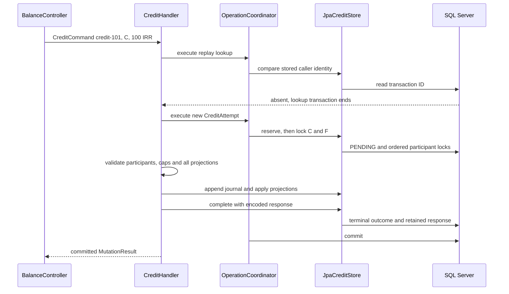

# Credit classes, responsibilities and request flows

[فارسی](../fa/Credit-class-walkthrough.md) · [Execution and evidence](Credit-execution.md) · [Coordinator design](Operation-coordinator.md) · [Policy configuration](Execution-policy.md)

## The failure this design prevents

A credit is incomplete if it increases the customer's balance but loses its journal or request outcome. A timeout is also ambiguous: the client may miss a response after the database commits. Repeating that credit with a new transaction ID could apply it twice. The design commits the journal, both account projections and the retained response together. A repeat with the original identity reads that committed result.

Consider an active IRR customer C with balance 500 and an active IRR funding account F with balance 500. These starting balances require previously balanced history; they are not arbitrary updates. Request `credit-101` credits C by 100. Its new journal debits F by 100 and credits C by 100. C becomes 600. F also becomes 600 because FUNDING_CLEARING uses a debit-normal balance, while CUSTOMER_LIABILITY uses a credit-normal balance. The journal balances because total debits equal total credits. These numbers describe internal accounting, not external bank cash or confirmation of a deposit.

## Input and policy classes

| Class | Responsibility and example |
| --- | --- |
| `AmountRequest` | Web input. Strict parsing rejects malformed amounts, unknown fields and duplicate JSON keys before execution. |
| `CreditCommand` | Immutable typed intent: transaction ID, customer ID and positive `Money`. HTTP details do not enter the handler. |
| `Money` | Currency and checked integer arithmetic. It does not know deployment-specific transaction caps. |
| `ExecutionPolicyProperties` | Bind `balance.execution` settings into typed configuration. Missing funding identifiers are not replaced with invented accounts. |
| `ExecutionPolicyConfiguration` | Create a validated policy only when `balance.execution.enabled=true`. Invalid enabled configuration fails startup. |
| `ExecutionPolicy` | Immutable startup snapshot of policy version, supported currencies, limits and complete funding map. It does not perform database lookup or canonical encoding. |
| `AmountLimits` | Inclusive transaction and customer-balance caps. Amount equal to the cap is allowed. |
| `FundingSelection` | Server-chosen counterpart account ID plus selection version for one currency. The caller cannot pick this internal counterpart. |
| `IdentityText` | Shared package-private validation for recurring version/identity text, including malformed Unicode. It does not hash or serialize a request. |

For example, enable execution with an already provisioned IRR FUNDING_CLEARING UUID and a funding version. The loader can validate the UUID's syntax and the complete IRR mapping. It cannot establish that the row exists, is active or belongs to the correct category. The handler checks those facts under database locks. Changing the funding row requires an intentional configuration/version change and application restart; there is no policy hot reload.

## Caller identity and execution identity

`CanonicalRequest` encodes the caller's credit intent with a versioned format and explicit absent actor binding for the current trusted-local API. `CanonicalFingerprint` carries canonical bytes and their SHA-256 companion. The transaction ID is the global lookup key; it is not a substitute for comparing the request. Replay compares full canonical bytes, so a matching ID with amount 101 instead of 100 conflicts.

The canonical caller intent excludes current limits and funding selection. Otherwise a policy deployment could make the same original request appear different. The separate funded identity records the chosen funding context for a new attempt. `ExecutionPolicy` validates its own text through `IdentityText`; it has no dependency on `CanonicalFingerprint`.

`CreditAttempt` groups the new operation UUID, journal UUID, command, canonical request, immutable policy and selected funding. It carries the facts needed by one writing attempt. It is neither a managed entity nor a persisted success, and it does not provide a retry loop.

## Application orchestration and transaction ownership

`CreditHandler` makes the business decisions. Its four dependencies separate transaction ownership, policy, persistence and response encoding. It first calls `recover` inside an owned transaction. Only if no terminal outcome exists does it evaluate the current policy and create a writing attempt.

`process` now makes that sequence explicit: replay first, `prepareAttempt` for new intent, then `executeOrRecover`. The last helper handles duplicate-reservation recovery outside the failed transaction; it does not add a retry loop. Inside `execute`, participant and cap checks remain in their original order. `createJournal` constructs the two domain postings and `calculateProjections` validates proposed balances from the locked snapshots. The calls to `appendJournal`, `applyProjections` and `complete` remain together so the atomic write boundary is visible.

`OperationCoordinator` is a production `@Service`. Spring injects the configured `PlatformTransactionManager` through its single constructor. That manager participates in real execution as well as tests. The coordinator creates a private `TransactionTemplate`, sets READ_COMMITTED and a five-second transaction timeout, rejects an already active transaction, and returns only after the template commits. A template still needs a transaction manager; removing the coordinator would move these ownership rules into its callers. See the coordinator guide for the serializable/blocking examples and SQL Server UPDLOCK/HOLDLOCK details.

`CreditStore` is the application persistence port. Its operations express replay, reservation, participant locking, history append, projection update and terminal completion. `LockedAccount` couples a domain snapshot with active status. The handler works with this port without constructing SQL or depending on JPA entities.

`JpaCreditStore` implements the port within an active writable joined JPA transaction. It records canonical identity, policy/funding context and PENDING during reservation. It verifies stored formats and terminal consistency during replay. It appends native history rows, applies managed account projections, flushes and updates the owned pending operation to terminal state. An update count other than one is a technical failure.

Its SQL statements are named text-block constants with named parameters. Replay maps native column labels through JPA `Tuple` into a private `StoredOperation` record instead of indexing an `Object[]`. That record checks canonical version and full request bytes before decoding the terminal outcome and response. `CompletionState` uses an exhaustive outcome switch to obtain the persisted state and rejection reason. The separate duplicate classifier recognizes only the named transaction-ID unique constraint. These changes improve Java-side mapping and readability; SQL text, parameter binding and driver conversions still need real SQL Server verification. They do not add compile-time SQL checking or change the schema, lock SQL, transaction ownership, write order or flush point.

`AccountStore` locks the complete deduplicated customer/funding set in descending application UUID order using UPDLOCK/HOLDLOCK. Every participating writer must use the same ordering. The locks protect the state used by decisions; READ_COMMITTED alone does not serialize read-check-write business logic.

## A successful request through the classes

The first lookup is an optimization and replay boundary, not a uniqueness guarantee. Two requests can both observe absence. The database unique constraint decides which writing reservation wins.

`Journal` validates balanced postings and calculates the complete proposed account map through `projectBalances`. `Posting` names account, side and money. `Account` applies the category's normal-side rules with checked arithmetic. The handler calculates every projection before calling `appendJournal` or `applyProjections`, so overflow on F cannot leave C changed. The persistence adapter must still commit all SQL writes atomically; a domain calculation alone proves no database behavior.

For a customer cap of 1,000 and amount 100, the handler compares current balance with `1,000 - 100`. Current 900 is accepted and becomes 1,000; current 901 is rejected. Subtraction avoids overflowing an unchecked proposed sum. Funding arithmetic is checked separately by the domain calculation.

## Outcomes, encoding and HTTP delivery

| Class | Role |
| --- | --- |
| `OperationOutcome` | Typed success or durable business rejection. Rejection is a return value because its record must commit. |
| `MutationResult` | Outcome plus currency and optional retained response. Its two-argument constructor remains available for unwired/test-double outcomes. |
| `CreditResponseEncoder` | Port for encoding the original HTTP envelope and validating one recovered from storage. |
| `JsonCreditResponseEncoder` | Uses the configured JSON mapper and public response mapping. It retains the rejection instance path and rejects malformed or metadata-inconsistent recovered JSON. |
| `StoredResponse` | Version, HTTP status, media type and defensive byte copies. Equality/hash code compare byte contents. Supported envelopes are success 200 JSON or terminal 4xx problem JSON. |
| `StoredOperationResponse` | Raw JSON body permitted by the sealed `OperationResponseBody` family. It emits retained JSON without rebuilding the response object. |
| `OperationResponses` | Maps the retained envelope back to the public status, content type and JSON body, or uses the existing typed mapping when no envelope exists. |
| `ApiProblems` / `ApiExceptionHandler` | Map known failures into the public contract while keeping SQL details out of the response. |

Encoding happens before terminal completion and commit. An encoding failure therefore cannot leave a successful monetary effect without its retained result. On replay the application validates the stored JSON and metadata before returning it. Corrupt or unsupported stored data fails closed.

## Alternate flows and their database effects

| Situation | Flow and effect |
| --- | --- |
| Same ID, same caller intent | Read original terminal result before current policy. No new journal, postings or projection changes. |
| Same ID, changed amount/account/currency | Canonical mismatch yields TRANSACTION_ID_CONFLICT. No second effect. |
| Unsupported currency on a new ID | Fail before reservation. No retained operation. An existing supported historical result can still replay after policy changes. |
| Transaction cap exceeded | Reserve, then commit TRANSACTION_LIMIT_EXCEEDED and its response. No account locks or monetary writes. This precedes missing-account rejection. |
| Missing customer | Validate internal funding under locks, then retain ACCOUNT_NOT_FOUND. Creating that customer later does not change the original result. |
| Customer cap exceeded | Retain BALANCE_LIMIT_EXCEEDED under participant locks. No journal or projection writes. |
| Invalid internal funding | Technical failure and rollback. Configuration defects do not become durable customer rejection. |
| Two new callers race on one ID | `DuplicateOperation` identifies only the named transaction-ID unique constraint. The failed transaction exits before a fresh replay lookup. Matching intent replays; different intent conflicts. Other integrity errors propagate. |
| Failure after journal/projection/completion writes | Roll back reservation, history, projections and outcome together. Prior committed balances remain. Repeat with the same ID. |
| Response lost after commit | Repeat the same ID and intent to retrieve the retained result. Do not invent a new ID. |

`OperationFailure` retains technical causes internally and identifies known public failures. Database/transaction exceptions become OPERATION_UNAVAILABLE. The current implementation has no general deadlock retry/backoff or automatic uncertain-commit recovery loop. A timeout is not proof of rollback. A confirmed rollback permits another same-ID attempt; an unknown outcome first needs same-ID recovery.

## Spring wiring and infrastructure-free smoke tests

`HttpAdapterConfiguration` assembles the staged `BalanceOperations` adapter. `ObjectProvider<GetBalanceHandler>`, `ObjectProvider<CreditHandler>` and `ObjectProvider<DebitHandler>` allow this adapter to operate in a deliberately restricted test context. The real application scans its normal production services. Credit and debit are available when their explicit policy feature is enabled; transfer retains its staged 503 response until CBS14. See [debit execution and verification](Debit-execution.md).

Production code contains no `@Profile("!smoke")`. `HttpSmokeConfiguration` lives under `src/test`, uses standalone `@Configuration`, imports only `HttpAdapterConfiguration`, `BalanceController` and `ApiExceptionHandler`, and enables auto-configuration. One `@Profile("smoke")` on that test configuration prevents other full-context tests from discovering it. The test resource excludes datasource, JPA and Flyway auto-configuration. No production service needs to know this test profile exists.

`ConcurrentBalanceServiceApplicationTests` explicitly selects that assembly and enables the execution property to prove it still cannot accidentally discover financial services. It asserts absence of the handlers, store, coordinator, transaction manager and entity manager factory, plus health UP and 503 for all unwired financial routes. A production coordinator registered in a context still requires a manager even if somebody calls a profile smoke. Policy creation likewise follows its explicit enabled property rather than a test-profile rule. The smoke assembly tests HTTP; SQL Server integration tests load the real application and prove persistence behavior.

## What the evidence covers

For the readability/mapping refactor on 2026-10-25, Java 21 wrapper verification passed 322 portable tests, including 16 handler cases, with zero failures, errors or skips. The initial run hit the documented Windows JDK loopback failure; the passing run used `-DargLine=-Djdk.net.unixdomain.tmpdir=D:/Projects/concurrent-balance-service/target` (adjust the absolute path for another checkout). A targeted `SqlServerCreditIT` run failed during fixture setup because `SQLSERVER_INITIALIZER_TEST_URL` was absent; no database regression case passed in that run. The refactored native replay mapping and parameter binding still require real SQL Server verification; earlier database results below predate this refactor.

`SqlServerCreditIT` exercises real SQL Server success, original-response replay, canonical conflicts, retained rejection, one reservation race, context/pool replacement and injected rollback boundaries. Codec and response tests cover malformed retained data and defensive bytes. See [execution evidence](Credit-execution.md) for exact counts and limitations. Debit/transfer implementation, general retry budgets, full cross-instance/mixed-operation concurrency and independent learner assessment remain open.
