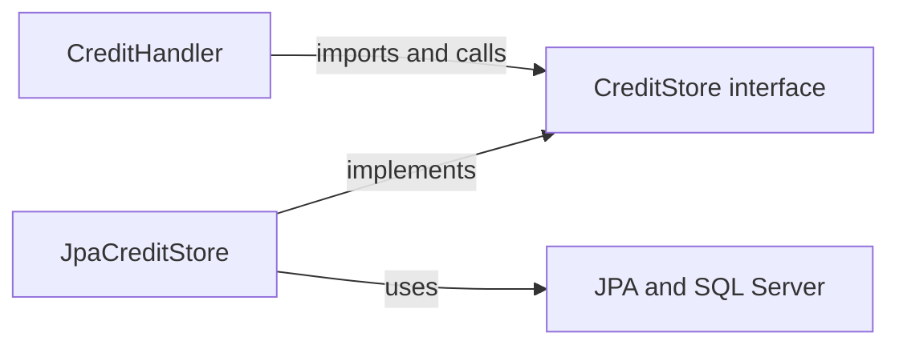

# Hexagonal architecture through the balance service

[فارسی](../fa/Hexagonal-architecture.md) · [Architecture](Architecture.md) · [Credit class walkthrough](Credit-class-walkthrough.md) · [Implementation status](Implementation-status.md)

## 1. Start with the change that hurts

Imagine the credit endpoint checks account balances, executes SQL, creates postings and formats JSON inside one controller method. A batch import now needs the same credit behavior. Copying the controller logic creates two implementations of the money rules. Calling the controller from the batch job drags HTTP concerns into a workflow that has no HTTP request. Testing a balance-limit decision also requires a database and web server.

Hexagonal architecture separates the application’s decisions from the mechanisms that deliver requests and store results. In this project, the credit use case talks to `CreditStore`, while `JpaCreditStore` supplies SQL Server persistence. HTTP reaches the application through `BalanceController`, which invokes the use-case handlers directly. The same separation lets tests exercise application decisions with test doubles.

The original pattern describes an application inside a boundary, with purposeful conversations represented by ports and technology translations supplied by adapters. The hexagon does not require six ports or six layers. [Cockburn’s original article](https://alistair.cockburn.us/hexagonal-architecture) explains that inside/outside distinction and the driving/driven terminology.

This is a tutorial grounded in the current source, including the package reorganization. Credit, debit and [transfer](Transfer-execution.md) are opt-in; CBS14 adds the transfer handler, store and encoder. [Durable debit](Debit-execution.md) extends the same boundary model with its own handler, store and response encoder. A diagram of a route does not establish that its financial implementation is complete. See [current evidence](Implementation-status.md).

## 2. The vocabulary

| Term | Meaning here | Example |
| --- | --- | --- |
| Domain | Financial values, calculations and invariants | `Money`, `Account`, `Journal`, `Posting` |
| Application / use case | Coordinates domain work and external capabilities to fulfill a request | `CreditHandler`, `GetBalanceHandler` |
| Port | A contract for a purposeful conversation across the application boundary | `CreditStore`, `BalanceReader` |
| Adapter | Translates between a port and a technology or external caller | `JpaCreditStore`, `BalanceController` |
| Driving / inbound | Initiates an application operation | An HTTP controller or a test invoking a handler |
| Driven / outbound | Supplies something the application requests | Persistence or response serialization |
| Composition root | Assembles concrete objects and their dependencies | Spring configuration and component registration |
| Infrastructure | Technical mechanisms supporting execution | JPA, SQL Server, Spring transaction integration |
| DTO | Data representation for a particular boundary | `AmountRequest`, `OperationResponse` |
| Projection | Stored/read representation derived from financial history | `accounts.balance` |
| Invariant | A condition that must remain true | Balanced postings; nonnegative customer balance |

A port is not a TCP port such as `14333`. It is also not automatically a Java interface: an explicit interface is useful when it makes a boundary enforceable, but a callable use-case API can be a port too. A class name ending in `Service` or `Repository` does not establish an architectural role.

## 3. Calls travel outward; source dependencies can point inward

At runtime, the credit handler calls an object whose actual class is `JpaCreditStore`. At compile time, its persistence dependency is the application-owned `CreditStore` interface. The implementation depends on that contract too.



This is dependency inversion: the high-level use case specifies a capability, and the low-level implementation conforms to it. Moving an interface into a folder named `port` helps navigation only when imports and contracts actually preserve that relationship.

Dependency injection is the object-assembly mechanism. For example, the `CreditHandler` constructor receives `CreditStore` rather than constructing `JpaCreditStore`. Spring resolves the implementation when it creates the bean. DI also works with direct Java constructors; a container is optional. [Spring’s DI reference](https://docs.spring.io/spring-framework/reference/core/beans/dependencies/factory-collaborators.html) explains constructor injection, while [Fowler’s discussion](https://martinfowler.com/articles/injection.html) separates configuration from dependency use.

## 4. The actual ports and adapters

| Port | Direction | Actual adapter / caller | Contract |
| --- | --- | --- | --- |
| Use-case handlers | Inbound application entry points | `BalanceController` calls each handler directly | Typed credit/debit/transfer commands and balance lookup |
| [BalanceReader](../../src/main/java/dev/kavrin/balance/account/application/BalanceReader.java) | Outbound | [AccountStore](../../src/main/java/dev/kavrin/balance/account/infrastructure/persistence/AccountStore.java) implements it | Optional authoritative balance projection |
| [CreditStore](../../src/main/java/dev/kavrin/balance/operation/application/credit/CreditStore.java) | Outbound | [JpaCreditStore](../../src/main/java/dev/kavrin/balance/operation/infrastructure/persistence/JpaCreditStore.java) implements it | Replay, reservation, locks, history, projections and completion |
| [CreditResponseEncoder](../../src/main/java/dev/kavrin/balance/operation/application/credit/CreditResponseEncoder.java) | Outbound | [JsonCreditResponseEncoder](../../src/main/java/dev/kavrin/balance/operation/web/response/JsonCreditResponseEncoder.java) implements it | Encode and check the response retained with a credit outcome |
| [DebitStore](../../src/main/java/dev/kavrin/balance/operation/application/debit/DebitStore.java) | Outbound | [JpaDebitStore](../../src/main/java/dev/kavrin/balance/operation/infrastructure/persistence/JpaDebitStore.java) implements it | Durable debit identity, locked funds check inputs and atomic persistence |
| [DebitResponseEncoder](../../src/main/java/dev/kavrin/balance/operation/application/debit/DebitResponseEncoder.java) | Outbound | [JsonDebitResponseEncoder](../../src/main/java/dev/kavrin/balance/operation/web/response/JsonDebitResponseEncoder.java) implements it | Original debit response encoding and validation |

An inbound HTTP adapter can call concrete use-case handlers directly; a forwarding interface is not required for hexagonal boundaries. `BalanceController` constructor-injects `CreditHandler`, `DebitHandler`, `TransferHandler` and `GetBalanceHandler` through Optional parameters because some are deliberately absent in disabled or smoke assembly. An absent route handler returns the existing unavailable response. Transaction ownership remains in the use case and coordinator.

The original `BalanceService` is an unused bootstrap contract, not another active financial implementation. `OperationCoordinator` is a concrete Spring transaction boundary, not an interface port. `AccountEntity` is a persistence mapping, not a port. `Money` is a domain value, not an adapter. `ApiExceptionHandler` and `OperationResponses` are parts of the HTTP adapter boundary, not separate business use cases.

## 5. Reading the smallest example

The complete balance-query port is small:

```java
public interface BalanceReader {
    Optional<Money> findBalance(AccountId id);
}
```

`GetBalanceHandler` requests a balance through this interface. `AccountStore` runs the projection query and maps the result to `Money`. Empty means the account does not exist; an amount of zero is a valid existing balance. Query failure must propagate as a technical failure, not become empty or zero.

The controller parses the account ID, calls `GetBalanceHandler.handle`, and creates `BalanceResponse`. Neither the HTTP DTO nor `AccountEntity` crosses into the balance-reader contract. This prevents JPA lifecycle and HTTP serialization concerns from becoming requirements for every caller.

There is a separate adapter-level capability: `AccountStore.lockAll()`. It is not part of `BalanceReader`. `JpaCreditStore` calls it directly, and converts managed entities into `LockedAccount` snapshots. This is a deliberate concrete dependency between persistence adapters. The application credit contract still avoids JPA entities.

## 6. A complete credit example

Assume an active IRR customer starts at 500 rials, its funding counterpart starts at zero, both exist, policy allows the command, and credit execution is enabled. These are illustrative inputs, not a newly executed database fixture.

```http
POST /api/v1/accounts/10000000-0000-4000-8000-000000000001/credits
Content-Type: application/json

{"transactionId":"hex-credit-001","amountRial":200,"currency":"IRR"}
```

```mermaid
sequenceDiagram
    participant HTTP as HTTP adapter
    participant H as CreditHandler
    participant TX as OperationCoordinator
    participant S as CreditStore / JpaCreditStore
    participant D as Journal domain model
    participant E as CreditResponseEncoder
    HTTP->>H: handle(command)
    H->>TX: execute replay lookup
    TX->>S: replay(command, fingerprint)
    S-->>H: no retained result, after transaction ends
    H->>H: prepare policy and funding snapshot
    H->>TX: execute writing attempt
    TX->>S: reserve; lock participants
    H->>D: calculate balanced journal and projections
    H->>S: appendJournal; applyProjections
    H->>E: encode outcome
    H->>S: complete with retained response
    TX-->>H: result after confirmed commit
    H-->>HTTP: committed MutationResult
```

The diagram groups calls by responsibility; in code the handler’s callback invokes the store inside the coordinator-owned transaction.

1. The HTTP adapter validates representation and creates a `CreditCommand`. Strict deserializers reject fractional or coerced amount input. They do not decide available funds or policy.
2. `CreditHandler` creates canonical caller intent and checks for a retained operation in a coordinator-owned transaction. Matching intent replays the original response; different intent under the same transaction ID conflicts.
3. Only for new intent does it select the current execution/funding policy. This keeps a policy change from changing an already-retained result.
4. A new writing transaction reserves the operation. When the command passes its amount cap, the store locks the customer and funding participants in the shared account-ID order before inspecting decision-making account state.
5. Domain code constructs a funding debit of 200 and a customer credit of 200. The customer projection becomes 700. A debit-normal funding account becomes +200, not -200: debit/credit signs depend on account category. The customer’s earlier 500 must itself have valid opening/ledger history. See [journal projection](Journal-projection.md).
6. The handler validates proposed projections, appends history, applies projections, encodes the response and completes the operation in the same transaction. Calling `complete()` is a database state transition, not a commit.
7. `OperationCoordinator` returns the result only after transaction completion. The web adapter returns the retained response with its original status, content type and body.

Send the same request again: the replay path adds no journal or postings and the customer remains at 700. Change the amount to 201 under `hex-credit-001`: the intent conflicts. Use a fresh ID and exceed the configured transaction cap: the current credit flow retains a terminal rejection without a journal. An unavailable database or serialization failure is a technical failure, not that business rejection.

## 7. Transactions are part of the port contract

`CreditStore` is more than a list of method signatures. Its JavaDoc requires every method to participate in the coordinator’s owning transaction and forbids independent commits. `lockAccounts` also promises a shared acquisition order and lock lifetime. A replacement that returns the same Java types but releases locks immediately violates the port.

The current coordinator uses `TransactionTemplate`, writable `READ_COMMITTED` transactions and an explicit no-ambient-transaction guard. Otherwise a nested call could return before the outer caller actually commits. [Spring’s programmatic transaction documentation](https://docs.spring.io/spring-framework/reference/data-access/transaction/programmatic.html) explains the callback mechanism and its explicit Spring coupling. The project-specific ownership rule is described in [the coordinator guide](Operation-coordinator.md).

Technical exceptions must escape the attempt so it rolls back. Expected business rejection is a result that must commit with its retained record. Do not introduce `REQUIRES_NEW` commits for reservation, postings or completion: those would break this financial unit of work. A completed callback is not automatically proof of a durable commit when an outer transaction owns completion.

Duplicate reservation recovery happens after the failed transaction exits. General transient retry/backoff and complete uncertain-commit recovery remain unfinished. Hexagonal structure does not supply them automatically. See [credit execution](Credit-execution.md).

## 8. What belongs in each boundary?

| Concern | Current home / guidance |
| --- | --- |
| JSON shape, UUID text, media types, problem responses | HTTP adapter |
| Positive command amount and distinct transfer accounts | Command validation |
| Supported currency, caps, retained funding selection | Application policy |
| Journal balancing and account-category projection arithmetic | Domain |
| Replay ordering and success/rejection workflow | Application handler |
| SQL, `UPDLOCK,HOLDLOCK`, persistence mappings and driver details | Persistence adapter |
| Transaction lifecycle | Current Spring coordinator, shared by the financial attempt |
| Business record constraints | Domain/application plus SQL safeguards, tested together |
| Identity, authorization and ownership | Enforce at appropriate trusted entry/use-case boundaries when implemented; current local scope has no completed auth flow |

Validation belongs at several boundaries for different reasons. HTTP checks representation, domain checks financial meaning, and SQL protects persisted facts from invalid writers. This is useful overlap when the responsibilities are explicit. An interface cannot replace a unique constraint, checked arithmetic or reconciliation.

## 9. How pure is this implementation?

The domain is independent of Spring/JPA/HTTP. The application is not completely framework-independent: handlers use Spring annotations and exceptions, and the coordinator uses Spring transaction APIs. A stricter design could introduce a transaction-execution port and translate infrastructure failures at adapter boundaries. That is an optional refactor with maintenance cost, not an unimplemented correctness requirement.

`CreditResponseEncoder` is also intentionally HTTP-aware. It produces `StoredResponse` containing status, content type and bytes because exact response replay is a requirement. A future gRPC or batch adapter could reuse the financial use case, but its output contract needs review; the current stored HTTP response is not automatically its native reply. Another design could retain a transport-neutral outcome and a versioned transport representation separately.

Do not describe this as effortless database replacement. A new adapter must preserve SQL Server-specific behavior currently relied upon: uniqueness, canonical byte comparison, account ordering, missing-key protection, permissions, atomicity and retained outcomes. PostgreSQL migration, for example, requires a concurrency design and real database tests, not a JDBC URL change.

## 10. Choosing the right size for ports

Use the caller’s capability and consistency requirements to choose boundaries. `BalanceReader` is narrow because a read use case needs one projection. `CreditStore` is wider because reservation, locked state, history and completion form one coordinated workflow.

Avoid a universal `Repository<T>` exposing every CRUD operation. It can make deleting immutable postings or independently saving an account appear legitimate. Conversely, one interface per method can scatter a transaction’s constraints across many objects. Splitting `CreditStore` may help later if consumers genuinely need independent capabilities, but every resulting port must preserve the same transaction contract.

One implementation can justify an interface when it separates financial orchestration from SQL or supports meaningful test substitution. Simple internal calculations do not need an interface just in case. Keep DTOs, ports and mappings only when they explain a real boundary. Package names organize responsibilities; they do not enforce module access by themselves.

Treat a port as a semantic API: document absence, ordering, idempotency, timeouts and errors, not just parameter types. A new implementation must remain substitutable under those conditions. Evolve contracts with their callers and tests; changing a return field or enum can affect persisted response versions and old retries. Do not rewrite old canonical formats or regenerate original outcomes during a compatibility change.

## 11. Wiring and test substitutes

Spring component registration supplies `JpaCreditStore` and `JsonCreditResponseEncoder` to `CreditHandler`. Conditional execution settings decide whether credit beans are available. `HttpAdapterConfiguration` connects the application boundary and staged fallbacks. Configuration is allowed to know the concrete pieces because assembling them is its job.

If multiple adapters implement a port, choose explicitly with configuration, profiles or qualifiers. Do not silently select an in-memory financial store when SQL Server is unavailable. A test double belongs in a deliberate test assembly.

[CreditHandlerTests](../../src/test/java/dev/kavrin/balance/operation/application/credit/CreditHandlerTests.java) uses mocked persistence/encoding ports and a recording Spring transaction manager. These verify application decisions and lifecycle interaction without SQL Server. The recording manager does not make writes durable. The test-only smoke configuration imports the HTTP boundary without production persistence; this is useful startup coverage, not a complete financial system.

## 12. Testing each architectural promise

| Test boundary | What to verify | What it cannot prove alone |
| --- | --- | --- |
| Domain tests | Balanced journal, projection signs, overflow and bounds | Database persistence or concurrency |
| Handler tests | Replay before policy; rejection without history; failure propagation | SQL rollback, actual lock lifetime |
| HTTP slice | Parsing, command mapping, response/error serialization | Real credit execution |
| Adapter integration on SQL Server | Native queries, types, constraints, lock behavior, permissions | Every multi-instance failure scenario |
| Full HTTP-to-database scenarios | Atomic result/history/projections and retained replay | Production capacity or all infrastructure outages |
| Architecture checks, if added | Forbidden imports and module cycles | Financial correctness |

Contract tests can run shared behavioral expectations against an in-memory adapter and a real one. They still need technology-specific cases for locking, isolation and driver types. Mocks cannot establish SQL Server semantics. The current `AccountStore` tuple mapping and named binding passed the full SQL Server regression at CBS13; [debit evidence](Debit-execution.md) records the fresh 351 portable and 134 SQL Server cases. The tutorial’s 200-rial journal calculation was checked against the current compiled domain classes: customer 500 → 700 and funding 0 → 200. That check made no database writes; the replay and transaction examples are source walkthroughs, not newly executed integration scenarios.

## 13. Extensions beyond this project

These are design examples, not implemented features:

| Requirement | Possible boundary | Essential question |
| --- | --- | --- |
| CLI or scheduled batch | New inbound adapter calling the existing use case | Which actor is authorized, and how are stable transaction IDs assigned? |
| External payment provider | Application-owned payment port and HTTP adapter | Did a timeout occur before or after the provider accepted the charge? |
| Clock or generated IDs | `Clock`/ID capability when nondeterminism matters | Must the value remain stable across retry? |
| Notification delivery | Notification port and provider adapter | Is delivery allowed to fail after money commits? |
| Events / Kafka | Outbox persistence plus publisher and consumer adapters | How are DB commit and publication reconciled, and duplicates deduplicated? |
| Cache | Optional read adapter/decorator with explicit freshness policy | Can stale state ever authorize a financial write? |

An email, Kafka broker and SQL database do not share the local SQL transaction automatically. For a future outbox, persist publication intent with the financial commit, publish later, and design consumer deduplication. A saga coordinates separate local transactions and compensating business actions; it does not provide this service’s current single-transaction atomic transfer guarantee. Authentication must cover every inbound adapter, including batch and messaging entry points. Publicly exposing a new adapter must not bypass ownership checks.

An anti-corruption layer translates an external provider’s vocabulary and rules into the application’s own model; it does more than rename JSON fields. Keep slow remote calls outside account-locking transactions unless a reviewed protocol requires otherwise. Adapter decorators can add metrics or caching, but must preserve the port’s failure and consistency semantics. Singleton adapters should not retain request-specific managed entities between transactions.

Set deadlines, bound retries and propagate cancellation through remote adapters. Classify permanent rejection separately from retryable and uncertain outcomes. Log useful correlation/operation IDs and latency; do not log passwords or secret payloads. Measure adapter latency, lock waits and pool saturation before introducing caches or splitting services.

## 14. Related patterns and common mistakes

Layered architecture organizes responsibilities vertically; hexagonal architecture emphasizes the application boundary and dependency direction. They can coexist. Clean and Onion architectures share inward-dependency ideas but prescribe their own organization. DDD adds domain modeling and bounded-context concepts. CQRS separates command and query models; this project uses one database and synchronous projections. An aggregate is a domain consistency boundary, and a bounded context owns a model and its language; neither is automatically a Java package or a port. This service’s transaction can coordinate multiple account snapshots and ledger history. A unit of work tracks related persistence changes; it still needs an explicit transaction owner and commit protocol. None of these names implies microservices or event sourcing. Immutable postings alone do not establish an event-sourced application.

Common mistakes to catch in review:

- A handler imports a controller DTO, JPA entity or concrete persistence store.
- An outbound port exposes `EntityManager`, HTTP response objects or vendor SDK classes without an intentional contract trade-off.
- A controller performs balance checks or starts separate financial commits.
- A test substitute ignores rejection retention, transaction ownership or duplicate identity behavior.
- A database exception becomes “account not found,” zero balance or a successful response.
- A retry repeats an external effect without a stable identity or recovery protocol.
- Every tiny helper receives a port while major consistency assumptions remain undocumented.
- A new messaging adapter bypasses authorization because only HTTP has a security filter.

## 15. Exercises and a review checklist

1. Follow `GET .../balance` from controller to `BalanceReader`. Which types cross each boundary? Explain why empty differs from zero.
2. Trace a 200-rial credit and its same-ID retry. Identify the component owning every decision, SQL write and commit.
3. Propose a CLI credit adapter without importing `BalanceController`. Explain how you would represent a retained HTTP response to the CLI user.
4. Design a shared `CreditStore` contract test. Separate what a fake can establish from cases requiring real SQL Server locks and concurrent connections.
5. Sketch a transaction-execution port as a stricter alternative to the concrete coordinator. Explain what coupling it removes and what guarantees it must preserve. Do not implement it only to make the diagram symmetrical.

Before adding a port, state the conversation, owner, input/output types, failure categories, transaction/consistency needs and expected consumer. Before accepting an adapter, verify that it preserves those semantics under failure, not just that it compiles. Before claiming architectural independence, inspect imports and runtime assumptions together.

## Further reading

The sources linked beside their relevant concepts were checked on 2026-10-25. For more practice in this repository, continue with [operation flow](Operation-flow.md), [canonical design](Canonical-design.md), [transaction ownership](Operation-coordinator.md), [ledger rules](Ledger.md) and [SQL Server verification](SQL-server-tests.md). This tutorial explains the design; [implementation status](Implementation-status.md) records delivery and evidence limits.
