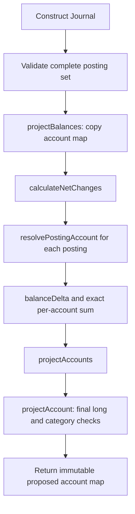

# Journal record and balance projection walkthrough

[فارسی](../fa/Journal-projection.md) · [Ledger design](Ledger.md) · [Debit and credit](Debit-and-credit.md)

This guide follows the current [Journal.java](../../src/main/java/dev/kavrin/balance/ledger/domain/Journal.java). It explains how a validated collection of accounting lines becomes proposed account balances. All amounts in the examples are direct rial amounts. Domain calculation is implemented; financial database transactions remain future work.

## What the record represents

```java
public record Journal(List<Posting> postings)
```

A `Journal` groups the complete posting set for one accounting entry. A `Posting` is one account's debit or credit line with a positive `Money` amount. The current record has one component, `postings`, exposed through the generated `postings()` accessor. Java also generates value-based `equals`, `hashCode` and `toString`; list order participates in record equality even though net projection results do not depend on posting order.

The `public Journal { ... }` block is a compact constructor. It validates constructor arguments before the record is created. Assigning `postings = List.copyOf(postings)` replaces the argument with a defensive, unmodifiable copy; Java assigns that validated copy to the record's field when the constructor completes. Records alone do not make a supplied list immutable. Here the copy plus immutable Posting, AccountId and Money values protect the posting set from later mutation.

The constructor requires at least two non-null postings in one currency and equal debit/credit totals. Posting construction separately requires non-null fields and positive amounts. Journal totals use `BigInteger` because several valid long amounts can have a total larger than long. Construction does not check account existence, current funds or account currency; those require the supplied account snapshots in the next step.

This record currently has no journal ID, operation ID, timestamp or persistence annotations. The accepted database journal header and its operation linkage still need implementation. Constructing this record does not create a stored financial operation or establish that an account's starting funds have valid history.

## Example: one customer appears twice

Start with customer A at 50 rials and the internal funding account at zero. Build this complete journal:

| Line | Account | Side | Amount | Effect on that account |
| --- | --- | --- | ---: | ---: |
| 1 | Customer A, credit-normal | Debit | 100 | -100 |
| 2 | Customer A, credit-normal | Credit | 150 | +150 |
| 3 | Funding, debit-normal | Debit | 50 | +50 |

Total debits are 100 + 50 = 150; total credits are 150. The journal passes construction. Final proposed balances are customer 50 - 100 + 150 = 100 and funding 0 + 50 = 50. Applying line 1 and checking it alone would wrongly reject the temporary customer balance of -50. The full journal is the unit of calculation.

This educational example exercises a multi-line journal. It is not a new public operation or an exception to the API's self-transfer rejection policy.

## Flow through projectBalances



The public method keeps the high-level steps together:

```java
public Map<AccountId, Account> projectBalances(Map<AccountId, Account> accounts) {
    Map<AccountId, Account> snapshots = Map.copyOf(accounts);
    Map<AccountId, BigInteger> netChanges = calculateNetChanges(snapshots);
    return projectAccounts(snapshots, netChanges);
}
```

The input map is keyed by AccountId. Each value is the matching immutable Account snapshot. `Map.copyOf` owns a stable map for this calculation and rejects null maps, keys or values. It is not a database snapshot or a concurrency mechanism; the caller must supply current accounts under the transaction's locking policy. Concurrent mutation of the input map during copying is not supported.

| Step | Job | Example result |
| --- | --- | --- |
| `resolvePostingAccount` | Find each account, check map key against its identity, check account/posting currency | Resolve both customer lines to customer A and the third to funding |
| `calculateNetChanges` | Use the resolved category with balanceDelta and sum by account using BigInteger | A = +50; funding = +50 |
| `projectAccount` | Add the complete net change to the original balance, convert the final result exactly to long, construct a validated Account | A = 100; funding = 50 |
| `projectAccounts` | Build all participant snapshots and return an immutable map after every account passes | Two proposed accounts |

`netChanges.merge(account.id(), delta, BigInteger::add)` stores the first change for an account and adds subsequent changes to that account's accumulated value. In the example, A progresses from -100 to +50 in this temporary calculation map. That map is not an account balance or a database update.

The final Account constructor enforces category rules, including a nonnegative customer balance. Original account objects and the caller's map are unchanged. The output contains posting participants only, including accounts whose net change is zero. Extra supplied accounts are omitted. Output iteration order is unspecified and must not be used as lock order.

## Why the net change also uses BigInteger

Suppose a signed funding balance moves from Long.MIN_VALUE to Long.MAX_VALUE:

```text
Old balance: -9,223,372,036,854,775,808
Net change: +18,446,744,073,709,551,615
New balance: 9,223,372,036,854,775,807
```

Both balances fit long, but the change does not. It can be expressed by several positive long postings with a balanced counterpart. Converting the net change to long first would reject a representable final balance. `projectAccount` therefore adds in BigInteger and calls `longValueExact()` only on the final amount. A final amount outside long raises ArithmeticException. This is a representation test; it does not define a permitted business transaction limit.

## Complete runnable domain example

The following Java 21 source uses the project's existing domain classes. It supplies illustrative snapshots, not persisted opening entries.

```java
import java.util.Currency;
import java.util.List;
import java.util.Map;
import java.util.UUID;

import dev.kavrin.balance.account.domain.Account;
import dev.kavrin.balance.account.domain.AccountCategory;
import dev.kavrin.balance.account.domain.AccountId;
import dev.kavrin.balance.ledger.domain.Journal;
import dev.kavrin.balance.ledger.domain.Posting;
import dev.kavrin.balance.ledger.domain.PostingSide;
import dev.kavrin.balance.money.Money;

public class JournalProjectionDemo {
    public static void main(String[] args) {
        var irr = Currency.getInstance("IRR");
        var customerId = new AccountId(UUID.fromString(
                "10000000-0000-0000-0000-000000000001"));
        var fundingId = new AccountId(UUID.fromString(
                "00000000-0000-0000-0000-000000000002"));

        var customer = new Account(customerId,
                AccountCategory.CUSTOMER_LIABILITY, new Money(50, irr));
        var funding = new Account(fundingId,
                AccountCategory.FUNDING_CLEARING, new Money(0, irr));
        var accounts = Map.of(customerId, customer, fundingId, funding);

        var journal = new Journal(List.of(
                new Posting(customerId, PostingSide.DEBIT, new Money(100, irr)),
                new Posting(customerId, PostingSide.CREDIT, new Money(150, irr)),
                new Posting(fundingId, PostingSide.DEBIT, new Money(50, irr))
        ));
        var proposedAccounts = journal.projectBalances(accounts);

        System.out.println("Customer before: " + customer.balance().amount());
        System.out.println("Customer proposed: "
                + proposedAccounts.get(customerId).balance().amount());
        System.out.println("Funding proposed: "
                + proposedAccounts.get(fundingId).balance().amount());
    }
}
```

After compiling the project, save the snippet as `/tmp/JournalProjectionDemo.java` and run with Java 21 from the repository root:

```sh
java --class-path target/classes /tmp/JournalProjectionDemo.java
```

Expected output:

```text
Customer before: 50
Customer proposed: 100
Funding proposed: 50
```

## Failure and transaction boundaries

| Condition | Current behavior |
| --- | --- |
| Null input map, key or snapshot | NullPointerException from the map copy |
| Posting account absent from map | IllegalArgumentException |
| Map key differs from resolved account ID | IllegalArgumentException |
| Posting and account currencies differ | IllegalArgumentException |
| Final customer balance is negative | IllegalArgumentException from Account category validation |
| Final balance exceeds long in either direction | ArithmeticException |

If any participant fails, the method returns no map and original snapshots remain unchanged. It may have created local temporary objects before failure; no partial result is published. This is not database rollback, and it does not map failures to HTTP responses or durable business rejections.

Future integration must resolve operation identity, acquire all account locks in the shared order, obtain current accounts, build and project the journal, then persist postings, projections and terminal success in the same financial transaction. Replay must bypass new posting generation. Authorization, command validation, business caps and missing-account rejection outcomes belong to their reviewed boundaries. None of those guarantees comes from calling projectBalances alone.

## Verification and maintenance

[JournalProjectionTests](../../src/test/java/dev/kavrin/balance/ledger/domain/JournalProjectionTests.java) covers the worked example, posting-order independence, category effects, intermediate overdraft/overflow, net changes beyond long, final overflow, account validation and immutable output. [JournalTests](../../src/test/java/dev/kavrin/balance/ledger/domain/JournalTests.java) covers posting-set construction. Latest focused refactor verification passed 36 ledger tests with zero failures/errors/skips; the preceding full build passed 92 tests. These are separate runs, not SQL Server evidence.

Keep this guide and its Persian pair aligned with Journal, Posting, Account and projection tests when their rules, helper flow, API, failure behavior or persistence responsibilities change. Re-run the example when affected; distinguish planned integration from implemented behavior and record verification precisely. The repository AGENTS.md records this maintenance requirement.
