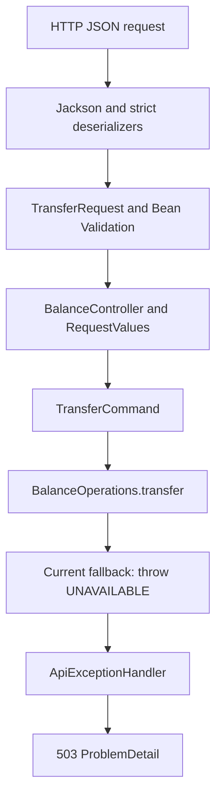
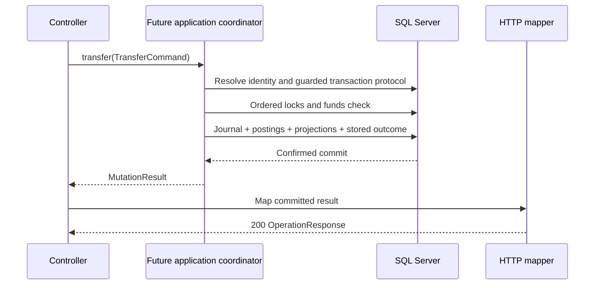

> Current persistence update: [CBS10 evidence](Persistence.md) now verifies JPA mappings, committed opening fixtures and the SQL Server balance route. Mutations remain unavailable. Earlier all-route-503 and schema-only statements below are historical.

# Operation walkthrough: from JSON to HTTP response

[فارسی](../fa/Operation-flow.md) · [API contract](API-v1.md) · [Business outcomes](Operation-outcomes.md) · [Adapter evidence](HTTP-adapter-evidence.md)

This guide explains the `operation` feature as implemented on 2026-10-23. Read it beside the linked source files. It follows one transfer and explains where each type participates, why the boundaries exist and where the future SQL Server transaction belongs.

## 1. Start with a concrete transfer

A local operator asks to move 100 rials from account A to account B:

```http
POST /api/v1/transfers
Content-Type: application/json

{
  "transactionId": "Tx-001",
  "sourceAccountId": "00000000-0000-0000-0000-000000000001",
  "destinationAccountId": "00000000-0000-0000-0000-000000000002",
  "amountRial": 100,
  "currency": "IRR"
}
```

For the planned financial example, suppose journal-backed setup already gave A a balance of 1,000 rials and B a balance of 300 rials. Successful execution would leave A with 900 and B with 400. These balances are an illustration, not current runtime behavior. Account opening and its journals are separate internal setup, not this public transfer.

Today the request can be parsed, validated and converted into a `TransferCommand`. The default application implementation then throws unavailability, so the actual HTTP result is 503. No account lookup, transaction-ID reservation or money movement happens. Contract tests supply application results to exercise success and rejection mapping separately.



The diagram describes implemented wiring. A later section shows the planned durable continuation without presenting it as implemented code.

## 2. The four entry points

[BalanceController](../../src/main/java/dev/kavrin/balance/operation/web/BalanceController.java) receives all four routes:

| Route | Input | Intended responsibility |
| --- | --- | --- |
| `POST /api/v1/accounts/{accountId}/credits` | Account in path; AmountRequest body | Add money to the customer account with a server-selected funding counterpart |
| `POST /api/v1/accounts/{accountId}/debits` | Account in path; AmountRequest body | Remove money with a server-selected counterpart, subject to available funds |
| `POST /api/v1/transfers` | TransferRequest body | Move money between distinct accounts atomically |
| `GET /api/v1/accounts/{accountId}/balance` | Account in path; no body | Read the committed balance projection |

Credit, debit and transfer share one planned transaction-ID namespace. Changing route or payload under an existing ID must conflict. A balance read does not need a transaction ID because it does not request a mutation. All four current default handlers report unavailability. The local trusted-operator assumption remains; authentication, ownership and role enforcement are later CBS24–25 work.

## 3. Deserialization: preserve what the caller actually sent

[AmountRequest](../../src/main/java/dev/kavrin/balance/operation/web/AmountRequest.java) contains transactionId, amountRial and currency. [TransferRequest](../../src/main/java/dev/kavrin/balance/operation/web/TransferRequest.java) adds sourceAccountId and destinationAccountId. Both are immutable HTTP records, separate from application commands and persistence entities.

`amountRial` names the unit: 100 means 100 rials directly, without multiplying by 100 or interpreting it as tomans. `currency` accompanies the amount into `Money`. The initial execution policy remains IRR. Recognizing another currency code in the parser does not enable that currency; review units and this API before enabling more currencies.

Jackson builds the DTO before Bean Validation examines it. That is why validation annotations alone cannot enforce the original JSON token type:

| Input fragment | Boundary and result |
| --- | --- |
| `"amountRial": 100` | StrictAmountDeserializer accepts an integer token within long range |
| `"amountRial": 100.5` or `100.0` | Deserializer rejects a decimal token |
| `"amountRial": 1e2` | Deserializer rejects exponent notation under this contract |
| `"amountRial": "100"` or `true` | Deserializer rejects string/boolean tokens |
| `"amountRial": 9223372036854775808` | Reading the long rejects overflow |
| `"amountRial": 0` or `-100` | Deserialization succeeds; @Positive rejects the value |
| Missing or null amount | @NotNull rejects it; Long preserves absence instead of using a primitive default |
| `"transactionId": 123` | StrictTextDeserializer rejects numeric-to-string conversion |
| `"transactionId": "Tx-001"` | Text token accepted; TransactionId later validates its contents |

[StrictAmountDeserializer](../../src/main/java/dev/kavrin/balance/operation/web/StrictAmountDeserializer.java) requires `VALUE_NUMBER_INT` and calls `getLongValue()`. [StrictTextDeserializer](../../src/main/java/dev/kavrin/balance/operation/web/StrictTextDeserializer.java) requires `VALUE_STRING` and preserves its contents. They check representation, not account existence, funds or currency admission.

[HttpAdapterConfiguration](../../src/main/java/dev/kavrin/balance/operation/web/HttpAdapterConfiguration.java) also configures the application JSON mapper to reject duplicate keys, unknown fields and trailing JSON values. For example, two amountRial keys cannot silently select different amounts. @Valid on the controller body activates the DTO constraints. Parsing and required-field failures produce 400 before `BalanceOperations` is called.

## 4. Conversion: turn transport values into domain values

[RequestValues](../../src/main/java/dev/kavrin/balance/operation/web/RequestValues.java) owns the HTTP-to-domain conversion helpers:

| Helper | Job |
| --- | --- |
| `account(text)` | Require full UUID group shape, parse UUID and construct AccountId |
| `transaction(text)` | Construct TransactionId without trimming or changing case |
| `money(amount, currency)` | Resolve the exact recognized currency code and construct Money |
| `parse(constructor)` | Translate expected constructor IllegalArgumentException/NullPointerException into InvalidRequest |

UUID shape checking precedes UUID parsing because shortened groups must not be accepted at this boundary. Hexadecimal case is accepted; account identity is the UUID value. Transaction IDs require 1–128 ASCII letters, digits, `.`, `_`, `:` or `-`. `Tx-001` and `tx-001` are distinct. Currency syntax must be recognized by `Currency.getInstance`, for example IRR; an unrecognized code fails here.

[InvalidRequest](../../src/main/java/dev/kavrin/balance/operation/web/InvalidRequest.java) is a transport exception marker. Advice converts it to a sanitized 400. RequestValues does not wrap the application call, so an unexpected IllegalArgumentException from an application implementation is not automatically mislabeled as invalid client input.

The example becomes this application input; the snippet constructs values only:

```java
var command = new TransferCommand(
        new TransactionId("Tx-001"),
        new AccountId(UUID.fromString("00000000-0000-0000-0000-000000000001")),
        new AccountId(UUID.fromString("00000000-0000-0000-0000-000000000002")),
        new Money(100, Currency.getInstance("IRR")));
```

The types come from `operation.application`, `operation.domain`, `account.domain`, `money` and `java.util`. Constructing them neither loads accounts nor moves money.


Supporting value types: [TransactionId](../../src/main/java/dev/kavrin/balance/operation/domain/TransactionId.java), [AccountId](../../src/main/java/dev/kavrin/balance/account/domain/AccountId.java) and [Money](../../src/main/java/dev/kavrin/balance/money/Money.java). Their constructors enforce local value rules; none performs database access.

## 5. Commands: validate intent independently of HTTP

[CreditCommand](../../src/main/java/dev/kavrin/balance/operation/application/CreditCommand.java), [DebitCommand](../../src/main/java/dev/kavrin/balance/operation/application/DebitCommand.java) and [TransferCommand](../../src/main/java/dev/kavrin/balance/operation/application/TransferCommand.java) are framework-free immutable application records. All require IDs and positive Money. Transfer additionally requires distinct AccountId values. Separate wrappers around the same UUID still describe the same account and fail the self-transfer check.

[CommandValidation](../../src/main/java/dev/kavrin/balance/operation/application/CommandValidation.java) shares the non-null positive-amount rule. Domain Money itself permits zero and signed values because other domain calculations need them. A positive mutation is a command rule, not a universal Money rule.

DTO constraints protect the HTTP boundary; command constructors protect other Java callers too. Neither checks account existence, authorization, available funds or resulting balance overflow. Long.MAX_VALUE is representable input, not an approved business cap.

[SupportedCurrencies](../../src/main/java/dev/kavrin/balance/operation/application/SupportedCurrencies.java) is an immutable supplied policy snapshot. It checks membership, with no hardcoded supported set in the commands. Its configuration/database loader and runtime application are pending. The future coordinator must resolve an existing outcome before applying current currency admission to a new operation. Disabling a currency must not change the recorded result of an identical retry.

CBS06 now adds [CanonicalRequest, CanonicalFingerprint and FundingSelection](Canonical-request.md). They encode typed intent, preserve exact actor binding when present and separately bind retained funding metadata. These pure values are implemented; the controller does not call them yet and replay/storage remain planned.

## 6. Application boundary: where execution will live

[BalanceOperations](../../src/main/java/dev/kavrin/balance/operation/application/BalanceOperations.java) exposes typed credit, debit, transfer and balance methods. The controller receives it through constructor injection. Mutation methods return MutationResult; balance returns Money.

[BalanceService](../../src/main/java/dev/kavrin/balance/operation/application/BalanceService.java) is the original string/long/void bootstrap interface. It remains in the source tree but is not the HTTP execution boundary and is not a registered financial implementation. BalanceOperations gives the adapter typed commands and explicit results without placing transaction logic in the controller.

HttpAdapterConfiguration registers an unavailable BalanceOperations bean when another implementation is absent. Its methods throw `OperationFailure(UNAVAILABLE)`. The fallback is a wiring placeholder, not an in-memory financial service. The conditional bean will need replacement as durable slices arrive.

The actual example therefore ends with this representative response, with JSON field order irrelevant:

```http
HTTP/1.1 503 Service Unavailable
Content-Type: application/problem+json

{
  "title": "Service Unavailable",
  "status": 503,
  "detail": "Operation outcome is unavailable. Retry mutations with the same transaction ID; commit may have occurred.",
  "instance": "/api/v1/transfers",
  "code": "OPERATION_UNAVAILABLE"
}
```

The fallback itself performs no commit. The shared unavailable-response wording is conservative so future infrastructure failures do not falsely promise that nothing committed. The current serializer omits the default about:blank type. Advice handles this exception; OperationResponses is not reached on this branch.

## 7. Planned durable continuation for the same example

The following is the accepted direction, subject to CBS02–04 review and real SQL Server evidence. No transaction coordinator or business persistence implements it yet. It is an algorithm outline, not runnable production code:

1. Resolve the global transaction ID and compare versioned canonical operation/payload. Replay a matching committed result; conflict on different intent. Detailed reservation races remain part of the identity protocol review.
2. For a new operation, evaluate admission using a consistent supported-currency policy. Future authenticated deployments must check current authorization before exposing replay.
3. Enter the guarded SQL Server transaction, reserve identity and lock all participants in the shared account order. Recheck funds while the relevant locks are held.
4. For A=1,000, B=300 and amount=100, prepare validated projections A=900, B=400 and a balanced single-currency journal. For customer account categories, the source posting has delta -100 and the destination posting has delta +100; total delta is zero. See [Ledger](Ledger.md) for accounting sides and [Journal projection](Journal-projection.md) for the implemented domain calculation.
5. Persist the journal, its postings, both account projections and the successful operation/response atomically. A failure after either write must roll the whole attempt back.
6. Return the application result to the HTTP boundary only after commit is confirmed. Creating a Success value inside the transaction callback is not proof that commit later succeeded.



All coordinator/database interactions in this diagram are planned. In a future confirmed-success path the result value is:

```java
var result = new MutationResult(
        new OperationOutcome.Success(new TransactionId("Tx-001"), OperationType.TRANSFER),
        Currency.getInstance("IRR"));
```

This snippet constructs metadata only. It does not create the journal, execute the transaction or certify commit. The future persistence path must retain the original serialized response and canonical metadata; MutationResult alone is not that durable replay envelope.

## 8. Outcome types and the reason rejection is a value

[OperationOutcome](../../src/main/java/dev/kavrin/balance/operation/domain/OperationOutcome.java) is the domain result family:

| Part | Responsibility |
| --- | --- |
| `Success(TransactionId, OperationType)` | Selected successful terminal outcome; expose only after confirmed commit |
| `Rejected(TransactionId, OperationType, RejectionReason)` | Selected terminal business rejection to retain without monetary writes |
| [OperationType](../../src/main/java/dev/kavrin/balance/operation/domain/OperationType.java) | CREDIT, DEBIT, TRANSFER and internal OPENING; OPENING has no public route |
| [RejectionReason](../../src/main/java/dev/kavrin/balance/operation/domain/RejectionReason.java) | ACCOUNT_NOT_FOUND, INSUFFICIENT_FUNDS or BALANCE_OVERFLOW |
| [MutationResult](../../src/main/java/dev/kavrin/balance/operation/application/MutationResult.java) | Pair the original outcome with its original currency for transport mapping |

Suppose the same transfer asks for 100 but A contains only 50. The future evaluator should select Rejected with INSUFFICIENT_FUNDS. Its transaction must commit the operation identity, canonical input and original rejection response, with no projection changes, journal or postings. A normal rejection return lets that record commit. Throwing a business exception from the financial callback could roll back the rejection record too.

By contrast, a technical exception must escape the financial attempt to trigger rollback. Whole-transaction transient retry and uncertain-commit recovery require the later reviewed coordinator. There is no TechnicalFailure variant in OperationOutcome. A missing requested account can be a terminal mutation rejection; a missing internal funding configuration is a technical/configuration defect, not ACCOUNT_NOT_FOUND for a customer request.

## 9. Sealed HTTP response bodies

[OperationResponses](../../src/main/java/dev/kavrin/balance/operation/web/OperationResponses.java) exhaustively switches on the supplied domain outcome. It translates business meaning into HTTP representation:

```text
OperationOutcome.Success  → OperationResponse → HTTP 200
OperationOutcome.Rejected → OperationProblem  → HTTP 404 or 409
```

[OperationResponseBody](../../src/main/java/dev/kavrin/balance/operation/web/OperationResponseBody.java) is a different sealed family from OperationOutcome. Its permitted implementations are [OperationResponse](../../src/main/java/dev/kavrin/balance/operation/web/OperationResponse.java), an immutable success DTO, and [OperationProblem](../../src/main/java/dev/kavrin/balance/operation/web/OperationProblem.java), a final ProblemDetail subclass. Controller mutation methods therefore return `ResponseEntity<OperationResponseBody>` rather than a wildcard. ResponseEntity carries the status, headers and typed body.

OperationProblem copies the standard problem and adds transaction metadata. Its standard fields and extensions serialize exactly like the original ProblemDetail, with extensions at the top level. No wrapper or JSON type discriminator is introduced. Exceptions handled by advice still have their own ProblemDetail path; the sealed family restricts normal mutation returns, not every possible server response.

For the supplied transfer Success, the mapper produces:

```http
HTTP/1.1 200 OK
Content-Type: application/json

{"transactionId":"Tx-001","operationType":"TRANSFER","currency":"IRR","status":"SUCCEEDED"}
```

For a supplied committed insufficient-funds rejection it produces:

```http
HTTP/1.1 409 Conflict
Content-Type: application/problem+json

{
  "title": "Conflict",
  "status": 409,
  "detail": "Available funds are insufficient.",
  "instance": "/api/v1/transfers",
  "code": "INSUFFICIENT_FUNDS",
  "transactionId": "Tx-001",
  "operationType": "TRANSFER",
  "currency": "IRR"
}
```

These are contract examples, not responses from working financial handlers. Success does not include current balances or a journal ID. The mapper rejects internal OPENING outcomes rather than exposing an opening operation through public mutation routes.

## 10. Failure branches and replay

[ApiProblems](../../src/main/java/dev/kavrin/balance/operation/web/ApiProblems.java) builds sanitized ProblemDetail values and maps terminal rejection reasons to statuses. [ApiExceptionHandler](../../src/main/java/dev/kavrin/balance/operation/web/ApiExceptionHandler.java) handles invalid transport values, framework failures and application exceptions. It is global because method/media negotiation may fail before controller selection.

[OperationFailure](../../src/main/java/dev/kavrin/balance/operation/application/OperationFailure.java) is separate from terminal domain rejections. Its reasons are ACCOUNT_NOT_FOUND for a missing balance lookup, TRANSACTION_ID_CONFLICT, UNSUPPORTED_CURRENCY and UNAVAILABLE. They do not themselves create retained terminal operation records.

| Branch for our example | HTTP result | Financial consequence |
| --- | --- | --- |
| amountRial is 100.5, ID malformed or accounts equal | 400 INVALID_REQUEST | Implemented validation; application is not invoked |
| Recognized currency is disabled for a new attempt | 400 UNSUPPORTED_CURRENCY | Mapping implemented; future application admission check pending |
| Requested mutation account does not exist | 404 ACCOUNT_NOT_FOUND | Future terminal rejection, no journal |
| A has only 50 for a transfer of 100 | 409 INSUFFICIENT_FUNDS | Future retained rejection, no money changes |
| A resulting projection overflows | 409 BALANCE_OVERFLOW | Future retained rejection, no money changes |
| Tx-001 already binds another operation/payload | 409 TRANSACTION_ID_CONFLICT | Future identity enforcement; do not replace the original outcome |
| Handler unavailable or classified infrastructure failure | 503 OPERATION_UNAVAILABLE | Current fallback; future failure may have uncertain commit |
| Unexpected application defect | 500 INTERNAL_ERROR | Sanitized response, no automatic business rejection |
| Wrong method, unacceptable response type, wrong request media | 405 / 406 / 415 | Stable HTTP negotiation codes |

Matching retries must eventually return the original response with no extra journal or postings. After a rejected Tx-001, adding funds does not make that ID a new attempt. After a successful Tx-001, changing balances later does not change its replay. Changed intent under Tx-001 conflicts. These behaviors are designed, not implemented durable replay.

A 503, 500 or lost response cannot establish that a future transaction failed to commit. Recover with the same transaction ID. A new ID represents a new financial attempt and can cause a second effect. The adapter currently calls the application boundary for every retry; it has no cache or deduplication store.

## 11. Credit, debit and balance differences

Credit and debit use AmountRequest because the customer account comes from the path. The server must later choose the funding counterpart; adding a counterpart field would currently fail unknown-property validation. They use their own CreditCommand/DebitCommand, allowing operation-type conflict checks to distinguish otherwise similar inputs.

Balance lookup parses AccountId and calls `BalanceOperations.balance`, then maps Money into [BalanceResponse](../../src/main/java/dev/kavrin/balance/operation/web/BalanceResponse.java): accountId, balanceRial and currency. It does not use OperationOutcome, MutationResult or the sealed mutation response family. A missing account maps to 404 instead of zero. With a future committed projection A=900, a balance response would report 900; a replayed mutation acknowledgment still reports its original result, not a refreshed balance.

## 12. How to verify and continue

[BalanceControllerTests](../../src/test/java/dev/kavrin/balance/operation/web/BalanceControllerTests.java) uses MockMvc and mocked BalanceOperations to check commands, parsing, mapping, errors and serialization compatibility. Its transfer command uses the same Tx-001, account UUIDs and 100-rial amount as this guide. The insufficient-funds example here uses TRANSFER to keep one narrative; current parameterized rejection tests supply CREDIT and exercise the same mapper. [Application tests](../../src/test/java/dev/kavrin/balance/ConcurrentBalanceServiceApplicationTests.java) start an embedded HTTP server under the test-only smoke profile and verify all four fallback routes return 503.

With JAVA_HOME pointing to Java 21:

```sh
./mvnw -Dtest=BalanceControllerTests,ConcurrentBalanceServiceApplicationTests test
```

Normal application startup requires configured SQL Server. The smoke test excludes persistence and does not make the normal application database-free. Contract tests are not financial integration tests. The earlier HTTP foundation build recorded in [adapter evidence](HTTP-adapter-evidence.md) passed 201 tests. The later CBS06 build in [canonical evidence](Canonical-request.md) passed 223 portable tests; neither result establishes financial persistence.

Guide verification on 2026-10-23: the focused command above passed 52 tests with zero failures, errors or skips in 7.151 seconds. Relative file links were checked. Mermaid source is included; rendering in the reader was not verified. No SQL Server or financial persistence was exercised.

The CBS06 portable canonical foundation is now implemented; next is CBS07–08 SQL Server infrastructure/harness and CBS02–04 closure before business migrations. CBS10–20 must prove durable execution, replay, rollback and accounting through real HTTP-to-SQL Server tests. See [Transaction protocol](Transaction-protocol.md), [Idempotency protocol](Idempotency-protocol.md) and [Roadmap](Roadmap.md).

Maintenance: update both language versions when operation DTOs, commands, response families, failure mapping or execution wiring change. Keep the implemented path, test-double examples and planned persistence flow explicitly distinguished.

The [canonical design companion](Canonical-design.md) explains intent versus execution identity, retry safety, funding snapshots and the underlying encoding/hash terminology.
