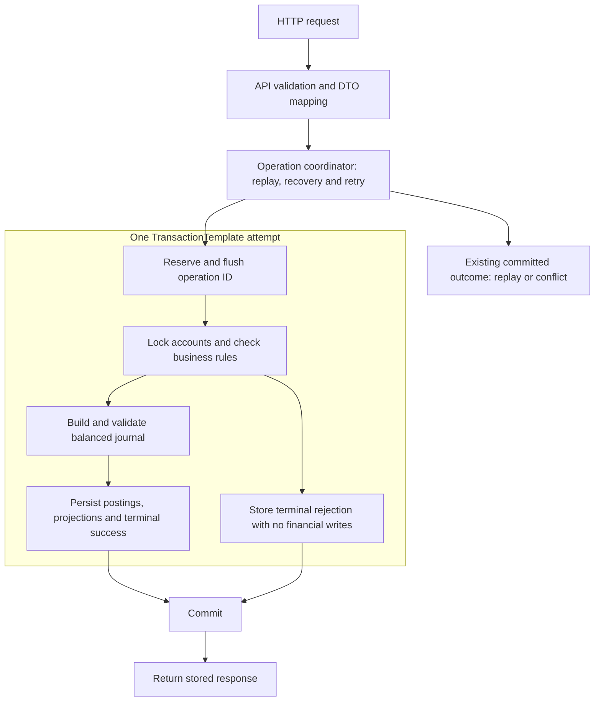

> به‌روزرسانی CBS14، ۲۰۲۶-۱۰-۲۶: [انتقال اتمیک](Transfer-execution.md) کنار credit، debit و استعلام موجودی مرجع پیاده شده است. regression کامل، ۳۸۵ تست قابل‌حمل و ۱۵۴ تست واقعی SQL Server، شامل هر ۲۰ تست انتقال را با صفر failure/error/skip گذراند. معیارهای retry، رقابت گسترده‌تر و پذیرش مستقل یادگیری باز هستند. گفته‌های قبلی دربارهٔ unavailable بودن مسیرها در ادامه تاریخی‌اند.

> به‌روزرسانی CBS13، ۲۰۲۶-۱۰-۲۵: [debit ماندگار](Debit-execution.md) و credit با فعال‌سازی صریح، با ۳۵۱ تست مستقل و ۱۳۴ تست SQL Server و صفر failure/error/skip تأیید شده‌اند. انتقال تا CBS14 unavailable می‌ماند. گفته‌های قبلی دربارهٔ وضعیت اجرا در ادامه دامنهٔ تاریخی خود را دارند.

# معماری پذیرفته‌شدهٔ برنامه

[English](../en/Architecture.md) · [ADR-008](../adr/ADR-008-application-architecture.fa.md) · [دفترکل](Ledger.md) · [پروتکل تراکنش](Transaction-protocol.md)

[آموزش Hexagonal Architecture، port و adapter](Hexagonal-architecture.md)

مالک پروژه در ۲۰۲۶-۱۰-۲۳ معماری و مثال‌های این سند را پذیرفت. packageها، مسئولیت‌ها و جهت وابستگی طرح مبنا هستند؛ نام کلاس‌های آینده مثال است و نباید برای آن‌ها لایهٔ خالی تولید کنیم. فعلاً bootstrap، اسکلت بدون پیاده‌سازی BalanceService، Money با محاسبات تست‌شده، مدل تغییرناپذیر Account/AccountId و سیاست علامت موجودی AccountCategory وجود دارند. persistence، endpoint مالی و کنترل خودکار مرز ماژول‌ها پیاده نشده‌اند.

## نوع‌های مستقل پیاده‌سازی

هر نوع فایل جداگانه دارد؛ helperهای تست هم همین قاعده را رعایت می‌کنند. interface بستهٔ `OperationOutcome` نوع‌های مستقل `OperationSuccess` و `OperationRejected` را مجاز می‌داند؛ خطاهای غیرنهایی از `OperationFailureReason` استفاده می‌کنند. هر سه پورت mutation از snapshot مشترک `account.application.LockedAccount` استفاده می‌کنند. adapterهای persistence، نوع‌های package-private مشترک `StoredOperation` و `OperationCompletion` دارند؛ query حساب هم با `BalanceProjection` مستقل نگاشت می‌شود. تنظیمات از record جداگانهٔ `FundingProperties` استفاده می‌کند. `BalanceController` چهار handler را با constructor injection می‌گیرد و مستقیم صدا می‌زند. پارامترهای Optional، رفتار execution غیرفعال و smoke مستقل از زیرساخت را حفظ می‌کنند؛ `HttpAdapterConfiguration` فقط parsing مربوط به JSON را تنظیم می‌کند.

## ساختار فعلی packageهای operation

در پوشه‌های تخت قبلی، پیدا کردن کد parsing درخواست، نگاشت پاسخ و اجرای credit سخت بود. مثلاً `StrictAmountDeserializer` به DTOهای درخواست مربوط است، اما `CreditStore` بخشی از use case اعتباردهی است. ساختار فعلی این مسئولیت‌ها را داخل همان feature عملیات گروه‌بندی می‌کند.

| package زیر `operation` | مسئولیت |
| --- | --- |
| `web` | `BalanceController`، نقطهٔ ورود چهار مسیر HTTP |
| `web.request` | DTOهای درخواست، deserializerهای سخت‌گیرانه و تبدیل فیلدهای HTTP |
| `web.response` | DTOهای پاسخ، خانوادهٔ sealed بدنه، نگاشت نتیجه و تولید JSON ماندگار credit/debit/transfer |
| `web.error` | advice سراسری خطا و ساخت problem detail |
| `web.configuration` | تنظیم JSON سخت‌گیرانه و اتصال مرحله‌ای سرویس‌ها |
| `application` | اسکلت اولیهٔ `BalanceService`؛ handlerهای use case در packageهای خود هستند |
| `application.command` | قصد credit/debit/transfer و اعتبارسنجی ساختاری command |
| `application.credit` | handler، اطلاعات attempt، پورت ذخیره‌سازی و پورت تولید پاسخ credit |
| `application.debit` | handler، اطلاعات attempt، پورت ذخیره‌سازی و پورت تولید پاسخ debit |
| `application.transfer` | handler انتقال اتمیک، اطلاعات attempt، پورت ذخیره‌سازی و پورت تولید پاسخ |
| `application.identity` | قصد canonical درخواست و fingerprint نسخه‌دار |
| `application.policy` | سیاست ارز و سقف مبلغ، انتخاب ماندگار حساب تأمین و اعتبارسنجی شناسهٔ سیاست |
| `application.execution` | مالکیت تراکنش و سیگنال عملیات تکراری |
| `application.result` | نتیجهٔ mutation، پاسخ ماندگار و خطای application |

تست‌ها package مسئولیت مربوط را دنبال می‌کنند. تست‌های SQL Server در `infrastructure.sqlserver` باقی می‌مانند، چون مسیر کامل persistence را بررسی می‌کنند. interface پاسخ sealed و تمام پیاده‌سازی‌هایش در `web.response` کنار هم هستند؛ Java در این پروژهٔ بدون named module همین هم‌مکانی را لازم دارد. helperهای کوچکی که بین packageها استفاده می‌شوند، متدهای فعلی‌شان را صریحاً عمومی می‌کنند؛ constructor آن‌ها خصوصی می‌ماند. این تغییر فقط ساختار packageهای سورس را جابه‌جا می‌کند و endpoint، JSON، تراکنش و schema را تغییر نمی‌دهد. رفتار فعلی و شواهد اجرا در [وضعیت پیاده‌سازی](Implementation-status.md) آمده است. درخت پایین طرح معماری اولیه است و فهرست فایل‌های فعلی نیست.


## شکل برنامه و مرز سازگاری

یک برنامهٔ Spring Boot ماژولار با سازمان‌دهی feature-based داریم. قواعد دامنه از هماهنگی use case، HTTP و adapter دیتابیس جدا هستند. ابتدا یک SQL Server شامل accounts، operations، journals و postings است. نتیجهٔ عملیات و تمام نوشتن‌های مالی موفق در یک تراکنش محلی commit می‌شوند؛ controller یا repository حساب و دفترکل بخشی از انتقال را جدا commit نمی‌کند.

TransactionTemplate و کنترل نبود تراکنش بیرونی در coordinator پذیرفته شده‌اند. این سند تمام جزئیات SQL، isolation و تنظیمات CBS03–04 را پذیرفته اعلام نمی‌کند، سقف تجاری عددی تعیین نمی‌کند و شاهد اجرا نیست. پیش از migration پروتکل‌های مرتبط مرور شوند.



replay پاسخ نهایی اصلی را بدون مسیر posting برمی‌گرداند. رد نهایی رکورد عملیات دارد ولی journal، posting و تغییر موجودی ندارد. commit نامطمئن با همان شناسه بازیابی می‌شود؛ خطای فنی به رد ساختگی تبدیل نمی‌شود.

## featureها

| feature | مسئولیت | مرحله |
| --- | --- | --- |
| money | مبلغ و ارز، جمع/تفریق checked و مقایسهٔ هم‌ارز | Money پیاده شده |
| account | هویت، ارز، نوع و قواعد موجودی، lookup/قفل و persistence | مدل تغییرناپذیر حساب و سیاست علامت پیاده شده؛ persistence در برنامه است |
| operation | هماهنگی credit/debit/transfer، هویت، fingerprint، نتیجه، replay و retry | هسته؛ فقط interface موجود است |
| ledger | ساخت سند کامل متوازن، سمت posting و تاریخچهٔ تغییرناپذیر | اعتبارسنجی posting و آماده‌سازی خالص projection پیاده شده؛ persistence در برنامه است |
| reconciliation | بازسازی مستقل، کشف مغایرت و مرز ترمیم کنترل‌شده | صحت هسته، برنامه‌ریزی‌شده |
| confirmation | intent ثابت، چرخهٔ OTP و تأیید | مرحلهٔ بعد |
| security | احراز هویت، مالکیت و عملیات privileged | پیش از دسترسی خارجی/اشتراکی |
| replaycache | نسخهٔ Redis پاسخ commitشده | مرحلهٔ بعد |
| event | outbox و مصرف‌کنندهٔ گزارش با حذف اثر تکرار | مرحلهٔ بعد |

دسترسی اولیه محلی و مورداعتماد است. package عمومی انباشته از shared/common/utils، سرویس دفترکل جدا یا build چندماژولی Maven لازم نداریم. Money مقدار دامنهٔ کوچک و مشترک در package خودش است. package آینده با کار مربوط ایجاد شود.

## ساختار جاوا

به‌جز فایل‌های دارای علامت implemented یا existing scaffold، ساختار زیر هدف آینده است:

```text
src/main/java/dev/kavrin/balance/
├── ConcurrentBalanceServiceApplication.java
├── money/
│   └── Money.java                         # implemented
├── account/
│   ├── domain/
│   │   ├── Account.java                    # implemented
│   │   ├── AccountId.java                  # implemented
│   │   └── AccountCategory.java            # implemented
│   ├── application/
│   │   ├── AccountLockOrder.java           # implemented comparator only
│   │   ├── GetBalanceHandler.java
│   │   └── port/AccountRepository.java
│   ├── api/
│   │   ├── BalanceController.java
│   │   └── BalanceResponse.java
│   └── persistence/
│       ├── AccountEntity.java
│       └── JpaAccountRepositoryAdapter.java
├── operation/
│   ├── domain/
│   │   ├── TransactionId.java             # implemented
│   │   ├── OperationType.java             # implemented
│   │   ├── RejectionReason.java           # implemented
│   │   └── OperationOutcome.java          # implemented business values
│   ├── application/
│   │   ├── BalanceService.java             # existing scaffold
│   │   ├── CreditCommand.java              # implemented
│   │   ├── DebitCommand.java               # implemented
│   │   ├── TransferCommand.java            # implemented
│   │   ├── CommandValidation.java          # package-private helper
│   │   ├── SupportedCurrencies.java        # supplied policy snapshot
│   │   ├── OperationCoordinator.java
│   │   ├── CreditHandler.java
│   │   ├── DebitHandler.java
│   │   ├── TransferHandler.java
│   │   ├── RequestFingerprint.java
│   │   └── port/OperationRepository.java
│   ├── api/
│   │   ├── CreditRequest.java
│   │   ├── DebitRequest.java
│   │   ├── TransferRequest.java
│   │   ├── OperationController.java
│   │   └── OperationResponseMapper.java
│   └── persistence/
│       ├── OperationEntity.java
│       └── JpaOperationRepositoryAdapter.java
├── ledger/
│   ├── domain/
│   │   ├── Journal.java                    # implemented posting set
│   │   ├── Posting.java                    # implemented
│   │   └── PostingSide.java                # implemented
│   ├── application/
│   │   └── port/JournalRepository.java
│   └── persistence/
│       ├── JournalEntity.java
│       ├── PostingEntity.java
│       └── JpaJournalRepositoryAdapter.java
├── reconciliation/                       # added in its task
└── configuration/
    └── TransactionConfiguration.java
```

## مسئولیت و جهت وابستگی

- domain قواعد و مقادیر مالی را بدون Spring، HTTP و JPA نگه می‌دارد. سیاست Account علامت موجودی را تعیین می‌کند؛ Money علامت‌دار می‌ماند.
- application اجرای use case، قواعد دامنه و portهای موردنیاز را هماهنگ می‌کند. OperationCoordinator مرز تلاش و recovery را دارد؛ handler در تراکنش داده‌شده مشارکت می‌کند و commit مستقل نمی‌سازد.
- api ساختار ورودی و نگاشت DTO/نتیجه را دارد. DTO همان entity نیست. نگاشت خطای HTTP پس از پایان تلاش انجام می‌شود.
- persistence، portها و نگاشت دامنه به entity را پیاده می‌کند. interface فقط برای قابلیت واقعی ایجاد شود، نه برای تک‌تک کلاس‌ها.
- configuration اجزای فنی را متصل می‌کند. وابستگی بین featureها از قرارداد صریح application یا مقدار مشترک عمدی است، نه entity یا پیاده‌سازی repository ماژول دیگر.

operation به قرارداد account و ledger وابسته است؛ این دو به coordinator عملیات وابسته نشوند. Journal می‌تواند شناسهٔ عملیات را نگه دارد، بدون import سرویس application آن. اعتبارسنجی دامنه تماس دیتابیس/شبکه ندارد. adapter بخشی از نوشتن مالی را به datasource یا transaction manager دیگری نبرد.

Money و snapshot حساب و سیاست علامت موجودند؛ اعتبارسنجی مجموعهٔ posting در Journal هم موجود است؛ repository و coordinator در این جریان هدف آینده‌اند:

```text
Money                  -> safe amount arithmetic
Account                -> category-specific balance rules
Journal                -> validate the complete balanced posting set
Repository adapters    -> load locked state and persist mapped records
Coordinator + template -> own commit, rollback and recovery
```

## مثال انتقال

برای انتقال A به B، مقدار A برابر 10000000-0000-4000-8000-000000000001 و B برابر f0000000-0000-4000-8000-000000000002 است. شناسهٔ حساب UUID است و AccountLockOrder.DESCENDING دو نیمه را unsigned و نزولی مقایسه می‌کند؛ SQL واقعی قفل همچنان مرور CBS04 را می‌خواهد.

```text
Outside transaction:
    Validate immutable request shape and current access
    Canonicalize command and resolve a committed replay

Inside one TransactionTemplate attempt:
    Reserve and flush the operation ID
    Lock account B, then account A
    Read and validate locked accounts
    Calculate every resulting balance with checked arithmetic
    Construct and validate the complete balanced journal
    Persist journal + postings + projections + success response
    Commit all together

Business rejection:
    Persist rejection response; commit with no journal or balance changes
Technical failure:
    Roll back the entire attempt; recover/retry outside it with the same ID
```

جهت مخالف هم ابتدا B و سپس A را قفل می‌کند. حساب مقابل credit/debit هم وارد همان ترتیب می‌شود. این کار الگوی deadlock ناشی از ترتیب حساب را کاهش می‌دهد؛ همهٔ deadlockهای SQL Server را حذف نمی‌کند. همهٔ موجودی‌های حاصل و سند پیش از تغییر projection اعتبارسنجی می‌شوند؛ خرابی persistence تمام نوشتن‌ها را rollback می‌کند.

مثال مستقیم و پیاده‌شدهٔ Money:

```java
var hundredRials = new Money(100, Currency.getInstance("IRR"));
var fiftyRials = new Money(50, Currency.getInstance("IRR"));
var total = hundredRials.add(fiftyRials); // 150 IRR
```

نامنفی‌بودن مشتری و مثبت‌بودن دستور/posting در نوع دامنهٔ مربوط کنترل می‌شوند، نه Money. در مثال Ledger.md، credit مبلغ 100، حساب تأمین را بدهکار و مشتری را بستانکار می‌کند؛ انتقال مشتری حساب مبدأ را بدهکار و مقصد را بستانکار می‌کند. این handlerهای مالی هنوز پیاده نشده‌اند.

## resource و تست

```text
src/main/resources/
├── application.yaml
├── application-redis.yaml
├── application-kafka.yaml
├── application-security.yaml
└── db/migration/                         # no business migration yet

src/test/java/dev/kavrin/balance/
├── ConcurrentBalanceServiceApplicationTests.java  # implemented
├── money/MoneyTests.java                          # implemented
├── account/                              # implemented domain/command tests
├── operation/                            # planned
├── ledger/                               # planned
├── reconciliation/                       # planned
└── testsupport/                          # planned fixture helpers

src/test/resources/
└── application-smoke.yaml

docs/
├── en/
├── fa/
└── adr/
```

migration مالی Flyway منتظر مرور قید و تراکنش است. package جاوا schema دیتابیس نمی‌سازد؛ یک namespace SQL کافی است. unit test ساختار featureها را دنبال می‌کند. تست واقعی HTTP تا SQL Server، SQL مستقیم و خرابی شاهد persistence/هم‌زمانی هستند؛ smoke و Money جای آن‌ها نیستند. فعلاً ۹۲ تست portable طبق Requirements.md عبور کرده‌اند.

## انتخاب الگوها و پیشنهادهای باقی‌مانده

الگوها پرسش‌های متفاوتی را پاسخ می‌دهند و می‌توان آن‌ها را ترکیب کرد:

| الگو | کاربرد | پیشنهاد |
| --- | --- | --- |
| Modular monolith | یک deployment، مرز feature روشن و یک تراکنش مالی | مبنای پذیرفته‌شده |
| لایه‌بندی داخل feature | api/application/domain/persistence | مبنای پذیرفته‌شده |
| Ports and adapters | قرارداد موردنیاز application، adapter HTTP/JPA، دامنه مستقل | جهت وابستگی پذیرفته‌شده؛ interface انتخابی |
| Domain model / ایده‌های تاکتیکی DDD | Money، Account، Journal و invariant صریح | انتخابی؛ package به‌تنهایی bounded context یا مرز aggregate را ثابت نمی‌کند |
| Vertical slice | مسیر کامل use case از HTTP تا SQL و تست | همان روش تحویل مرحله‌ای حفظ شود |
| CQRS با یک دیتابیس | مدل و handler جدا برای command و query روی SQL Server مشترک | پذیرفته‌شده در ۲۰۲۶-۱۰-۲۳ طبق ADR-009؛ بدون framework یا دیتابیس دوم |
| CQRS غیرهم‌زمان | مدل گزارش از outbox/Kafka | بعداً برای نیاز مشخص و workload اندازه‌گیری‌شده |
| Event sourcing | event stream مرجع و بازسازی aggregate از replay | الزام V1 نشود |
| Microservices / saga | سرویس مستقل و workflow توزیع‌شده با جبران | فعلاً عقب بیفتد؛ تقسیم commit مالی مسئلهٔ سازگاری تازه دارد |
| Transaction script | روال سادهٔ use case | برای هماهنگی مناسب؛ قواعد مشترک در دامنه بمانند |

در CQRS تک‌دیتابیسی پذیرفته‌شده در ۲۰۲۶-۱۰-۲۳، credit/debit/transfer مدل command و نتیجهٔ عملیات دارند. GetBalanceHandler مستقیماً BalanceResponse را از دادهٔ commitشدهٔ accounts می‌خواند و مدل دامنهٔ نوشتن را بازسازی نمی‌کند. دیتابیس مشترک و projection هم‌زمان است؛ balance update غیرهم‌زمان یا command bus اجباری نداریم. صرف نام CommandHandler/QueryHandler کافی نیست؛ نمایش و منطق خواندن عمداً جدا شوند. درخت موجود جا دارد و package سراسری command/query برای همهٔ featureها لازم نیست.

CQRS دیتابیس جدا را اجبار نمی‌کند. دیتابیس‌های جدا مسئلهٔ هماهنگی و تأخیر دارند. گزارش Kafka در آینده می‌تواند eventual باشد؛ funds check و موجودی مرجع همچنان projection هم‌زمان و commitشده را می‌خوانند. پاسخ command می‌تواند نتیجهٔ مفید داشته باشد و لازم نیست void باشد.

posting تغییرناپذیر و موجودی قابل‌بازسازی به event sourcing شباهت دارند، اما پیاده‌سازی عمومی aggregate مبتنی بر event stream را ثابت نمی‌کنند. بر اساس این شباهت dependency event store، بارگذاری stream برای هر دستور یا اجرای انتقال مشتری از Kafka اضافه نکنیم. integration event در outbox با posting مرجع حسابداری فرق دارد.

در آینده ArchUnit یا Spring Modulith سازگار می‌تواند مرز packageها را بررسی کند. Modulith ابزار ماژول منطقی است؛ modular monolith بودن به معنی نصب dependency یا سازگاری پیش‌فرض قواعد API آن با این درخت نیست. این سند framework تازه‌ای نمی‌پذیرد.

## منابع مرور الگوها

مرور در ۲۰۲۶-۱۰-۲۳: [CQRS مایکروسافت](https://learn.microsoft.com/en-us/azure/architecture/patterns/cqrs) مدل‌های جدا روی دیتابیس مشترک و شکل پیچیده‌تر با store جدا را توضیح می‌دهد. [Fowler دربارهٔ CQRS](https://martinfowler.com/bliki/CQRS.html) کاربرد انتخابی و پیچیدگی را بررسی می‌کند. [Event sourcing](https://learn.microsoft.com/en-us/azure/architecture/patterns/event-sourcing) stream مرجع را توضیح می‌دهد. [مبانی Spring Modulith](https://docs.spring.io/spring-modulith/reference/fundamentals.html) API ماژول و کنترل ساختار را شرح می‌دهد. این منابع پیشنهاد را پشتیبانی می‌کنند، نه پذیرش یا عبور تست پروژه را.

[ADR-009](../adr/ADR-009-single-database-cqrs.fa.md) پذیرش این شکل محدود CQRS را ثبت می‌کند. store غیرهم‌زمان پیشرفته، event sourcing و framework تازه جزو این پذیرش نیستند.

[راهنمای بیت UUID و ترتیب قفل](UUID-lock-order.md) مبنای شانزده، two’s complement، دو نیمهٔ unsigned، علامت نتیجهٔ comparator و هر تست را با مثال قابل‌اجرا توضیح می‌دهد.

اعتبارسنجی نوع‌دار CreditCommand، DebitCommand و TransferCommand در operation.application پیاده شد؛ handler و persistence همچنان در برنامه‌اند. آخرین verify با Java 21 تعداد ۱۲۸ تست را بدون خطا یا skip گذراند؛ جزئیات در Requirements.md آمده است.

پشتیبانی ارز سیاست application با مجموعهٔ تغییرناپذیر است؛ سازندهٔ command فقط ساختار و مبلغ مثبت را می‌سنجد. adapter تنظیمات یا دیتابیس در آینده SupportedCurrencies را فراهم می‌کند. مرز بارگذاری و ترتیب replay در Decisions.md ثبت شده است. آخرین verify تعداد ۱۳۷ تست را بدون خطا یا skip گذراند.

[نتیجهٔ کسب‌وکار و مرز commit](Operation-outcomes.md)
