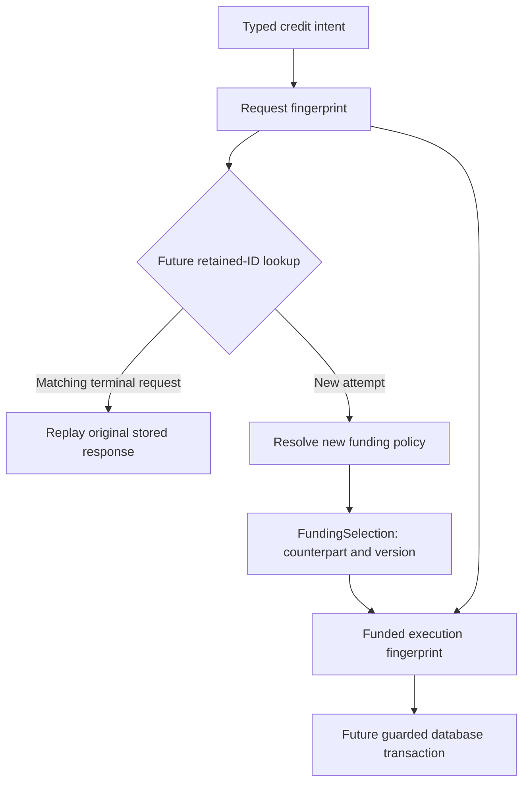

# چرا درخواست canonical، fingerprint و انتخاب حساب تأمین جدا هستند؟

[English](../en/Canonical-design.md) · [مرجع دقیق encoding](Canonical-request.md) · [راهنمای عملیات](Operation-flow.md) · [پروتکل هویت](Idempotency-protocol.md)

این سند دلیل طراحی CBS06 را بر اساس کد فعلی در ۲۰۲۶-۱۰-۲۳ توضیح می‌دهد. برای مفهوم‌های system design از اینجا شروع کنید و برای چیدمان دقیق بایت به Canonical-request.md بروید. منظور از «انتخاب حساب تأمین»، record موسوم به `FundingSelection` است: حساب مقابل منتخب سرور و نسخهٔ سیاست انتخاب آن.

سه نوع مقدار و مقایسهٔ Portable آن‌ها وجود دارند، اما controller HTTP هنوز آن‌ها را صدا نمی‌زند. ذخیره‌سازی SQL Server، رزرو، loader سیاست، coordinator تراکنش و replay کار آینده‌اند. درخواست مالی همچنان fallback عدم دسترسی می‌گیرد. timelineهای دیتابیس در این سند طراحی موردنظرند، نه تضمین اندازه‌گیری‌شدهٔ runtime.

## ۱. مسئله از گم‌شدن پاسخ شروع می‌شود

فرض کنید A هزار و B سیصد ریال دارند. کلاینت با Tx-001 انتقال صد ریال از A به B را می‌خواهد. ممکن است سرور A=900 و B=400 را commit کند و سپس اتصال قطع شود. کلاینت timeout می‌بیند و این سه حالت را از هم تشخیص نمی‌دهد:

| اتفاق واقعی | دانستهٔ کلاینت |
| --- | --- |
| درخواست اصلاً به سرویس نرسیده است | پاسخی ندارد |
| تراکنش rollback شده است | پاسخی ندارد |
| تراکنش commit شده اما پاسخ گم شده است | پاسخی ندارد |

retry دسترس‌پذیری را بهتر می‌کند، اما اجرای سادهٔ دوباره ممکن است صد ریال دیگر جابه‌جا کند. قراردادی لازم داریم که تکرار همان تلاش را امن کند. AWS Builders' Library از شناسهٔ درخواستِ caller و تشخیص تغییر پارامتر زیر همان شناسه توضیح می‌دهد؛ قاعدهٔ شناسهٔ حفظ‌شده و mismatch ما کاربرد همین الگوی عمومی در دامنهٔ مرورشدهٔ پروژه است. [منبع اصلی](https://builder.aws.com/content/3Ev0BENTyBr0XxzRk5FDZzgNYos/m).

طراحی سه سؤال جدا می‌پرسد:

| سؤال | نمایش |
| --- | --- |
| کدام تلاش دوباره ارسال شده است؟ | TransactionId، کلید lookup ماندگار آینده |
| آیا این تلاش هنوز همان چیز را می‌خواهد؟ | CanonicalRequest و fingerprint درخواست |
| کدام حساب مقابل و سیاست سرور متعلق به اجرای آن بود؟ | FundingSelection و funded fingerprint |

هیچ‌کدام از این آبجکت‌ها به‌تنهایی تضمین نمی‌کنند پول فقط یک بار جابه‌جا شود. هویت ماندگار، کنترل هم‌زمانی و commit اتمیک دیتابیس باید کنار هم قرار بگیرند.

## ۲. Canonicalization یعنی انتخاب نمایش مشخص

**Canonical** یعنی شکل معیار انتخاب‌شده. **Canonicalization** تبدیل مقدار معنایی پذیرفته‌شده به آن شکل است. **برابری معنایی** یعنی مقدارها یک درخواست را بیان می‌کنند، حتی اگر متن اولیه متفاوت باشد.

دو body معتبر زیر فقط قالب و ترتیب متفاوت دارند:

```json
{"transactionId":"Tx-001","amountRial":100,"currency":"IRR"}
```

```json
{
  "currency": "IRR",
  "amountRial": 100,
  "transactionId": "Tx-001"
}
```

برای همان مسیر credit و همان حساب، command تایپ‌شده یکسان است. CanonicalRequest از command شروع می‌کند و نه JSON خام؛ پس فاصله و ترتیب propertyها در هویت اثر ندارد. UUID کامل با هگز بزرگ و کوچک هم به یک مقدار parse و سپس با UUID.toString به یک شکل نمایش داده می‌شود.

canonicalization به معنای پذیرفتن ورودی دلخواه و تمیزکردن آن نیست. parser مبلغ 100.0، نماد 1e2 و رشتهٔ عددی را رد می‌کند. transaction ID هرگز trim یا case-fold نمی‌شود. actor، بزرگی حروف، فاصلهٔ اطراف متن غیرblank و نمایش Unicode را دقیق حفظ می‌کند. فقط هم‌ارزی‌ای را می‌پذیریم که نوع یا قرارداد قبلاً تعریف کرده است.

sort کردن حساب‌های transfer اشتباه است. A→B با B→A اثر متفاوت دارد. ترتیب قفل ابزار کنترل هم‌زمانی است؛ ترتیب مبدأ/مقصد معنای کسب‌وکار است. این دو مسئولیت متفاوت‌اند.

## ۳. چرا سه نوع داریم؟

[CanonicalRequest](../../src/main/java/dev/kavrin/balance/operation/application/identity/CanonicalRequest.java) قصد تایپ‌شده را به schema ثابت تبدیل می‌کند و نوع عملیات و نقش حساب را می‌شناسد. حساب نمی‌خواند، actor را احراز هویت نمی‌کند و سیاست تأمین انتخاب نمی‌کند.

[CanonicalFingerprint](../../src/main/java/dev/kavrin/balance/operation/application/identity/CanonicalFingerprint.java) نمایش تغییرناپذیر را نگه می‌دارد: نسخه، بایت canonical، SHA-256 و برابری. دربارهٔ کافی‌بودن وجه تصمیم نمی‌گیرد و شناسه رزرو نمی‌کند.

[FundingSelection](../../src/main/java/dev/kavrin/balance/operation/application/policy/FundingSelection.java) تصمیمی از سرور را ثبت می‌کند که ممکن است در طول زمان عوض شود. دقیقاً دو فیلد دارد:

```java
public record FundingSelection(
        AccountId counterpartAccountId,
        String policyVersion) {
    // Constructor validation is in the source file.
}
```

| فیلد | معنی | چه چیزی را اثبات نمی‌کند؟ |
| --- | --- | --- |
| counterpartAccountId | حساب داخلی واقعیِ انتخاب‌شده برای سمت دیگر posting | وجود حساب، category درست یا نقدینگی واقعی بیرونی |
| policyVersion | برچسب دقیق و غیرblank قاعدهٔ انتخاب، مثل funding-v1 | بارگذاری سیاست، Git commit بودن یا پیروی از semantic versioning |

FundingSelection حساب غیرnull و نسخهٔ غیرblank با Unicode معتبر می‌خواهد. CanonicalRequest حساب مقابل برابر target را هم رد می‌کند. خود record انتخاب‌کنندهٔ سیاست ندارد؛ نتیجهٔ تصمیم را می‌گیرد، نه اینکه تصمیم را بگیرد.

این **جداسازی مسئولیت‌ها** است. قصد caller، مکانیک encoding و سیاست متغیر اجرا دلیل‌های متفاوتی برای تغییر دارند. نوع‌ها مرزها را آشکار و بدون Spring یا دیتابیس قابل‌تست می‌کنند. این‌ها value object محلی در modular monolith هستند و microservice جدا نیستند.

## ۴. هویت تلاش با هویت محتوا فرق دارد

| شناسه | قصد | تعبیر لازم در آینده |
| --- | --- | --- |
| Tx-001 | A→B، صد IRR | تلاش اول |
| Tx-001 | A→B، صد IRR | retry همان تلاش |
| Tx-001 | A→B، دویست IRR | conflict با قصد حفظ‌شده |
| Tx-002 | A→B، صد IRR | تلاش جدا با محتوای یکسان |

TransactionId در payload canonical نیست چون کلید lookup است. fingerprint یکسان برای Tx-001 و Tx-002 درخواست دوم را duplicate نمی‌کند. این طراحی اجرای content-addressed نیست که یکسانی محتوا را خودکار به «فقط یک بار اجرا» تبدیل کند. تکرار مشروع دستور یکسان با شناسهٔ جدید ممکن است لازم باشد.

**Idempotency** در اینجا یعنی ارسال چندبارهٔ همان تلاش حفظ‌شده، اثر مالی commit‌شدهٔ دیگری اضافه نکند. **Deduplication** تشخیص ارسال تکراری زیر آن هویت است. **Replay** نتیجهٔ اصلی را برمی‌گرداند. **Conflict** یعنی شناسه برای ورودی معنایی متفاوت استفاده شده است. این اصطلاح‌ها بخش‌های مرتبط پروتکل‌اند و مترادف hash نیستند.

## ۵. چه چیزی وارد هویت درخواست می‌شود؟

پس از header نسخه/تعداد، schema نسخهٔ ۱ این فیلدها را دارد:

| فیلد | دلیل حضور |
| --- | --- |
| برچسب فضای نام request | جداسازی هدف encoding از funded-execution |
| نوع عملیات | credit صد با debit صد متفاوت است |
| حساب target | مشتری credit/debit/افتتاحیهٔ داخلی |
| حساب source | فرستندهٔ transfer با نقش صریح |
| حساب destination | گیرندهٔ transfer با نقش صریح |
| مبلغ مثبت | صد و دویست دو دستورند |
| ارز | عدد یکسان با ارز متفاوت، دستور متفاوت است |
| actor اختیاری | اتصال principal احرازهویت‌شده وقتی آن مرز اضافه شود |

مسیر محلی مورداعتماد فعلی actor را Optional.empty می‌گیرد؛ کاربری ساختگی به نام system ایجاد نمی‌کند. actor آینده باید از احراز هویت معتبر بیاید، نه body کنترل‌شدهٔ کلاینت. fingerprint کردن actor به او مجوز نمی‌دهد؛ مالکیت و دسترسی فعلی پیش از اجرا یا replay لازم است.

زمان درخواست، trace ID، timestamp پاسخ، موجودی فعلی و راز OTP را حذف می‌کنیم. آن‌ها ممکن است در retry تغییر کنند بدون اینکه قصد عملیات عوض شود. موجودی، وضعیت ارزیابی است و نه قصد. SupportedCurrencies سیاست پذیرش متغیر است؛ replay باید پیش از اعمال مجموعهٔ پشتیبانی امروز بررسی شود.

## ۶. Serialization، framing و ترتیب بایت

**Serialization** تبدیل ساختار به بایت است. **Serialization قطعی** یعنی مقدار معتبر یکسان با نسخهٔ یکسان، بایت یکسان بسازد. قالب کوچک داخلی ما schema صریح دارد و از serialization پیش‌فرض آبجکت استفاده نمی‌کند.

اتصال سادهٔ متن، مرزها را گم می‌کند:

```text
Fields ["ab", "c"]  → naive concatenation "abc"
Fields ["a", "bc"]  → naive concatenation "abc"
```

delimiter تنها هم وقتی خود فیلد delimiter داشته باشد مبهم می‌شود. **Length-prefix framing** ابتدا طول بایت هر فیلد را می‌نویسد. نمایش توضیحی ده‌دهی دو مثال `2:ab,1:c` و `1:a,2:bc` است. طول واقعی در کد عدد باینری است، نه متن با دونقطه.

```text
00 00 00 01     format version = 1
00 00 00 08     request field count = 8
00 00 00 07     first field has 7 UTF-8 bytes
72 65 71 75 65 73 74     "request"
```

هر **byte** هشت بیت است. **Hexadecimal** هر بایت را با دو رقم مبنای شانزده نشان می‌دهد؛ 00 و ff هرکدام یک بایت‌اند. **Big-endian** بایت پرارزش‌تر را اول می‌گذارد. DataOutputStream.writeInt چهار بایت را همین‌طور می‌نویسد. برای header/طول از آن و برای محتوا از بایت UTF-8 صریح استفاده می‌کنیم. writeUTF، modified UTF-8 و طول مخصوص خودش دارد و قالب ما نیست. [Java DataOutputStream](https://docs.oracle.com/en/java/javase/21/docs/api/java.base/java/io/DataOutputStream.html).

طول علامت‌دار -1 فیلد غایب و صفر فیلد حاضرِ خالی است. framing عمومی این‌ها را تفکیک می‌کند، هرچند actor/policy در سطح معنایی متن خالی را رد می‌کنند. نقش ثابت فیلدها، تعداد، طول‌ها و فضای نام با هم ابهام را حذف می‌کنند. **Domain separation** در اینجا برچسب‌زدن دو هدف request و funded-execution است؛ به ساخت سرویس دامنهٔ تازه ربط ندارد.

## ۷. UTF-8، Unicode و ورودی سخت‌گیرانه

Unicode برای کاراکترهای متن code point تعریف می‌کند و UTF-8 آن‌ها را با طول متغیر به بایت تبدیل می‌کند. String جاوا از واحدهای UTF-16 استفاده می‌کند و بعضی کاراکترها دو واحد می‌خواهند. پس تعداد کاراکتر جاوا الزاماً تعداد بایت UTF-8 نیست. طول ما تعداد بایت واقعی encode‌شده است.

surrogate جفت‌نشده نباید پنهانی جایگزین شود؛ جایگزینی ممکن است دو ورودی خراب متفاوت را یکسان کند. encoder خطا گزارش می‌کند. CharsetEncoder جاوا گزارش خطا را رفتار پیش‌فرض معرفی می‌کند. [Java CharsetEncoder](https://docs.oracle.com/en/java/javase/21/docs/api/java.base/java/nio/charset/CharsetEncoder.html).

دو نمایش Unicode معتبر می‌توانند شبیه هم دیده شوند اما هویت متفاوت داشته باشند؛ مثلاً é آماده با e و accent ترکیبی. این کلاس‌ها آن‌ها را normalize نمی‌کنند. هم‌ارز دانستنشان سیاست صریح هویت actor و مرور سازگاری می‌خواهد.

## ۸. SHA-256، برخورد hash، برابری و immutability

**Hash یا digest** بایت را به مقدار با اندازهٔ ثابت نگاشت می‌کند. SHA-256 خروجی ۲۵۶بیتی، یعنی ۳۲ بایت دارد که اینجا با ۶۴ رقم هگز کوچک نمایش داده می‌شود. MessageDigest جاوا محاسبهٔ SHA-256 را ارائه می‌کند. [Java MessageDigest](https://docs.oracle.com/en/java/javase/21/docs/api/java.base/java/security/MessageDigest.html).

فضای محدود digest نمی‌تواند برای همهٔ ورودی‌های ممکن یکتا باشد. **Collision** یعنی ورودی‌های متفاوت digest یکسان داشته باشند. پس همهٔ بایت canonical را نگه می‌داریم و equals کلاس از Arrays.equals استفاده می‌کند؛ digest مطابق به‌تنهایی اجازهٔ replay نمی‌دهد. hashCode جاوا ابزار ۳۲بیتی جدا برای collection است و نه SHA-256 یا قرارداد هویت ماندگار.

hashing رمزنگاری برگشت‌پذیر نیست؛ کلید decrypt ندارد. احراز هویت، امضا یا HMAC هم نیست. کسی که درخواست احتمالی را می‌داند می‌تواند SHA-256 بدون کلیدش را بسازد. digest را راز در نظر نگیرید و فرض نکنید بایت canonical یا hex اطلاعات حساب/actor را مخفی می‌کند.

**Immutability** یعنی مقدار پس از ساخت تغییر نکند. bytes() کپی می‌دهد چون آرایه حتی در فیلد final هم mutable است. بدون کپی دفاعی، caller می‌تواند هویتی را که قبلاً مقایسه یا وارد hash collection شده عوض کند. سازندهٔ private نسخهٔ درون‌حافظه‌ای متعلق به خود را می‌گیرد و آرایهٔ mutable بیرونی حفظ نمی‌شود.

digest می‌تواند مقدار کمکی فشرده برای بررسی/تصمیم index آینده باشد؛ index دیتابیس digest امروز وجود ندارد. بهبود سرعت اندازه‌گیری نشده است. encode و hash به اندازهٔ بایت زمان می‌برند و حفظ بایت کامل فضا می‌خواهد. انتخاب ما برای correctness است، نه اثبات performance بهتر.

## ۹. دنبال‌کردن کامل مثال transfer

A را UUID با انتهای 1، B با انتهای 2 و C با انتهای 3 از مثال runnable در نظر بگیرید. command برابر Tx-001، TRANSFER، مسیر A→B، مبلغ صد IRR و actor غایب است.

1. parser HTTP توکن صحیح 100 و UUID کامل را می‌خواهد. ورودی اعشاری یا خراب پیش از command رد می‌شود.
2. TransferCommand حضور مقدارها، مبلغ مثبت و حساب متمایز را بررسی می‌کند؛ موجودی نمی‌خواند.
3. CanonicalRequest.transfer نقش‌ها را به هشت فیلد ثابت تبدیل می‌کند. target و actor غایب‌اند، source=A و destination=B است.
4. CanonicalFingerprint فیلدها را frame و SHA-256 را حساب می‌کند. بردار تست برابر `9eac5bca4175ebd6aaa024fd362e313b1ae23cb7cf43e5f5fe4495b558a5a996` است.
5. coordinator آینده Tx-001 را lookup می‌کند. درخواست حفظ‌شدهٔ مطابق پاسخ اصلی می‌دهد و درخواست متفاوت conflict است. عملیات جدید پروتکل مرورشدهٔ رزرو/قفل را طی می‌کند.
6. موفقیت آینده journal، postingها، A=900، B=400 و نتیجه/پاسخ اصلی را با هم commit می‌کند. فقط پایان قطعی به نگاشت موفقیت HTTP می‌رسد.
7. اگر پاسخ پس از commit گم شود، همان Tx-001 و command retry می‌شوند. replay آینده posting اضافه و تصمیم وجه تازه ندارد.

کنترلر اکنون handlerهای ماندگار را مستقیم صدا می‌زند؛ credit، debit و transfer با سیاست فعال اجرا می‌شوند. راهنماهای اجرای آن‌ها شواهد فعلی persistence و replay را ثبت می‌کنند. transfer به FundingSelection نیاز ندارد چون هر دو حساب مؤثر صریح‌اند. fundedFingerprint روی transfer محلی خطا می‌دهد.

## ۱۰. دنبال‌کردن credit با تغییر سیاست تأمین

credit مشتری A و مبلغ صد را مشخص می‌کند و اجازهٔ انتخاب حساب تأمین داخلی به caller نمی‌دهد. طبق طراحی پذیرفته‌شدهٔ ledger، موفقیت به خطوط متوازن نیاز دارد؛ مثلاً funding debit صد و customer credit صد. category حساب مشخص می‌کند سمت حسابداری چه اثری روی projection نمایشی دارد. برابری مجموع debit/credit به معنی یکسانی علامت delta در همهٔ categoryها نیست.

فرض کنید سرور B را با funding-v1 انتخاب کند. FundingSelection مقدار `(B, funding-v1)` را ثبت می‌کند. funded fingerprint شامل کل بایت درخواست به‌شکل hex، counterpart انتخابی و نسخه، زیر فضای نام funded-execution است. حضور کل بایت قصد دقیق را نگه می‌دارد؛ قراردادن فقط digest، این مقایسه را به یکتایی digest وابسته می‌کند.



این نمودار پردازش آینده است؛ lookup و resolver سیاست هنوز نداریم. کلاس می‌تواند دو نمایش مقدار را مستقل حساب کند.

| اتفاق | هویت درخواست | هویت تأمین/اجرا | نتیجهٔ آینده |
| --- | --- | --- | --- |
| ارزیابی اول credit-001 با B/v1 | اصلی | Request+B+v1 | یک نتیجه commit می‌شود |
| سیاست به C/v2 تغییر می‌کند | قصد اصلی ثابت است | انتخاب جدید فرق می‌کند | نتیجهٔ قبلی تغییرناپذیر می‌ماند |
| retry همان credit-001 با قصد اصلی | با درخواست حفظ‌شده مطابق است | B/v1 حفظ‌شده | replay، بدون اجرای سیاست امروز |
| credit-002 جدید با همان مشتری/مبلغ | payload یکسان، lookup ID جدید | می‌تواند C/v2 را بگیرد | تلاش مالی جدا در صورت مجازبودن |
| credit-001 مبلغ را دویست می‌کند | متفاوت | برای تصمیم replay لازم نیست | conflict؛ نتیجهٔ اصلی حفظ می‌شود |

این **snapshot** تصمیم اجراست، نه ارجاع زنده به سیاست امروز. **سازگاری زمانی** اینجا یعنی تغییر تنظیمات آینده، عملیات گذشته را بازتفسیر نکند. نسخه می‌گوید کدام سیاست اعمال شد و account ID می‌گوید چه چیزی واقعاً انتخاب شد. نسخهٔ یکسان با counterpart متفاوت هم funded identity را عوض می‌کند. counterpart یکسان با نسخهٔ متفاوت هم آن را عوض می‌کند تا زمینهٔ تصمیم جدید حفظ شود.

actor اختیاری داخل درخواست داخلی است و funded fingerprint را هم تحت‌تأثیر قرار می‌دهد. حساب مشتری ناموجود می‌تواند بدون posting به رد نهایی حفظ‌شده برسد؛ funded fingerprint موفقیت شرط نمایش همهٔ ردها نیست.

## ۱۱. چرا hash مشکل concurrency و atomicity را حل نمی‌کند؟

دو instance می‌توانند هم‌زمان بایت یکسان بسازند و هر دو نبود عملیات حفظ‌شده را ببینند. مقایسهٔ حافظه‌ای جلوی write هر دو را نمی‌گیرد. **کنترل هم‌زمانی** باید تلاش‌های دیتابیس را هماهنگ کند. پروتکل پیشنهادی قید یکتایی شناسهٔ تراکنش مشترک و recovery تازه پس از collision موردانتظار را می‌خواهد؛ مرور و تست SQL Server لازم است.

SQL Server با unique index، UNIQUE constraint را enforce می‌کند؛ این یکتایی کلید است و تمام پروتکل replay ما نیست. [مستند Microsoft](https://learn.microsoft.com/en-us/sql/relational-databases/tables/unique-constraints-and-check-constraints).

**Atomicity** یعنی writeهای لازم با هم commit یا rollback شوند. موفقیت آینده هویت/نتیجه، journal، posting و projection را در بر می‌گیرد. **Durability** یعنی حالت commit‌شده طبق تضمین‌های دیتابیس مستقر، restart/خرابی مربوط را دوام بیاورد. **Isolation** مشاهده و تداخل تراکنش‌های هم‌زمان را کنترل می‌کند. رفتار دقیق قفل/isolation باید روی SQL Server مرور و تست شود؛ fingerprint هیچ‌کدام را تضمین نمی‌کند.

این ویژگی‌ها کنار consistency مجموعهٔ **ACID** را می‌سازند. consistency در ACID یعنی حفظ invariantهای تعریف‌شدهٔ داده/کسب‌وکار، نه فوراً به‌روز بودن همهٔ replicaها. constraint دیتابیس قاعدهٔ محلی را enforce می‌کند، اما fingerprint متوازن‌بودن journal چندسطری را اثبات نمی‌کند؛ مسیر write مرورشده و reconciliation لازم‌اند.

جهت پروژه **CQRS** با یک دیتابیس است: command تغییردهنده قصد را بیان می‌کند و query موجودی از projection هم‌زمان حساب می‌خواند. CQRS مسئولیت command/query را جدا می‌کند و دو سرویس یا دو دیتابیس اجباری نمی‌سازد. نگه‌داشتن journal و projection هم به‌تنهایی معماری کامل event sourcing را ثابت نمی‌کند. [Ledger](Ledger.md) دامنهٔ پذیرفته‌شده را توضیح می‌دهد.

commit تراکنش مرز رؤیت موردنظر است که در بحث عملیات گاهی **linearization point** نامیده می‌شود. اجرای callback، ساخت Success یا hash آن نقطه نیست. تست Portable ادعای linearizability رسمی یا semantics commit دیتابیس نمی‌دهد.

هدف، حداکثر یک اثر commit‌شده زیر هویت حفظ‌شده با retry/recovery است؛ تحویل شبکه دقیقاً یک بار نیست. درخواست و پاسخ ممکن است تکرار یا گم شوند. گم‌شدن تأیید commit یک **نتیجهٔ نامعلوم** می‌سازد که recovery با همان شناسه می‌خواهد، نه ادعای وقوع rollback.

## ۱۲. رد کسب‌وکار، retention و مجوز فعلی

debit/transfer خوش‌ساخت ممکن است به علت کسری وجه رد شود. سیاست پذیرفته‌شده رد نهایی را بدون journal یا write پول حفظ می‌کند. اگر وجه بعداً زیاد شود، replay شناسهٔ قبلی همان رد را می‌دهد. تلاش تازه شناسهٔ تازه می‌خواهد. رد یک تصمیم ماندگار کسب‌وکار است و با خرابی زیرساخت موقت یا syntax نامعتبر فرق دارد.

retention جزو correctness است. سیاست پذیرفته‌شدهٔ V1 هویت نهایی و پاسخ اصلی را نامحدود نگه می‌دارد. حذف رکورد و اجازهٔ اجرای دوباره با همان شناسه، تضمین retry را تغییر می‌دهد. TTL آیندهٔ Redis عمر هویت SQL Server را تعیین نمی‌کند؛ Redis cache احتمالی است و نه مرجع اجرا.

actor binding، metadata هویت است. **Authorization** می‌پرسد caller فعلی اکنون حق دسترسی/اجرای عملیات را دارد یا نه. replay آینده حتی با actor یا fingerprint مطابق، مجوز فعلی می‌خواهد. idempotency جلوی ارسال شناسه‌های تازهٔ زیاد توسط caller مجاز را نمی‌گیرد؛ rate limit، سقف تجاری و تأیید بعدی تهدید دیگری را پوشش می‌دهند.

## ۱۳. Versioning و compatibility بخشی از پروتکل‌اند

قالب با نسخهٔ ۱ شروع می‌شود چون استقرار و تصمیم سیاست از یک build جاوا بیشتر عمر می‌کنند. ترتیب فیلد، تعبیر نقش، normalization، واحد مبلغ و قاعدهٔ actor هویت را عوض می‌کنند. refactor تغییر‌دهندهٔ بایت بدون سازگاری storage می‌تواند retry معتبر را conflict کاذب کند.

**Backward compatibility** یعنی استقرار جدید بتواند رکورد قدیمی را درست بفهمد. decoder آینده باید نسخهٔ ذخیره‌شده را بخواند، قالب نامعتبر/ناشناخته را امن رد کند و قاعدهٔ مقایسهٔ همان نسخه را اجرا کند. اجرای مستقیم قاعدهٔ نسخهٔ ۲ روی digest نسخهٔ ۱ کافی نیست. افزودن دسترسی احرازهویت‌شده به رکورد قدیمی بدون actor هم مرور سیاست می‌خواهد، نه actor ساختگی.

**Golden test vector** ورودی، بایت و digest مشخص را ثابت می‌کند. تغییر تصادفی را پیدا می‌کند ولی جای migration plan و اثبات همهٔ ورودی‌ها نیست. تست فعلی و محاسبهٔ مستقل Python روی بردار انتقال توافق دارند. decoder و migration قالب ذخیره‌شده هنوز پیاده نشده‌اند.

## ۱۴. گزینه‌های دیگر و هزینهٔ انتخاب ما

| گزینه | چرا اینجا انتخابش نکردیم؟ | کجا ممکن است مناسب باشد؟ |
| --- | --- | --- |
| hash از JSON خام | قالب‌بندی اختلاف کاذب می‌سازد؛ metadata transport وارد هویت می‌شود | هویت سند دقیقاً هم‌بایت، اگر هدف همین باشد |
| اتصال متن فیلدها | مرز فیلد مبهم می‌شود | با escaping/framing کاملاً مشخص |
| فقط hash | مرجع مقایسهٔ دقیق موردنیاز را حذف می‌کند | سامانه‌ای که مدل ریسک digest-only را می‌پذیرد |
| Canonical JSON | گزینهٔ معتبر است، اما قاعدهٔ معنایی فیلد و normalization هم لازم دارد | امضای JSON و قرارداد میان زبان‌ها |
| Protobuf یا serializer قطعی دیگر | schema/tooling می‌خواهد و باز به قاعدهٔ نسخه/دامنه نیاز دارد | اکوسیستم پروتکلی که از آن استفاده می‌کند |
| fingerprint یکپارچه با سیاست امروز در هر retry | تغییر سیاست conflict کاذب یا بازتفسیر اجرای قبلی می‌سازد | وقتی زمینهٔ سیاست حفظ‌شده پیش از مقایسه بازیابی شود |
| قفل سراسری حافظه یا marker فقط Redis | هویت حسابداری ماندگار چندinstance‌ای ایجاد نمی‌کند | هماهنگی محلی یا cache کنار مرجع ماندگار |

RFC 8785 روش canonicalization برای JSON از جمله ترتیب قطعی propertyها را تعریف می‌کند. بایت سفارشی انتخاب پروژه است و به معنی غیرممکن‌بودن canonical JSON نیست. [RFC 8785](https://www.rfc-editor.org/info/rfc8785/).

قالب ما کوچک و بدون dependency است، اما مسئولیت specification، تست سازگاری و decoder آینده با خودمان است. خواندن بایت از JSON دشوارتر است. نمایش hex اندازهٔ درخواست داخلی را دو برابر می‌کند؛ encoder فیلد متنی را ساده می‌کند اما هزینهٔ storage/allocation دارد. benchmark نداریم که سریع‌تر بودن از canonical JSON را ادعا کنیم.

متن actor/policy فعلاً سقف طول مخصوص برنامه ندارد و به منابع موجود جاوا محدود است. پیش از storage یا دسترسی خارجی باید bound و سازگاری ستون دیتابیس مرور شوند؛ این سند عددی اختراع نمی‌کند. بایت canonical شناسه دارد و hex آن را ناشناس نمی‌کند. log، دسترسی و retention همان حساسیت metadata اصلی را دارند.

## ۱۵. یک مثال را اجرا و خروجی را بررسی کنید

برنامهٔ مستقل زیر فقط کلاس‌های مقدار کامپایل‌شدهٔ پروژه و Java 21 را می‌خواهد. metadata می‌سازد و مقایسه می‌کند؛ Spring را اجرا نمی‌کند و پول جابه‌جا نمی‌کند. کد را با نام CanonicalDesignExample.java ذخیره کنید. پس از compile پروژه، از ریشه اجرا کنید:

```sh
javac -cp target/classes -d /tmp CanonicalDesignExample.java
java -cp target/classes:/tmp CanonicalDesignExample
```

جداکنندهٔ classpath بالا برای macOS/Linux است؛ در Windows از `;` استفاده کنید.

```java
import java.util.Currency;
import java.util.Optional;
import java.util.UUID;
import dev.kavrin.balance.account.domain.AccountId;
import dev.kavrin.balance.money.Money;
import dev.kavrin.balance.operation.application.identity.CanonicalRequest;
import dev.kavrin.balance.operation.application.command.CreditCommand;
import dev.kavrin.balance.operation.application.policy.FundingSelection;
import dev.kavrin.balance.operation.application.command.TransferCommand;
import dev.kavrin.balance.operation.domain.TransactionId;

public class CanonicalDesignExample {
    public static void main(String[] args) {
        var a = account("00000000-0000-0000-0000-000000000001");
        var b = account("00000000-0000-0000-0000-000000000002");
        var c = account("00000000-0000-0000-0000-000000000003");
        var amount = new Money(100, Currency.getInstance("IRR"));
        var first = new TransferCommand(new TransactionId("Tx-001"), a, b, amount);
        var otherId = new TransferCommand(new TransactionId("Tx-002"), a, b, amount);
        var reversed = new TransferCommand(new TransactionId("Tx-001"), b, a, amount);
        var request = CanonicalRequest.transfer(first, Optional.empty());
        var equivalent = CanonicalRequest.transfer(otherId, Optional.empty());
        var changed = CanonicalRequest.transfer(reversed, Optional.empty());

        System.out.println("samePayload=" + request.fingerprint().equals(equivalent.fingerprint()));
        System.out.println("sameTransactionId=" + first.transactionId().equals(otherId.transactionId()));
        System.out.println("reversedPayload=" + request.fingerprint().equals(changed.fingerprint()));
        System.out.println("transferSha256=" + request.fingerprint().sha256());

        var credit = CanonicalRequest.credit(
                new CreditCommand(new TransactionId("credit-001"), a, amount), Optional.empty());
        var retained = new FundingSelection(b, "funding-v1");
        var originalExecution = credit.fundedFingerprint(retained);
        var sameSelection = credit.fundedFingerprint(new FundingSelection(b, "funding-v1"));
        var changedAccount = credit.fundedFingerprint(new FundingSelection(c, "funding-v1"));
        var changedPolicy = credit.fundedFingerprint(new FundingSelection(b, "funding-v2"));
        System.out.println("sameExecution=" + originalExecution.equals(sameSelection));
        System.out.println("changedAccount=" + originalExecution.equals(changedAccount));
        System.out.println("changedPolicy=" + originalExecution.equals(changedPolicy));
    }

    private static AccountId account(String text) {
        return new AccountId(UUID.fromString(text));
    }
}
```

خروجی موردانتظار:

```text
samePayload=true
sameTransactionId=false
reversedPayload=false
transferSha256=9eac5bca4175ebd6aaa024fd362e313b1ae23cb7cf43e5f5fe4495b558a5a996
sameExecution=true
changedAccount=false
changedPolicy=false
```

هر خط نتیجهٔ مقایسه است. دو خط اول نشان می‌دهند برابری محتوا دو تلاش متفاوت را ادغام نمی‌کند. reversedPayload=false اهمیت نقش حساب را نشان می‌دهد. سه خط آخر می‌گویند انتخاب حفظ‌شدهٔ یکسان مطابق است و تغییر حساب یا سیاست هویت اجرا را عوض می‌کند. هیچ خطی dedup دیتابیس یا posting موفق را اثبات نمی‌کند.

## ۱۶. واژه‌ها در همین طراحی

| اصطلاح | معنی اینجا |
| --- | --- |
| Invariant | قاعدهٔ همیشگی مثل تغییرنکردن قصد حفظ‌شدهٔ یک شناسه |
| Canonical representation | شکل بایت مشخص برای ورودی معنایی پذیرفته‌شده |
| Determinism | مقدار و نسخهٔ یکسان، بایت یکسان می‌سازند |
| Framing | اطلاعات رفع ابهام مرز هر فیلد |
| Domain separation | برچسب متفاوت برای هدف request و funded-execution |
| Value object | metadata مقایسه‌شده با محتوا، بدون lifecycle دیتابیس مستقل |
| Snapshot | تصمیم counterpart/نسخه مستقل از تغییر بعدی سیاست |
| Actor/principal | هویت از احراز هویت معتبر وقتی آن ویژگی موجود شود |
| Source of truth | SQL Server به‌عنوان مرجع ماندگار آیندهٔ هویت/نتیجهٔ مالی |
| Idempotency key | TransactionId نشان‌دهندهٔ یک تلاش مالی حفظ‌شده |
| Deduplication | تشخیص ارسال دوبارهٔ همان تلاش |
| Replay | بازگرداندن نتیجهٔ ذخیره‌شده بدون اثر مالی تازه |
| Fingerprint/digest | در نوع پروژه بایت canonical همراه hash کمکی؛ خود SHA-256 صرفاً digest است |
| Collision | ورودی متفاوت با hash محدود یکسان |
| Atomic commit | ماندگارشدن هم‌زمان تاریخچه، projection و نتیجه |
| Race condition | تصمیم‌های هم‌پوشان instanceها بدون هماهنگی کافی |
| Uncertain outcome | caller نمی‌داند commit رخ داده یا نه |
| Backward compatibility | قابل‌فهم‌ماندن هویت قدیمی پس از تغییر نرم‌افزار |
| Golden vector | ورودی/بایت/hash ثابت برای محافظت قرارداد encoding |
| Admission policy | شرط تلاش جدید، جدا از replay |

فیلد دقیق و شواهد فعلی در [Canonical-request.md](Canonical-request.md) است. پروتکل پیشنهادی رزرو/قفل و مرورهای باز در [Idempotency-protocol.md](Idempotency-protocol.md) و [Transaction-protocol.md](Transaction-protocol.md) آمده‌اند. تست‌ها نمایش و مقایسهٔ Portable را می‌سنجند، نه اجرای دیتابیس یا تسلط یادگیرنده را.

## بررسی سند

در ۲۰۲۶-۱۰-۲۳ با Java 21.0.11 هر ۲۲ مورد CanonicalRequestTests بدون failure، error یا skip در ۳٫۶۲۷ ثانیه موفق شدند. برنامهٔ مستقل عیناً از هر دو نسخه استخراج، compile و اجرا شد؛ خروجی مستندشدهٔ هر دو نسخه بایت‌به‌بایت مطابق است. لینک فایل نسبی و whitespace بررسی شدند. سورس Mermaid وجود دارد، اما ظاهر renderشده بررسی نشده است. رفتار دیتابیس تست نشد. منابع اصلی بیرونی در همین تاریخ بررسی شدند؛ تصمیم و رفتار آیندهٔ پروژه از کد و اسناد مرجع لینک‌شده می‌آیند.
