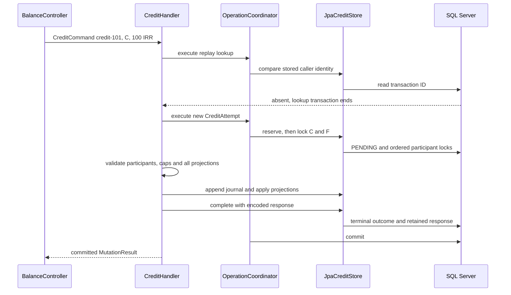

# کلاس‌های credit و جریان اجرای درخواست

[English](../en/Credit-class-walkthrough.md) · [اجرا و شواهد](Credit-execution.md) · [طراحی coordinator](Operation-coordinator.md) · [تنظیم سیاست](Execution-policy.md)

## مسئله‌ای که این طراحی حل می‌کند

اگر credit موجودی مشتری را افزایش دهد ولی journal یا نتیجهٔ درخواست ذخیره نشود، عملیات ناقص است. timeout هم نتیجه را روشن نمی‌کند؛ ممکن است دیتابیس commit کرده باشد ولی پاسخ به مشتری نرسیده باشد. تکرار درخواست با transaction ID جدید می‌تواند مبلغ را دوباره اعمال کند. این طراحی journal، هر دو projection و پاسخ ماندگار را با هم commit می‌کند؛ تکرار هویت قبلی همان نتیجه را می‌خواند.

فرض کنید مشتری فعال C و حساب funding فعال F هر دو در IRR موجودی ۵۰۰ دارند. این موجودی اولیه باید تاریخچهٔ متوازن قبلی داشته باشد؛ update دلخواه موجودی نیست. درخواست `credit-101` مبلغ ۱۰۰ را به C اضافه می‌کند. journal جدید F را ۱۰۰ DEBIT و C را ۱۰۰ CREDIT می‌کند. موجودی هر دو ۶۰۰ می‌شود؛ جهت عادی FUNDING_CLEARING بدهکار و جهت عادی CUSTOMER_LIABILITY بستانکار است. مجموع debit و credit برابر می‌ماند. موجودی funding حسابداری داخلی است و اثبات ورود پول از بانک نیست.

## کلاس‌های ورودی و سیاست

| کلاس | مسئولیت و مثال |
| --- | --- |
| `AmountRequest` | ورودی HTTP؛ parsing سخت‌گیرانه مبلغ نامعتبر، فیلد ناشناخته و کلید تکراری JSON را پیش از اجرا رد می‌کند. |
| `CreditCommand` | قصد typed و تغییرناپذیر شامل transaction ID، شناسهٔ مشتری و `Money` مثبت؛ جزئیات HTTP وارد handler نمی‌شوند. |
| `Money` | ارز و محاسبات integer با کنترل overflow؛ سقف مخصوص deployment را نمی‌شناسد. |
| `ExecutionPolicyProperties` | تنظیمات `balance.execution` را bind می‌کند؛ برای funding ناموجود حساب خیالی نمی‌سازد. |
| `ExecutionPolicyConfiguration` | فقط با `balance.execution.enabled=true` سیاست معتبر می‌سازد؛ تنظیم فعال نامعتبر startup را متوقف می‌کند. |
| `ExecutionPolicy` | snapshot تغییرناپذیر نسخه، ارزهای پشتیبانی‌شده، سقف‌ها و mapping کامل funding؛ lookup دیتابیس یا canonical encoding انجام نمی‌دهد. |
| `AmountLimits` | سقف inclusive مبلغ تراکنش و موجودی مشتری؛ برابری با سقف مجاز است. |
| `FundingSelection` | UUID حساب مقابل و نسخهٔ انتخاب برای یک ارز؛ سرور آن را انتخاب می‌کند و caller اختیاری برای تعیین آن ندارد. |
| `IdentityText` | اعتبارسنجی مشترک و package-private متن نسخه و هویت، شامل Unicode خراب؛ hash یا serialization نمی‌سازد. |

برای فعال‌سازی، UUID حساب IRR از نوع FUNDING_CLEARING و نسخهٔ funding را بدهید. حساب باید قبلاً provision شده باشد. loader می‌تواند syntax شناسه و کامل‌بودن mapping را بررسی کند، ولی وجود، active بودن و دستهٔ واقعی حساب را نمی‌داند. handler این موارد را زیر قفل دیتابیس بررسی می‌کند. تغییر انتخاب funding نیازمند تنظیم و نسخهٔ آگاهانه و restart است؛ hot reload نداریم.

## هویت caller و هویت اجرا

`CanonicalRequest` قصد caller را با قالب نسخه‌دار و actor binding صریحاً غایب encode می‌کند؛ API فعلی برای محیط محلی قابل‌اعتماد است. `CanonicalFingerprint` بایت‌های canonical و SHA-256 همراه آن‌ها را نگه می‌دارد. transaction ID کلید lookup عمومی است، ولی جای مقایسهٔ درخواست را نمی‌گیرد. replay بایت‌های کامل را مقایسه می‌کند؛ همان ID با مبلغ ۱۰۱ به‌جای ۱۰۰ conflict است.

سقف و funding فعلی بخشی از قصد canonical caller نیستند. در غیر این صورت تغییر سیاست می‌توانست درخواست قبلی را متفاوت جلوه دهد. هویت funded جداگانه زمینهٔ funding انتخاب‌شده برای تلاش جدید را ثبت می‌کند. `ExecutionPolicy` متن خودش را با `IdentityText` اعتبارسنجی می‌کند و وابستگی به `CanonicalFingerprint` ندارد.

`CreditAttempt` شناسهٔ operation، شناسهٔ journal، command، درخواست canonical، snapshot سیاست و funding را کنار هم می‌گذارد. این record اطلاعات یک تلاش نوشتن است؛ entity مدیریت‌شده، موفقیت ماندگار یا حلقهٔ retry نیست.

## هماهنگی اجرا و مالکیت تراکنش

`CreditHandler` تصمیم‌های کاربردی را می‌گیرد. چهار dependency آن مالکیت تراکنش، سیاست، persistence و encoding پاسخ را جدا می‌کنند. ابتدا `recover` را داخل تراکنش متعلق به coordinator اجرا می‌کند. فقط اگر نتیجهٔ terminal پیدا نشود، سیاست فعلی را ارزیابی و تلاش نوشتن را می‌سازد.

`OperationCoordinator` یک `@Service` در production است. Spring، `PlatformTransactionManager` تنظیم‌شده را به تنها سازندهٔ آن تزریق می‌کند. manager در اجرای واقعی لازم است و مخصوص تست نیست. coordinator یک `TransactionTemplate` خصوصی با READ_COMMITTED و timeout پنج‌ثانیه‌ای می‌سازد، تراکنش فعال caller را رد می‌کند و فقط پس از commit برمی‌گردد. template هم به manager نیاز دارد؛ حذف coordinator این قواعد مالکیت را به callerها منتقل می‌کند. مثال blocking و SERIALIZABLE و توضیح UPDLOCK/HOLDLOCK در راهنمای coordinator آمده است.

`CreditStore` پورت persistence لایهٔ application است. متدهای آن replay، رزرو، قفل حساب‌ها، افزودن تاریخچه، اعمال projection و تکمیل terminal را بیان می‌کنند. `LockedAccount` snapshot دامنه را همراه active status می‌دهد. handler SQL نمی‌سازد و entityهای JPA را نمی‌شناسد.

`JpaCreditStore` این پورت را در تراکنش writable و joined واقعی JPA پیاده می‌کند. هنگام رزرو هویت canonical، زمینهٔ سیاست/funding و PENDING را می‌نویسد. هنگام replay قالب و سازگاری نتیجهٔ terminal را بررسی می‌کند. تاریخچه را با SQL اضافه می‌کند، projection entityهای managed را اعمال و flush می‌کند و operation متعلق به تلاش را از pending به terminal می‌برد. update count غیر از یک، خطای فنی است.

`AccountStore` مجموعهٔ کامل و بدون تکرار مشتری/funding را با ترتیب نزولی UUID برنامه و UPDLOCK/HOLDLOCK قفل می‌کند. همهٔ writerها باید همین ترتیب را رعایت کنند. این قفل‌ها از وضعیت مؤثر بر تصمیم محافظت می‌کنند؛ READ_COMMITTED به‌تنهایی read-check-write منطق مالی را سری نمی‌کند.

## عبور یک درخواست موفق از کلاس‌ها

lookup اول مرز replay و کاهش کار اضافی است، ولی یکتایی را تضمین نمی‌کند. دو caller می‌توانند هر دو نبودن ID را ببینند. unique constraint دیتابیس برندهٔ رزرو نوشتن را تعیین می‌کند.

`Journal` توازن postingها را کنترل و با `projectBalances` نقشهٔ کامل موجودی پیشنهادی را حساب می‌کند. `Posting` حساب، جهت و مبلغ را مشخص می‌کند. `Account` قواعد جهت عادی دستهٔ حساب و محاسبات checked را اعمال می‌کند. handler همهٔ projectionها را پیش از `appendJournal` و `applyProjections` حساب می‌کند؛ overflow در F نباید C را تغییر دهد. adapter همچنان باید همهٔ SQLها را اتمیک commit کند؛ محاسبهٔ دامنه شاهد رفتار دیتابیس نیست.

با سقف مشتری ۱۰۰۰ و مبلغ ۱۰۰، handler موجودی فعلی را با `1000 - 100` مقایسه می‌کند. موجودی ۹۰۰ پذیرفته می‌شود و به ۱۰۰۰ می‌رسد؛ ۹۰۱ رد می‌شود. این تفریق از overflow جمع پیشنهادی جلوگیری می‌کند. محاسبهٔ funding جداگانه در دامنه checked است.

## نتیجه، encoding و پاسخ HTTP

| کلاس | نقش |
| --- | --- |
| `OperationOutcome` | موفقیت typed یا رد تجاری ماندگار؛ rejection مقدار برگشتی است تا رکوردش commit شود. |
| `MutationResult` | نتیجه، ارز و پاسخ ماندگار اختیاری؛ سازندهٔ دوپارامتری برای outcomeهای unwired و test double باقی است. |
| `CreditResponseEncoder` | پورت ساخت envelope اصلی HTTP و اعتبارسنجی پاسخ بازیابی‌شده. |
| `JsonCreditResponseEncoder` | از mapper تنظیم‌شده و نگاشت عمومی پاسخ استفاده می‌کند؛ instance path رد credit را نگه می‌دارد و JSON خراب یا ناسازگار با metadata را رد می‌کند. |
| `StoredResponse` | نسخه، HTTP status، media type و کپی دفاعی بایت‌ها؛ equality و hash code بر اساس محتوای بایت هستند. قالب فعلی موفقیت 200 JSON یا رد terminal با 4xx problem JSON است. |
| `StoredOperationResponse` | بدنهٔ Raw JSON در خانوادهٔ sealed از `OperationResponseBody`؛ JSON ماندگار را بدون بازسازی object پاسخ می‌فرستد. |
| `OperationResponses` | status، content type و بدنهٔ ماندگار را برمی‌گرداند؛ بدون envelope از نگاشت typed قبلی استفاده می‌کند. |
| `ApiProblems` / `ApiExceptionHandler` | خطاهای شناخته‌شده را به قرارداد عمومی نگاشت می‌کنند و جزئیات SQL را به client نمی‌دهند. |

encoding پیش از تکمیل terminal و commit انجام می‌شود. شکست encoding نباید اثر مالی موفقی بدون نتیجهٔ ذخیره‌شده باقی بگذارد. هنگام replay، برنامه JSON و metadata ماندگار را پیش از ارسال اعتبارسنجی می‌کند؛ دادهٔ خراب یا نسخهٔ ناشناخته fail closed می‌شود.

## جریان‌های جایگزین و اثر دیتابیس

| وضعیت | جریان و اثر |
| --- | --- |
| ID و قصد caller یکسان | نتیجهٔ terminal اصلی پیش از سیاست فعلی خوانده می‌شود؛ journal، posting یا تغییر projection جدید نداریم. |
| ID یکسان با مبلغ، حساب یا ارز متفاوت | mismatch canonical به TRANSACTION_ID_CONFLICT می‌رسد؛ اثر دوم نداریم. |
| ارز پشتیبانی‌نشده برای ID جدید | پیش از رزرو رد می‌شود؛ operation ماندگار ندارد. نتیجهٔ تاریخی موجود بعد از تغییر سیاست همچنان replay می‌شود. |
| عبور از سقف تراکنش | رزرو و سپس commit نتیجهٔ TRANSACTION_LIMIT_EXCEEDED و پاسخ آن؛ بدون قفل حساب یا تغییر مالی. این بررسی بر نبودن حساب مقدم است. |
| مشتری ناموجود | funding داخلی زیر قفل بررسی و ACCOUNT_NOT_FOUND ماندگار می‌شود؛ ساخت بعدی مشتری نتیجهٔ اصلی را عوض نمی‌کند. |
| عبور از سقف موجودی | BALANCE_LIMIT_EXCEEDED زیر قفل حساب‌ها ثبت می‌شود؛ journal و projection تغییر نمی‌کنند. |
| funding داخلی نامعتبر | خطای فنی و rollback؛ نقص تنظیمات، رد تجاری ماندگار مشتری نیست. |
| رقابت دو caller جدید برای یک ID | `DuplicateOperation` فقط unique constraint نام‌دار transaction ID را تشخیص می‌دهد. تراکنش شکست‌خورده تمام می‌شود و سپس lookup تازه انجام می‌شود؛ قصد یکسان replay و قصد متفاوت conflict است. خطای integrity دیگر مسیر خودش را دارد. |
| خطا پس از نوشتن journal، projection یا completion | رزرو، تاریخچه، projection و outcome با هم rollback می‌شوند؛ موجودی committed قبلی باقی می‌ماند. تکرار با همان ID انجام می‌شود. |
| گم‌شدن پاسخ پس از commit | همان ID و قصد را دوباره بفرستید تا نتیجهٔ ماندگار بازیابی شود؛ ID جدید نسازید. |

`OperationFailure` علت فنی را برای بررسی داخلی نگه می‌دارد و خطای عمومی شناخته‌شده را مشخص می‌کند. خطاهای دیتابیس/تراکنش به OPERATION_UNAVAILABLE می‌رسند. فعلاً retry عمومی deadlock و backoff یا حلقهٔ خودکار بازیابی commit نامطمئن نداریم. timeout اثبات rollback نیست. پس از rollback قطعی می‌توان با همان ID دوباره تلاش کرد؛ نتیجهٔ نامعلوم ابتدا به بازیابی همان ID نیاز دارد.

## wiring در Spring و smoke بدون زیرساخت

`HttpAdapterConfiguration` adapter مرحله‌ای `BalanceOperations` را می‌سازد. `ObjectProvider<GetBalanceHandler>` و `ObjectProvider<CreditHandler>` اجازه می‌دهند همین adapter در context آزمایشی محدود اجرا شود. برنامهٔ واقعی serviceهای production را طبق روال scan می‌کند. credit با فعال‌بودن feature سیاست در دسترس است؛ debit و transfer فعلاً 503 مرحله‌ای دارند.

کد production هیچ `@Profile("!smoke")` ندارد. `HttpSmokeConfiguration` در `src/test` قرار دارد، `@Configuration` مستقل است، فقط `HttpAdapterConfiguration`، `BalanceController` و `ApiExceptionHandler` را import می‌کند و auto-configuration را فعال می‌کند. یک `@Profile("smoke")` روی همین تنظیم آزمایشی مانع کشف آن در تست‌های full-context دیگر می‌شود. resource آزمایشی datasource، JPA و Flyway را غیرفعال می‌کند؛ serviceهای production نیازی به شناختن این profile ندارند.

`ConcurrentBalanceServiceApplicationTests` این assembly را صریحاً انتخاب و حتی execution را فعال می‌کند تا نشان دهد تنظیم feature باعث کشف تصادفی اجزای مالی نمی‌شود. تست نبود handlerها، store، coordinator، transaction manager و entity manager factory را بررسی می‌کند؛ health باید UP و هر چهار route متصل‌نشده 503 باشند. coordinator واقعی حتی در context با نام profile برابر smoke هم manager لازم دارد. ساخت سیاست هم فقط تابع property فعال‌سازی است. smoke مرز HTTP را می‌آزماید؛ تست SQL Server برنامهٔ واقعی را load و رفتار persistence را بررسی می‌کند.

## دامنهٔ شواهد

`SqlServerCreditIT` موفقیت واقعی، replay پاسخ اصلی، conflict canonical، رد ماندگار، یک رقابت رزرو، تعویض context/pool و rollbackهای تزریق‌شده را روی SQL Server بررسی می‌کند. تست codec و پاسخ، دادهٔ خراب و کپی دفاعی بایت‌ها را پوشش می‌دهد. تعداد دقیق و محدودیت‌ها در [شواهد اجرا](Credit-execution.md) آمده است. debit/transfer، بودجهٔ retry عمومی، هم‌زمانی کامل cross-instance و mixed-operation و ارزیابی مستقل یادگیرنده هنوز باز هستند.
