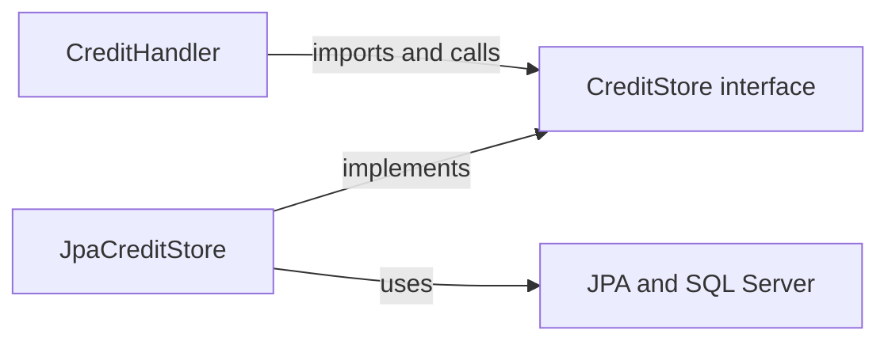

# یادگیری Hexagonal Architecture با سرویس موجودی

[English](../en/Hexagonal-architecture.md) · [معماری](Architecture.md) · [راهنمای کلاس‌های credit](Credit-class-walkthrough.md) · [وضعیت پیاده‌سازی](Implementation-status.md)

## ۱. از یک تغییر دردسرساز شروع کنیم

فرض کنید controller اعتباردهی خودش موجودی را بررسی کند، SQL اجرا کند، posting بسازد و JSON پاسخ را تولید کند. حالا یک batch import همان عملیات را لازم دارد. اگر منطق controller را کپی کنیم، دو نسخه از قواعد مالی خواهیم داشت. اگر batch مستقیماً controller را صدا بزند، به HTTP وابسته می‌شود، درحالی‌که اصلاً درخواست HTTP ندارد. حتی تست یک تصمیم ساده دربارهٔ سقف موجودی هم دیتابیس و وب‌سرور می‌خواهد.

Hexagonal Architecture تصمیم‌های برنامه را از شیوهٔ دریافت درخواست و ذخیرهٔ نتیجه جدا می‌کند. در این پروژه use case اعتباردهی با `CreditStore` کار می‌کند و `JpaCreditStore` جزئیات SQL Server را انجام می‌دهد. درخواست HTTP هم از مسیر `BalanceController` و `BalanceOperations` وارد برنامه می‌شود. تست‌ها می‌توانند همین مرزها را با test double جایگزین کنند.

در الگوی اصلی، برنامه داخل یک مرز قرار دارد. هر port قرارداد یک گفت‌وگوی مشخص با بیرون است و adapter جزئیات فنی آن گفت‌وگو را تبدیل می‌کند. شکل شش‌ضلعی به معنی الزام شش port یا شش لایه نیست. [مقالهٔ اصلی Cockburn](https://alistair.cockburn.us/hexagonal-architecture) تفاوت داخل و بیرون و اصطلاح‌های driving و driven را توضیح می‌دهد.

این راهنما بر اساس سورس فعلی و packageهای مرتب‌شده نوشته شده است. credit و debit با تنظیم صریح فعال می‌شوند؛ transfer تا CBS14 در wiring مرحله‌ای unavailable می‌ماند. [debit ماندگار](Debit-execution.md) همین مدل مرزها را با handler، store و encoder مستقل دنبال می‌کند. حضور یک مسیر در نمودار، پیاده‌سازی مالی کامل آن را ثابت نمی‌کند. [وضعیت فعلی و شواهد](Implementation-status.md) مرجع پیشرفت اجراست.

## ۲. اصطلاح‌ها را دقیق بشناسیم

| اصطلاح | معنی در این پروژه | مثال |
| --- | --- | --- |
| Domain | مقدارها، محاسبات و invariantهای مالی | `Money`، `Account`، `Journal`، `Posting` |
| Application / use case | هماهنگی قواعد دامنه و قابلیت‌های بیرونی برای انجام درخواست | `CreditHandler`، `GetBalanceHandler` |
| Port | قرارداد یک گفت‌وگوی مشخص در مرز برنامه | `CreditStore`، `BalanceReader` |
| Adapter | تبدیل قرارداد برنامه به فناوری یا ورودی بیرونی | `JpaCreditStore`، `BalanceController` |
| Driving / inbound | بخشی که عملیات برنامه را آغاز می‌کند | controller HTTP یا تستی که handler را صدا می‌زند |
| Driven / outbound | بخشی که نیاز برنامه را پاسخ می‌دهد | ذخیره‌سازی یا تولید پاسخ JSON |
| Composition root | محل کنار هم گذاشتن objectهای واقعی و وابستگی‌هایشان | configuration و ثبت componentهای Spring |
| Infrastructure | سازوکارهای فنی اجرای برنامه | JPA، SQL Server و اتصال تراکنش به Spring |
| DTO | نمایش داده برای یک مرز مشخص | `AmountRequest`، `OperationResponse` |
| Projection | نمایش ذخیره‌شده یا خواندنی مشتق از تاریخچهٔ مالی | `accounts.balance` |
| Invariant | شرطی که باید همواره برقرار بماند | توازن postingها و نامنفی‌بودن موجودی مشتری |

Port اینجا شمارهٔ TCP مثل `14333` نیست. همچنین هر port الزاماً یک interface جاوا نیست؛ interface وقتی ارزش دارد که مرز را روشن و قابل‌کنترل کند. یک API مشخص برای فراخوانی use case هم می‌تواند نقش port را داشته باشد. پسوند `Service` یا `Repository` به‌تنهایی نقش معماری کلاس را تعیین نمی‌کند.

## ۳. جهت فراخوانی با جهت وابستگی سورس فرق دارد

در runtime، handler اعتباردهی objectای را صدا می‌زند که کلاس واقعی آن `JpaCreditStore` است. اما وابستگی persistence در سورس handler، interface متعلق به application یعنی `CreditStore` است. پیاده‌سازی SQL هم به همین قرارداد وابسته است.



این همان Dependency Inversion است: use case سطح بالاتر، قابلیت موردنیازش را تعریف می‌کند و پیاده‌سازی فنی با آن سازگار می‌شود. انتقال interface به پوشه‌ای با نام `port` فقط وقتی مؤثر است که نوع‌های ورودی و خروجی و importها همین رابطه را حفظ کنند.

Dependency Injection روش ساخت و اتصال objectهاست. constructor کلاس `CreditHandler` یک `CreditStore` دریافت می‌کند و خودش `JpaCreditStore` نمی‌سازد. Spring هنگام ساخت bean پیاده‌سازی مناسب را تزریق می‌کند. این کار با constructor معمولی جاوا هم ممکن است و الزاماً container نمی‌خواهد. [راهنمای DI در Spring](https://docs.spring.io/spring-framework/reference/core/beans/dependencies/factory-collaborators.html) سازوکار constructor injection را توضیح می‌دهد و [مقالهٔ Fowler](https://martinfowler.com/articles/injection.html) بر جدایی configuration از استفادهٔ وابستگی تأکید دارد.

## ۴. port و adapter واقعی پروژه

| Port | جهت | adapter یا caller واقعی | قرارداد |
| --- | --- | --- | --- |
| [BalanceOperations](../../src/main/java/dev/kavrin/balance/operation/application/BalanceOperations.java) | Inbound | [BalanceController](../../src/main/java/dev/kavrin/balance/operation/web/BalanceController.java) آن را صدا می‌زند | ورودی تایپ‌شدهٔ credit/debit/transfer و استعلام موجودی |
| [BalanceReader](../../src/main/java/dev/kavrin/balance/account/application/BalanceReader.java) | Outbound | [AccountStore](../../src/main/java/dev/kavrin/balance/account/infrastructure/persistence/AccountStore.java) آن را پیاده می‌کند | خواندن projection موجودی با امکان نبود حساب |
| [CreditStore](../../src/main/java/dev/kavrin/balance/operation/application/credit/CreditStore.java) | Outbound | [JpaCreditStore](../../src/main/java/dev/kavrin/balance/operation/infrastructure/persistence/JpaCreditStore.java) آن را پیاده می‌کند | replay، رزرو، قفل، تاریخچه، projection و تکمیل نتیجه |
| [CreditResponseEncoder](../../src/main/java/dev/kavrin/balance/operation/application/credit/CreditResponseEncoder.java) | Outbound | [JsonCreditResponseEncoder](../../src/main/java/dev/kavrin/balance/operation/web/response/JsonCreditResponseEncoder.java) آن را پیاده می‌کند | تولید و بررسی پاسخ ماندگار credit |
| [DebitStore](../../src/main/java/dev/kavrin/balance/operation/application/debit/DebitStore.java) | Outbound | [JpaDebitStore](../../src/main/java/dev/kavrin/balance/operation/infrastructure/persistence/JpaDebitStore.java) آن را پیاده می‌کند | هویت ماندگار debit، state قفل‌شده برای بررسی وجه و persistence اتمیک |
| [DebitResponseEncoder](../../src/main/java/dev/kavrin/balance/operation/application/debit/DebitResponseEncoder.java) | Outbound | [JsonDebitResponseEncoder](../../src/main/java/dev/kavrin/balance/operation/web/response/JsonDebitResponseEncoder.java) آن را پیاده می‌کند | تولید و بررسی پاسخ اصلی debit |

adapter ورودی port را صدا می‌زند و لازم نیست آن را implement کند. اگر `BalanceController` خودش `BalanceOperations` را implement کند، نقطهٔ ورود transport با قرارداد application مخلوط می‌شود. در کد فعلی، bean ساخته‌شده در `HttpAdapterConfiguration.stagedOperations` این interface را به‌شکل anonymous پیاده می‌کند و به handlerهای موجود وصل می‌شود. fallback نبود handler هم همان‌جاست؛ انتقال تا CBS14 مرحله‌ای باقی می‌ماند.

`BalanceService` قرارداد قدیمی bootstrap است و پیاده‌سازی مالی فعال دیگری نیست. `OperationCoordinator` یک مرز تراکنش concrete وابسته به Spring است، نه interface یک port. `AccountEntity` نگاشت persistence است، نه port. `Money` مقدار دامنه است، نه adapter. `ApiExceptionHandler` و `OperationResponses` بخش‌های مرز HTTP هستند و use case مالی جداگانه‌ای ایجاد نمی‌کنند.

## ۵. کوچک‌ترین مثال را بخوانیم

تمام قرارداد استعلام موجودی همین است:

```java
public interface BalanceReader {
    Optional<Money> findBalance(AccountId id);
}
```

`GetBalanceHandler` از این interface موجودی می‌خواهد. `AccountStore` query مربوط به projection را اجرا می‌کند و نتیجه را به `Money` تبدیل می‌کند. خروجی empty یعنی حساب وجود ندارد؛ موجودی صفر برای یک حساب موجود کاملاً معتبر است. شکست query نباید به empty یا صفر تبدیل شود؛ این یک خطای فنی است.

controller شناسهٔ حساب را parse می‌کند، `BalanceOperations.balance` را صدا می‌زند و `BalanceResponse` می‌سازد. DTO مربوط به HTTP و `AccountEntity` وارد قرارداد `BalanceReader` نمی‌شوند. در نتیجه callerهای دیگر مجبور نیستند lifecycle مربوط به JPA یا serialization پاسخ HTTP را بشناسند.

قابلیت `AccountStore.lockAll()` جداست و عضو `BalanceReader` نیست. `JpaCreditStore` آن را مستقیم صدا می‌زند و entityهای مدیریت‌شده را به snapshotهای `CreditStore.LockedAccount` تبدیل می‌کند. این یک وابستگی concrete و آگاهانه بین adapterهای persistence است. قرارداد credit در application همچنان entity مربوط به JPA را برنمی‌گرداند.

## ۶. یک مثال کامل credit

فرض کنیم مشتری فعال IRR موجودی ۵۰۰ ریال دارد، حساب تأمین متناظر از صفر شروع می‌کند، هر دو حساب وجود دارند، سیاست درخواست را مجاز می‌داند و اجرای credit فعال است. این‌ها ورودی آموزشی هستند و fixture تازه‌ای روی دیتابیس اجرا نکرده‌ایم.

```http
POST /api/v1/accounts/10000000-0000-4000-8000-000000000001/credits
Content-Type: application/json

{"transactionId":"hex-credit-001","amountRial":200,"currency":"IRR"}
```

```mermaid
sequenceDiagram
    participant HTTP as HTTP adapter
    participant API as BalanceOperations wiring
    participant H as CreditHandler
    participant TX as OperationCoordinator
    participant S as CreditStore / JpaCreditStore
    participant D as Journal domain model
    participant E as CreditResponseEncoder
    HTTP->>API: credit(command)
    API->>H: handle(command)
    H->>TX: execute replay lookup
    TX->>S: replay(command, fingerprint)
    S-->>H: no retained result, after transaction ends
    H->>H: prepare policy and funding snapshot
    H->>TX: execute writing attempt
    TX->>S: reserve; lock participants
    H->>D: calculate balanced journal and projections
    H->>S: appendJournal; applyProjections
    H->>E: encode outcome
    H->>S: complete with retained response
    TX-->>H: result after confirmed commit
    H-->>HTTP: committed MutationResult
```

نمودار مسئولیت‌ها را گروه‌بندی می‌کند؛ در سورس، callback مربوط به handler متدهای store را داخل تراکنش تحت مالکیت coordinator صدا می‌زند.

1. adapter HTTP شکل ورودی را بررسی و `CreditCommand` را می‌سازد. deserializerهای سخت‌گیرانه مبلغ اعشاری یا تبدیل ضمنی نامعتبر را رد می‌کنند؛ دربارهٔ وجه قابل‌استفاده یا سیاست تصمیم نمی‌گیرند.
2. `CreditHandler` قصد canonical درخواست را می‌سازد و در یک تراکنش تحت مالکیت coordinator نتیجهٔ قبلی را جست‌وجو می‌کند. قصد یکسان پاسخ اصلی را replay می‌کند؛ قصد متفاوت با همان transaction ID تعارض دارد.
3. فقط برای قصد جدید، سیاست اجرا و حساب تأمین انتخاب می‌شود. تغییر سیاست نباید نتیجهٔ ماندگار قبلی را عوض کند.
4. تراکنش نوشتن، عملیات را رزرو می‌کند. اگر مبلغ از سقف مجاز عبور نکند، store همهٔ حساب‌های مشتری و تأمین را با ترتیب مشترک شناسه‌ها قفل می‌کند و سپس state مؤثر در تصمیم را می‌خواند.
5. دامنه یک debit به مبلغ ۲۰۰ برای تأمین و یک credit به مبلغ ۲۰۰ برای مشتری می‌سازد. موجودی مشتری به ۷۰۰ می‌رسد. موجودی حساب تأمین با ماهیت debit-normal برابر مثبت ۲۰۰ می‌شود، نه منفی ۲۰۰؛ اثر debit و credit به دستهٔ حساب وابسته است. موجودی اولیهٔ ۵۰۰ مشتری هم باید تاریخچهٔ معتبر افتتاحیه یا ledger داشته باشد. [راهنمای projection](Journal-projection.md) این محاسبات را باز می‌کند.
6. handler تمام projectionهای پیشنهادی را اعتبارسنجی می‌کند، تاریخچه را می‌نویسد، projectionها را اعمال می‌کند، پاسخ را می‌سازد و عملیات را در همان تراکنش تکمیل می‌کند. `complete()` تغییر state رکورد است و خودش commit نیست.
7. `OperationCoordinator` پس از پایان موفق تراکنش نتیجه را برمی‌گرداند. adapter وب پاسخ ماندگار را با status، content type و body اصلی ارسال می‌کند.

همان درخواست را دوباره بفرستید: مسیر replay، journal یا posting جدیدی نمی‌سازد و موجودی مشتری ۷۰۰ می‌ماند. مبلغ را با همان `hex-credit-001` به ۲۰۱ تغییر دهید: قصد جدید تعارض دارد. با شناسهٔ تازه از سقف مبلغ عبور کنید: مسیر فعلی credit یک رد نهایی ماندگار بدون journal ثبت می‌کند. دیتابیس در دسترس‌نباشد یا serialization شکست بخورد، با خطای فنی روبه‌رو هستیم؛ این همان رد کسب‌وکار نیست.

## ۷. قرارداد port شامل تراکنش هم می‌شود

`CreditStore` فقط مجموعه‌ای از signatureها نیست. JavaDoc می‌گوید همهٔ متدها در تراکنش تحت مالکیت coordinator شرکت می‌کنند و مستقل commit نمی‌کنند. قرارداد `lockAccounts` ترتیب مشترک گرفتن قفل و حفظ آن تا پایان تراکنش را هم دارد. adapter جایگزینی که همان نوع‌های جاوا را برگرداند ولی قفل را زود آزاد کند، قرارداد را نقض کرده است.

coordinator فعلی از `TransactionTemplate`، تراکنش قابل‌نوشتن `READ_COMMITTED` و کنترل صریح نبود تراکنش بیرونی استفاده می‌کند. بدون این کنترل، فراخوانی داخلی ممکن است پیش از commit واقعی caller نتیجه برگرداند. [راهنمای تراکنش برنامه‌ای Spring](https://docs.spring.io/spring-framework/reference/data-access/transaction/programmatic.html) مدل callback و وابستگی صریح آن به Spring را توضیح می‌دهد. قانون مالکیت پروژه در [راهنمای coordinator](Operation-coordinator.md) آمده است.

exception فنی باید از attempt بیرون برود تا rollback انجام شود. رد قابل‌انتظار کسب‌وکار یک نتیجه است که باید همراه رکورد ماندگارش commit شود. برای رزرو، posting یا تکمیل عملیات commit جدا با `REQUIRES_NEW` نگذارید؛ واحد اتمیک مالی شکسته می‌شود. پایان callback، وقتی تراکنش بیرونی مالک commit است، به‌تنهایی موفقیت ماندگار را ثابت نمی‌کند.

بازیابی رزرو تکراری پس از خروج از تراکنش شکست‌خورده انجام می‌شود. retry/backoff عمومی و بازیابی کامل commit نامطمئن هنوز تکمیل نشده‌اند. ساختار hexagonal خودش این قابلیت‌ها را تولید نمی‌کند. [اجرای credit](Credit-execution.md) را ببینید.

## ۸. هر مسئولیت کجا قرار می‌گیرد؟

| مسئولیت | محل فعلی یا قاعدهٔ پیشنهادی |
| --- | --- |
| شکل JSON، متن UUID، media type و problem response | adapter HTTP |
| مثبت‌بودن مبلغ command و متفاوت‌بودن حساب‌های transfer | اعتبارسنجی command |
| ارز مجاز، سقف‌ها و انتخاب ماندگار حساب تأمین | سیاست application |
| توازن journal و محاسبهٔ projection بر اساس دستهٔ حساب | Domain |
| تقدم replay و مسیر موفقیت یا رد | handler در application |
| SQL، `UPDLOCK,HOLDLOCK`، entity و جزئیات driver | adapter persistence |
| lifecycle تراکنش | coordinator فعلی Spring برای کل attempt مالی |
| قید رکوردهای کسب‌وکار | دامنه و application همراه safeguardهای SQL و تست مشترک |
| هویت، authorization و مالکیت حساب | مرزهای معتبر ورود و use case هنگام پیاده‌سازی؛ دسترسی فعلی محلی است و جریان auth کامل ندارد |

اعتبارسنجی در چند مرز می‌تواند درست باشد، چون هدف هرکدام فرق دارد. HTTP شکل نمایش داده را بررسی می‌کند، دامنه معنای مالی را و SQL واقعیت ذخیره‌شده را در برابر writer نامعتبر محافظت می‌کند. وقتی مسئولیت روشن باشد، این هم‌پوشانی مفید است. interface جای unique constraint، محاسبات checked یا reconciliation را نمی‌گیرد.

## ۹. پیاده‌سازی فعلی چقدر مستقل است؟

دامنه از Spring، JPA و HTTP مستقل است؛ تمام application چنین استقلالی ندارد. handlerها annotation و exceptionهای Spring را می‌شناسند و coordinator از API تراکنش Spring استفاده می‌کند. در طراحی سخت‌گیرانه‌تر می‌توان port اجرای تراکنش ساخت و خطاهای infrastructure را در adapter تبدیل کرد. این یک refactor اختیاری با هزینهٔ نگه‌داری است و شرط بازِ صحت مالی پروژه محسوب نمی‌شود.

`CreditResponseEncoder` هم آگاهانه HTTP-aware است. خروجی `StoredResponse` شامل status، content type و بایت‌های پاسخ است، چون replay دقیق پاسخ نیاز پروژه است. adapter آیندهٔ gRPC یا batch می‌تواند از use case مالی استفاده کند، اما قرارداد خروجی‌اش باید مرور شود؛ پاسخ ماندگار HTTP خودبه‌خود پاسخ بومی آن transport نیست. گزینهٔ دیگر، نگه‌داری نتیجهٔ مستقل از transport کنار نمایش نسخه‌دار هر transport است.

عوض‌کردن دیتابیس هم بی‌هزینه نیست. adapter تازه باید رفتارهای مورداتکای فعلی را حفظ کند: یکتایی شناسه، مقایسهٔ بایت canonical، ترتیب حساب‌ها، محافظت کلید غایب، permission، atomicity و نتیجهٔ ماندگار. مهاجرت به PostgreSQL مثلاً طراحی هم‌زمانی و تست واقعی دیتابیس می‌خواهد؛ تغییر JDBC URL کافی نیست.

## ۱۰. اندازهٔ مناسب port را چطور انتخاب کنیم؟

قابلیت موردنیاز caller و نیاز سازگاری آن، مرز را تعیین می‌کند. `BalanceReader` کوچک است چون use case خواندن فقط یک projection می‌خواهد. `CreditStore` بزرگ‌تر است چون رزرو، state قفل‌شده، تاریخچه و تکمیل نتیجه یک workflow هماهنگ دارند.

یک `Repository<T>` عمومی با تمام CRUDها نسازید. چنین APIای می‌تواند حذف posting تغییرناپذیر یا ذخیرهٔ مستقل حساب را کار عادی جلوه دهد. از طرف دیگر، interface جدا برای هر متد ممکن است شروط یک تراکنش را بین objectهای زیادی پخش کند. اگر بعداً مصرف‌کننده‌های مستقل پیدا شدند، شکستن `CreditStore` می‌تواند مفید باشد؛ تمام portهای حاصل باید قرارداد تراکنش مشترک را حفظ کنند.

حتی با یک پیاده‌سازی، interface می‌تواند ارزش داشته باشد اگر منطق مالی را از SQL جدا کند یا جایگزینی معنادار در تست بدهد. برای محاسبهٔ داخلی ساده صرفاً با تصور آینده interface نسازید. DTO، port و mapping باید یک مرز واقعی را توضیح بدهند. نام package به‌تنهایی دسترسی ماژول‌ها را کنترل نمی‌کند.

port را یک API معنایی بدانید: نبود داده، ترتیب، idempotency، timeout و خطا را هم تعریف کنید، نه فقط نوع پارامترها را. پیاده‌سازی تازه باید با همین شروط قابل‌جایگزینی باشد. قرارداد را همراه caller و تست‌هایش تغییر دهید؛ تغییر فیلد خروجی یا enum ممکن است روی نسخهٔ پاسخ ماندگار و retry قدیمی اثر بگذارد. در تغییر سازگاری، فرمت canonical قدیمی را بازنویسی یا نتیجهٔ اصلی را دوباره محاسبه نکنید.

## ۱۱. wiring و جایگزین‌های تست

ثبت componentها در Spring، `JpaCreditStore` و `JsonCreditResponseEncoder` را به `CreditHandler` می‌رساند. تنظیم شرطی اجرا تعیین می‌کند beanهای credit در دسترس باشند یا نه. `HttpAdapterConfiguration` مرز application و fallbackهای مرحله‌ای را متصل می‌کند. configuration مجاز است objectهای concrete را بشناسد؛ وظیفه‌اش همین اتصال است.

اگر چند adapter یک port را implement کردند، انتخاب را با configuration، profile یا qualifier صریح کنید. وقتی SQL Server در دسترس نیست، نباید بی‌سروصدا یک store مالی حافظه‌ای انتخاب شود. test double متعلق به assembly مشخص تست است.

[CreditHandlerTests](../../src/test/java/dev/kavrin/balance/operation/application/credit/CreditHandlerTests.java) از mock پورت‌های persistence و encoding و یک transaction manager ثبت‌کنندهٔ Spring استفاده می‌کند. این تست‌ها تصمیم application و تعامل با lifecycle تراکنش را بدون SQL Server بررسی می‌کنند. manager ثبت‌کننده چیزی را واقعاً durable نمی‌کند. configuration مخصوص smoke هم فقط مرز HTTP را بدون persistence تولید وارد می‌کند؛ برای startup مفید است، اما سیستم مالی کامل را اثبات نمی‌کند.

## ۱۲. هر ادعا چه تستی می‌خواهد؟

| مرز تست | چه چیزی را بررسی کنیم؟ | به‌تنهایی چه چیزی را ثابت نمی‌کند؟ |
| --- | --- | --- |
| Domain | توازن journal، علامت projection، overflow و حدود | ذخیره‌سازی و هم‌زمانی دیتابیس |
| Handler | replay پیش از سیاست، رد بدون تاریخچه و انتشار شکست | rollback واقعی SQL و طول عمر قفل |
| HTTP slice | parsing، نگاشت command و serialization پاسخ و خطا | اجرای واقعی credit |
| adapter روی SQL Server | query بومی، نوع‌ها، قیدها، قفل و permission | تمام سناریوهای خرابی چند instance |
| مسیر کامل HTTP تا دیتابیس | اتمیک‌بودن نتیجه، تاریخچه و projection و replay ماندگار | ظرفیت production یا تمام قطعی‌ها |
| کنترل معماری، در صورت اضافه‌شدن | import ممنوع و چرخهٔ ماژول‌ها | صحت مالی |

Contract test می‌تواند انتظارهای رفتاری مشترک را روی adapter حافظه‌ای و واقعی اجرا کند. همچنان باید تست مخصوص فناوری برای locking، isolation و نوع‌های driver داشته باشیم. mock رفتار SQL Server را ثابت نمی‌کند. mapping فعلی `Tuple` و named binding در `AccountStore`، regression کامل SQL Server را در CBS13 گذراند؛ [شواهد debit](Debit-execution.md) اجرای تازهٔ ۳۵۱ تست مستقل و ۱۳۴ تست SQL Server را ثبت می‌کند. محاسبهٔ journal به مبلغ ۲۰۰ ریال با کلاس‌های کامپایل‌شدهٔ فعلی دامنه بررسی شد: مشتری از ۵۰۰ به ۷۰۰ و تأمین از صفر به ۲۰۰ رسید. این بررسی هیچ نوشتنی در دیتابیس نداشت؛ مثال‌های replay و تراکنش، مرور مسیر سورس هستند و سناریوی integration تازه‌اجراشده نیستند.

## ۱۳. توسعه‌های بیرون از دامنهٔ فعلی پروژه

مثال‌های این بخش پیشنهاد طراحی هستند و پیاده‌سازی موجود نیستند:

| نیاز | مرز ممکن | پرسش حیاتی |
| --- | --- | --- |
| CLI یا batch زمان‌بندی‌شده | adapter ورودی تازه روی use case موجود | actor مجاز کیست و transaction ID پایدار چگونه ساخته می‌شود؟ |
| سرویس پرداخت بیرونی | port پرداخت متعلق به application و adapter HTTP | timeout پیش از پذیرش پرداخت رخ داده یا بعد از آن؟ |
| ساعت یا تولید شناسه | قابلیت `Clock` یا تولید ID وقتی عدم‌قطعیت مهم است | مقدار باید در retry ثابت بماند؟ |
| ارسال اعلان | port اعلان و adapter provider | شکست ارسال پس از commit پول چه معنایی دارد؟ |
| رویداد و Kafka | persistence مربوط به outbox و adapterهای publisher و consumer | commit دیتابیس و انتشار چگونه هماهنگ و duplicateها چگونه حذف اثر می‌شوند؟ |
| Cache | adapter یا decorator خواندن با سیاست صریح تازگی | دادهٔ قدیمی می‌تواند اجازهٔ نوشتن مالی بدهد؟ |

ایمیل، Kafka و SQL خودبه‌خود عضو یک تراکنش محلی نیستند. در outbox آینده، قصد انتشار همراه commit مالی ذخیره می‌شود، انتشار بعداً انجام می‌شود و consumer باید duplicate را بدون اثر تکراری مدیریت کند. Saga چند تراکنش محلی و اقدام جبرانی کسب‌وکار را هماهنگ می‌کند؛ تضمین اتمیک انتقال در تراکنش واحد فعلی را نمی‌دهد. authentication باید تمام adapterهای ورودی، از جمله batch و پیام‌رسانی را پوشش بدهد. adapter تازه نباید راه دورزدن کنترل مالکیت باشد.

Anti-corruption layer واژه‌ها و قواعد provider بیرونی را به مدل خود برنامه تبدیل می‌کند؛ کارش فراتر از عوض‌کردن نام فیلد JSON است. تماس کند شبکه‌ای را بیرون تراکنش قفل حساب نگه دارید، مگر اینکه پروتکل مرورشده خلاف آن را لازم بداند. decorator مربوط به metric یا cache باید معنای شکست و سازگاری port را حفظ کند. adapter از نوع singleton نباید entity مدیریت‌شدهٔ یک درخواست را برای تراکنش‌های بعدی نگه دارد.

برای adapter بیرونی deadline تعیین کنید، retry را محدود کنید و cancellation را منتقل کنید. رد دائمی، شکست قابل‌retry و نتیجهٔ نامطمئن را جدا تشخیص دهید. correlation ID، شناسهٔ عملیات و latency مفیدند؛ password یا payload محرمانه را log نکنید. پیش از cache یا تفکیک سرویس، latency adapter، انتظار قفل و اشباع connection pool را اندازه بگیرید.

## ۱۴. الگوهای مرتبط و اشتباه‌های رایج

معماری لایه‌ای مسئولیت‌ها را عمودی مرتب می‌کند؛ hexagonal روی مرز برنامه و جهت وابستگی تمرکز دارد. این دو می‌توانند کنار هم باشند. Clean و Onion هم ایدهٔ وابستگی رو به داخل دارند، ولی سازمان‌دهی خودشان را پیشنهاد می‌کنند. DDD دربارهٔ مدل‌سازی دامنه و bounded context هم صحبت می‌کند. CQRS مدل command و query را جدا می‌کند؛ در این پروژه دیتابیس مشترک و projection هم‌زمان است. Aggregate مرز سازگاری دامنه است و bounded context مالک یک مدل و زبان مشخص است؛ هیچ‌کدام خودبه‌خود با package جاوا یا port یکی نیست. تراکنش این سرویس می‌تواند چند snapshot حساب و تاریخچهٔ ledger را هماهنگ کند. Unit of work تغییرهای مرتبط persistence را دنبال می‌کند، ولی همچنان مالک صریح تراکنش و پروتکل commit می‌خواهد. هیچ‌کدام الزام microservice یا event sourcing ایجاد نمی‌کنند. posting تغییرناپذیر به‌تنهایی برنامه را event-sourced نمی‌کند.

در review این خطاها را پیدا کنید:

- handler، DTO مربوط به controller، entity مربوط به JPA یا store concrete را import می‌کند.
- port خروجی بدون trade-off روشن، `EntityManager`، object پاسخ HTTP یا کلاس SDK فروشنده را بیرون می‌دهد.
- controller وجه را بررسی یا بخشی از عملیات مالی را مستقل commit می‌کند.
- جایگزین تست، نگه‌داری رد نهایی، مالکیت تراکنش یا رفتار شناسهٔ تکراری را نادیده می‌گیرد.
- exception دیتابیس به «حساب پیدا نشد»، موجودی صفر یا پاسخ موفق تبدیل می‌شود.
- retry بدون شناسهٔ پایدار یا پروتکل recovery، اثر بیرونی را تکرار می‌کند.
- برای هر helper کوچک port ساخته‌ایم، ولی فرض‌های اصلی سازگاری را ننوشته‌ایم.
- adapter پیام‌رسانی authorization را دور می‌زند، چون فقط HTTP فیلتر امنیتی دارد.

## ۱۵. تمرین و پرسش‌های review

1. مسیر `GET .../balance` را از controller تا `BalanceReader` دنبال کنید. چه نوع‌هایی از هر مرز رد می‌شوند؟ چرا empty با صفر فرق دارد؟
2. credit به مبلغ ۲۰۰ ریال و retry آن با همان ID را دنبال کنید. مالک هر تصمیم، نوشتن SQL و commit کدام جزء است؟
3. یک adapter اعتباردهی CLI پیشنهاد دهید که `BalanceController` را import نکند. پاسخ ماندگار HTTP را چطور به کاربر CLI نشان می‌دهید؟
4. یک contract test مشترک برای `CreditStore` طراحی کنید. چه چیزهایی با fake روشن می‌شوند و چه چیزهایی SQL Server واقعی با چند connection و قفل لازم دارند؟
5. یک port اجرای تراکنش به‌عنوان گزینهٔ سخت‌گیرانه‌تر از coordinator concrete رسم کنید. کدام وابستگی حذف می‌شود و کدام تضمین‌ها باید بمانند؟ فقط برای متقارن‌شدن نمودار آن را پیاده نکنید.

پیش از ساخت port، گفت‌وگو، مالک قرارداد، نوع ورودی و خروجی، دستهٔ شکست‌ها، نیاز تراکنش و سازگاری و مصرف‌کننده را مشخص کنید. پیش از پذیرش adapter، حفظ همین معنا زیر شکست را بررسی کنید؛ compileشدن کافی نیست. برای ادعای استقلال معماری، importها و فرض‌های runtime را با هم ببینید.

## مطالعهٔ تکمیلی

منابع هر مفهوم کنار همان بخش لینک شده‌اند و در ۲۰۲۶-۱۰-۲۵ مرور شدند. برای تمرین بیشتر در پروژه، [جریان عملیات](Operation-flow.md)، [طراحی canonical](Canonical-design.md)، [مالکیت تراکنش](Operation-coordinator.md)، [قواعد ledger](Ledger.md) و [تست SQL Server](SQL-server-tests.md) را بخوانید. این راهنما طراحی را آموزش می‌دهد؛ [وضعیت پیاده‌سازی](Implementation-status.md) مرجع تحویل و محدودیت شواهد است.
