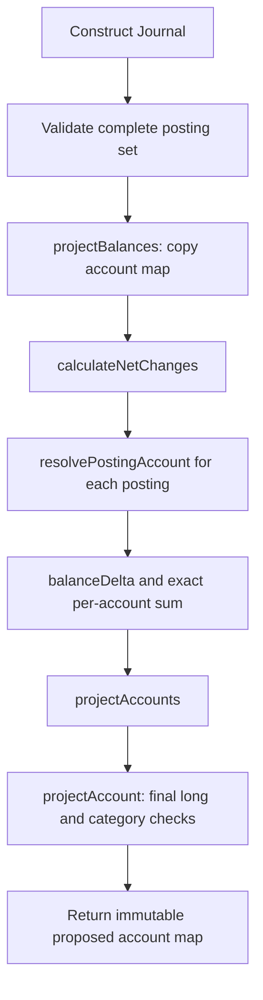

# راهنمای record مربوط به Journal و محاسبهٔ مانده

[English](../en/Journal-projection.md) · [طراحی دفترکل](Ledger.md) · [بدهکار و بستانکار](Debit-and-credit.md)

این راهنما پیاده‌سازی فعلی [Journal.java](../../src/main/java/dev/kavrin/balance/ledger/domain/Journal.java) را دنبال می‌کند: چگونه یک مجموعهٔ معتبر از سطرهای حسابداری به مانده‌های پیشنهادی تبدیل می‌شود. مبلغ‌ها مستقیم برحسب ریال‌اند. محاسبهٔ دامنه پیاده شده؛ تراکنش مالی دیتابیس هنوز در برنامه است.

## این record چه چیزی را نگه می‌دارد؟

```java
public record Journal(List<Posting> postings)
```

`Journal` همهٔ postingهای یک ثبت حسابداری را گروه‌بندی می‌کند. هر `Posting` یک سطر بدهکار یا بستانکار برای یک حساب با مبلغ مثبت `Money` است. record فعلی یک مؤلفه به نام `postings` دارد که با متد تولیدشدهٔ `postings()` خوانده می‌شود. Java متدهای `equals`، `hashCode` و `toString` را هم تولید می‌کند. ترتیب فهرست در برابری دو Journal اثر دارد، هرچند نتیجهٔ خالص projection به ترتیب سطرها وابسته نیست.

بلوک `public Journal { ... }` سازندهٔ فشرده یا compact constructor است. ورودی‌ها را پیش از ساخت record بررسی می‌کند. عبارت `postings = List.copyOf(postings)` ورودی را با یک کپی غیرقابل‌تغییر جایگزین می‌کند؛ Java پس از پایان سازنده همان مقدار اعتبارسنجی‌شده را در فیلد record می‌گذارد. record به‌تنهایی فهرست ورودی را تغییرناپذیر نمی‌کند. در اینجا کپی فهرست و تغییرناپذیری Posting، AccountId و Money از تغییر بعدی مجموعه جلوگیری می‌کنند.

سازنده حداقل دو posting غیرnull، ارز یکسان و تساوی جمع بدهکار و بستانکار را لازم می‌داند. سازندهٔ Posting جداگانه فیلدهای لازم و مثبت‌بودن مبلغ را کنترل می‌کند. جمع‌ها `BigInteger` هستند چون مجموع چند مبلغ معتبر long می‌تواند از long بزرگ‌تر شود. ساخت Journal وجود حساب، کفایت موجودی یا ارز حساب را بررسی نمی‌کند؛ برای آن‌ها snapshot حساب‌ها لازم است.

این record فعلاً شناسهٔ journal، شناسهٔ عملیات، زمان یا annotation مربوط به persistence ندارد. header دیتابیسی و ارتباط آن با عملیات هنوز باید پیاده شوند. ساخت این record عملیات مالی ذخیره‌شده ایجاد نمی‌کند و معتبر بودن تاریخچهٔ ماندهٔ اولیهٔ حساب را ثابت نمی‌کند.

## مثال: یک مشتری در دو سطر

مشتری A ابتدا ۵۰ ریال و حساب داخلی تأمین صفر دارد. journal کامل زیر را می‌سازیم:

| سطر | حساب | سمت | مبلغ | اثر بر همان حساب |
| --- | --- | --- | ---: | ---: |
| ۱ | مشتری A با ماهیت بستانکار | بدهکار | ۱۰۰ | منفی ۱۰۰ |
| ۲ | مشتری A با ماهیت بستانکار | بستانکار | ۱۵۰ | مثبت ۱۵۰ |
| ۳ | تأمین با ماهیت بدهکار | بدهکار | ۵۰ | مثبت ۵۰ |

جمع بدهکار ۱۵۰ و جمع بستانکار ۱۵۰ است؛ ساخت journal موفق می‌شود. ماندهٔ پیشنهادی مشتری از محاسبهٔ ۵۰ منهای ۱۰۰ به‌علاوهٔ ۱۵۰، برابر ۱۰۰ است. ماندهٔ تأمین هم ۵۰ می‌شود. بررسی سطر اول به‌تنهایی، ماندهٔ موقت منفی ۵۰ را به‌اشتباه رد می‌کند. واحد محاسبه، journal کامل است.

این مثال آموزشی رفتار journal چندسطری را نشان می‌دهد. عملیات عمومی تازه یا استثنایی برای سیاست رد انتقال به همان حساب نیست.

## جریان اجرای projectBalances



متد عمومی مراحل اصلی را کنار هم نشان می‌دهد:

```java
public Map<AccountId, Account> projectBalances(Map<AccountId, Account> accounts) {
    Map<AccountId, Account> snapshots = Map.copyOf(accounts);
    Map<AccountId, BigInteger> netChanges = calculateNetChanges(snapshots);
    return projectAccounts(snapshots, netChanges);
}
```

کلید map ورودی AccountId و مقدار آن snapshot تغییرناپذیر همان Account است. `Map.copyOf` یک map ثابت برای این محاسبه می‌سازد و map، کلید یا مقدار null را رد می‌کند. این کپی snapshot دیتابیس یا ابزار کنترل هم‌زمانی نیست. فراخوان باید حساب‌های فعلی را طبق سیاست قفل تراکنش تهیه کند؛ تغییر هم‌زمان map هنگام کپی پشتیبانی نمی‌شود.

| مرحله | مسئولیت | نتیجه در مثال |
| --- | --- | --- |
| `resolvePostingAccount` | پیدا کردن حساب، بررسی تطابق کلید و شناسه، تطابق ارز حساب و posting | دو سطر به A و سطر سوم به تأمین وصل می‌شوند |
| `calculateNetChanges` | گرفتن balanceDelta با نوع حساب واقعی و جمع دقیق تغییرات با BigInteger | تغییر A مثبت ۵۰؛ تأمین مثبت ۵۰ |
| `projectAccount` | جمع تغییر خالص با ماندهٔ اصلی، تبدیل دقیق نتیجه به long و ساخت Account معتبر | A برابر ۱۰۰؛ تأمین برابر ۵۰ |
| `projectAccounts` | ساخت همهٔ snapshotها و برگرداندن map تغییرناپذیر پس از اعتبارسنجی همگی | دو حساب پیشنهادی |

عبارت `netChanges.merge(account.id(), delta, BigInteger::add)` اولین تغییر حساب را ذخیره می‌کند و تغییرهای بعدی همان حساب را به آن اضافه می‌کند. در مثال، مقدار A در این map موقت ابتدا منفی ۱۰۰ و سپس مثبت ۵۰ می‌شود. این map ماندهٔ حساب یا نوشتن در دیتابیس نیست.

سازندهٔ Account نهایی قواعد نوع حساب، از جمله نامنفی‌بودن موجودی مشتری را کنترل می‌کند. حساب‌های اصلی و map فراخوان تغییر نمی‌کنند. خروجی فقط شرکت‌کنندگان posting را دارد؛ حتی حسابی با تغییر خالص صفر در آن می‌ماند. حساب اضافهٔ ورودی حذف می‌شود. ترتیب پیمایش خروجی مشخص نیست و نباید مبنای ترتیب قفل قرار بگیرد.

## چرا تغییر خالص هم BigInteger است؟

فرض کنید ماندهٔ علامت‌دار تأمین از Long.MIN_VALUE به Long.MAX_VALUE برسد:

```text
Old balance: -9,223,372,036,854,775,808
Net change: +18,446,744,073,709,551,615
New balance: 9,223,372,036,854,775,807
```

هر دو مانده در long جا می‌شوند ولی تغییر خالص جا نمی‌شود. چند posting با مبلغ مثبت long و سمت مقابل متوازن می‌توانند این تغییر را بسازند. تبدیل زودهنگام تغییر خالص به long، ماندهٔ نهایی قابل‌نمایش را رد می‌کند. پس `projectAccount` جمع را با BigInteger انجام می‌دهد و فقط روی نتیجهٔ نهایی `longValueExact()` را صدا می‌زند. خروج نتیجه از محدودهٔ long خطای ArithmeticException می‌دهد. این مثال مرز نمایش عدد را می‌سنجد؛ سقف مجاز تراکنش کسب‌وکار را تعیین نمی‌کند.

## مثال کامل قابل‌اجرا

کد Java 21 زیر از کلاس‌های فعلی پروژه استفاده می‌کند. snapshotها نمایشی‌اند و جای ثبت افتتاحیهٔ ذخیره‌شده را نمی‌گیرند.

```java
import java.util.Currency;
import java.util.List;
import java.util.Map;
import java.util.UUID;

import dev.kavrin.balance.account.domain.Account;
import dev.kavrin.balance.account.domain.AccountCategory;
import dev.kavrin.balance.account.domain.AccountId;
import dev.kavrin.balance.ledger.domain.Journal;
import dev.kavrin.balance.ledger.domain.Posting;
import dev.kavrin.balance.ledger.domain.PostingSide;
import dev.kavrin.balance.money.Money;

public class JournalProjectionDemo {
    public static void main(String[] args) {
        var irr = Currency.getInstance("IRR");
        var customerId = new AccountId(UUID.fromString(
                "10000000-0000-0000-0000-000000000001"));
        var fundingId = new AccountId(UUID.fromString(
                "00000000-0000-0000-0000-000000000002"));

        var customer = new Account(customerId,
                AccountCategory.CUSTOMER_LIABILITY, new Money(50, irr));
        var funding = new Account(fundingId,
                AccountCategory.FUNDING_CLEARING, new Money(0, irr));
        var accounts = Map.of(customerId, customer, fundingId, funding);

        var journal = new Journal(List.of(
                new Posting(customerId, PostingSide.DEBIT, new Money(100, irr)),
                new Posting(customerId, PostingSide.CREDIT, new Money(150, irr)),
                new Posting(fundingId, PostingSide.DEBIT, new Money(50, irr))
        ));
        var proposedAccounts = journal.projectBalances(accounts);

        System.out.println("Customer before: " + customer.balance().amount());
        System.out.println("Customer proposed: "
                + proposedAccounts.get(customerId).balance().amount());
        System.out.println("Funding proposed: "
                + proposedAccounts.get(fundingId).balance().amount());
    }
}
```

بعد از کامپایل پروژه، کد را در `/tmp/JournalProjectionDemo.java` ذخیره کنید و با Java 21 از ریشهٔ مخزن اجرا کنید:

```sh
java --class-path target/classes /tmp/JournalProjectionDemo.java
```

خروجی مورد انتظار:

```text
Customer before: 50
Customer proposed: 100
Funding proposed: 50
```

## خطاها و مرز تراکنش

| وضعیت | رفتار فعلی |
| --- | --- |
| map، کلید یا snapshot برابر null | NullPointerException هنگام کپی map |
| حساب posting در map نیست | IllegalArgumentException |
| کلید map با شناسهٔ حساب فرق دارد | IllegalArgumentException |
| ارز posting و حساب فرق دارد | IllegalArgumentException |
| ماندهٔ نهایی مشتری منفی است | IllegalArgumentException از اعتبارسنجی نوع Account |
| ماندهٔ نهایی از هر سمت از long خارج است | ArithmeticException |

اگر یک حساب نامعتبر باشد، متد map خروجی برنمی‌گرداند و snapshotهای اصلی تغییر نمی‌کنند. ممکن است پیش از خطا، شیءهای موقتی درون متد ساخته شده باشند؛ نتیجهٔ جزئی منتشر نمی‌شود. این رفتار rollback دیتابیس نیست و نگاشت HTTP یا ثبت رد نهایی کسب‌وکار را انجام نمی‌دهد.

اتصال آینده باید هویت عملیات را تعیین کند، همهٔ حساب‌ها را با ترتیب مشترک قفل کند، مانده‌های فعلی را بگیرد، journal و projection را بسازد و postingها، projectionها و موفقیت نهایی را در یک تراکنش مالی ذخیره کند. Replay نباید posting تازه بسازد. مجوز، اعتبارسنجی command، سقف کسب‌وکار و نتیجهٔ رد برای حساب غایب مرزهای بررسی‌شدهٔ خود را دارند. صرف فراخوانی projectBalances این تضمین‌ها را ایجاد نمی‌کند.

## اعتبارسنجی و نگهداری سند

[JournalProjectionTests](../../src/test/java/dev/kavrin/balance/ledger/domain/JournalProjectionTests.java) مثال بالا، استقلال از ترتیب، اثر نوع حساب، ماندهٔ منفی و سرریز موقت، تغییر بزرگ‌تر از long، سرریز نهایی، اعتبارسنجی حساب و خروجی تغییرناپذیر را پوشش می‌دهد. [JournalTests](../../src/test/java/dev/kavrin/balance/ledger/domain/JournalTests.java) ساخت مجموعهٔ posting را می‌سنجد. آخرین اجرای متمرکز بازآرایی ۳۶ تست دفترکل را بدون failure، error یا skip گذراند؛ اجرای کامل پیش از آن ۹۲ تست داشت. این‌ها دو اجرای جدا هستند و شواهد SQL Server نیستند.

هر زمان قواعد، جریان helperها، API، رفتار خطا یا مسئولیت persistence در Journal، Posting، Account و تست‌های projection تغییر کرد، این راهنما و نسخهٔ انگلیسی آن را هماهنگ کنید. در صورت تأثیر تغییر، مثال را دوباره اجرا کنید. رفتار پیاده‌شده را از اتصال برنامه‌ریزی‌شده جدا نگه دارید و شواهد را دقیق بنویسید. AGENTS.md مخزن این الزام نگهداری را ثبت می‌کند.

## پیاده‌سازی persistence و query در CBS10، ۲۰۲۶-۱۰-۲۳

نگاشت چهار جدول روی V1 بدون تغییر validate می‌شود. استعلام موجودی اکنون query projection از SQL Server در تراکنش read-only و HTTP واقعی است؛ mutation همچنان fallback برابر 503 دارد. fixture افتتاحیه فقط در تست، canonical intent، history متوازن، هر دو projection و موفقیت را اتمیک commit می‌کند؛ سه خطای تزریقی در مرز نوشتن کامل rollback می‌شوند. قفل بومی JPA تا پایان تراکنش دارنده حفظ و state قدیمی مدیریت‌شده refresh می‌شود. اجرای کامل ۲۴۰ تست مستقل از زیرساخت و ۱۰۳ تست SQL Server را بدون failure، error یا skip در ۲۳٫۷۶۰ ثانیه گذراند. [Persistence.md](Persistence.md) را ببینید. گام بعد CBS11–12، credit/coordinator/replay ماندگار است؛ پذیرش رسمی یادگیری جداست.
