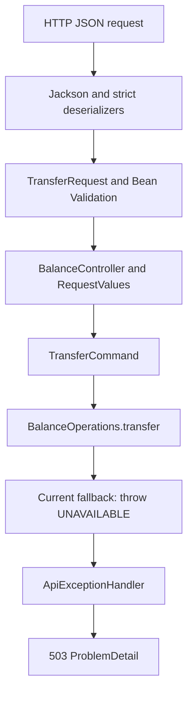
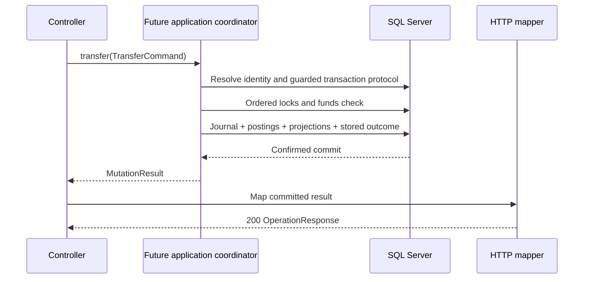

> به‌روزرسانی persistence: [شواهد CBS10](Persistence.md) اکنون نگاشت JPA، fixture افتتاحیهٔ committed و route موجودی SQL Server را تأیید می‌کند. mutation هنوز unavailable است. گفته‌های قبلی دربارهٔ 503 برای همهٔ routeها و شواهد فقط schema در ادامه تاریخی‌اند.

# راهنمای عملیات از JSON تا پاسخ HTTP

[English](../en/Operation-flow.md) · [قرارداد API](API-v1.md) · [نتیجهٔ کسب‌وکار](Operation-outcomes.md) · [شواهد adapter](HTTP-adapter-evidence.md)

این راهنما feature موسوم به `operation` را مطابق کد ۲۰۲۶-۱۰-۲۳ توضیح می‌دهد. یک انتقال را دنبال می‌کنیم تا مسئولیت هر نوع، دلیل جداسازی لایه‌ها و جای تراکنش آیندهٔ SQL Server روشن شود. لینک هر بخش به کد مربوط می‌رسد.

## ۱. یک انتقال مشخص

اپراتور محلی درخواست انتقال ۱۰۰ ریال از حساب A به حساب B را می‌فرستد:

```http
POST /api/v1/transfers
Content-Type: application/json

{
  "transactionId": "Tx-001",
  "sourceAccountId": "00000000-0000-0000-0000-000000000001",
  "destinationAccountId": "00000000-0000-0000-0000-000000000002",
  "amountRial": 100,
  "currency": "IRR"
}
```

برای مثال مالیِ آینده فرض می‌کنیم setup مبتنی بر journal، موجودی A را ۱۰۰۰ و B را ۳۰۰ ریال ساخته است. موفقیت انتقال باید A را به ۹۰۰ و B را به ۴۰۰ برساند. این اعداد توضیح طراحی‌اند، نه رفتار فعلی برنامه. افتتاح حساب و journalهای آن setup داخلی جداگانه است و endpoint انتقال آن را انجام نمی‌دهد.

امروز برنامه درخواست را parse و اعتبارسنجی می‌کند و `TransferCommand` می‌سازد. پیاده‌سازی پیش‌فرض برنامه سپس خطای عدم دسترسی می‌دهد و پاسخ واقعی 503 است. حسابی خوانده نمی‌شود، شناسه‌ای رزرو نمی‌شود و پولی جابه‌جا نمی‌شود. تست قرارداد برای بررسی نگاشت موفقیت و رد، نتیجهٔ برنامه را با test double تأمین می‌کند.



این نمودار اتصال فعلی را نشان می‌دهد. ادامهٔ ماندگار SQL Server در بخش جداگانه با برچسب طراحی آینده آمده است.

## ۲. چهار ورودی feature

[BalanceController](../../src/main/java/dev/kavrin/balance/operation/web/BalanceController.java) هر چهار مسیر را دریافت می‌کند:

| مسیر | ورودی | مسئولیت نهایی |
| --- | --- | --- |
| `POST /api/v1/accounts/{accountId}/credits` | حساب در path و AmountRequest در body | افزایش موجودی مشتری با حساب مقابل تأمین منتخب سرور |
| `POST /api/v1/accounts/{accountId}/debits` | حساب در path و AmountRequest در body | کاهش موجودی با بررسی وجه و حساب مقابل منتخب سرور |
| `POST /api/v1/transfers` | TransferRequest در body | انتقال اتمیک بین دو حساب متمایز |
| `GET /api/v1/accounts/{accountId}/balance` | حساب در path؛ بدون body | خواندن projection موجودی commit‌شده |

سه mutation فضای مشترک شناسهٔ تراکنش خواهند داشت. تغییر مسیر یا payload با شناسهٔ قبلی باید conflict بدهد. استعلام موجودی تغییری ایجاد نمی‌کند و شناسهٔ تراکنش نمی‌خواهد. هر چهار handler پیش‌فرض فعلاً عدم دسترسی می‌دهند. فرض اپراتور محلی مورداعتماد پابرجاست؛ احراز هویت، مالکیت و نقش در CBS24–25 اضافه می‌شوند.

## ۳. Deserialization و حفظ نوع ورودی

[AmountRequest](../../src/main/java/dev/kavrin/balance/operation/web/AmountRequest.java) سه فیلد transactionId، amountRial و currency دارد. [TransferRequest](../../src/main/java/dev/kavrin/balance/operation/web/TransferRequest.java) دو فیلد sourceAccountId و destinationAccountId را اضافه می‌کند. این recordهای تغییرناپذیر متعلق به HTTP هستند و از command برنامه و entity ذخیره‌سازی جدا می‌مانند.

نام `amountRial` واحد را روشن می‌کند: 100 یعنی ۱۰۰ ریال، بدون ضرب در ۱۰۰ و بدون تعبیر تومان. `currency` همراه مبلغ وارد `Money` می‌شود. سیاست اجرای اولیه همچنان IRR است. شناخت کد ارز دیگر در parser آن ارز را فعال نمی‌کند؛ پیش از فعال‌کردن باید واحد و قرارداد API مرور شود.

Jackson پیش از Bean Validation مقدار DTO را می‌سازد. پس annotation اعتبارسنجی به‌تنهایی نوع اصلی توکن JSON را تضمین نمی‌کند:

| ورودی | مرز بررسی و نتیجه |
| --- | --- |
| `"amountRial": 100` | StrictAmountDeserializer توکن صحیح در بازهٔ long را می‌پذیرد |
| `"amountRial": 100.5` یا `100.0` | توکن اعشاری در deserializer رد می‌شود |
| `"amountRial": 1e2` | نماد علمی طبق قرارداد رد می‌شود |
| `"amountRial": "100"` یا `true` | string یا boolean به مبلغ تبدیل نمی‌شود |
| `"amountRial": 9223372036854775808` | خواندن long به دلیل overflow رد می‌شود |
| `"amountRial": 0` یا `-100` | parse ممکن است، اما @Positive مقدار را رد می‌کند |
| مبلغ حذف‌شده یا null | @NotNull رد می‌کند؛ Long نبود مقدار را حفظ می‌کند |
| `"transactionId": 123` | StrictTextDeserializer تبدیل عدد به شناسهٔ متنی را رد می‌کند |
| `"transactionId": "Tx-001"` | توکن متن پذیرفته می‌شود؛ محتوایش بعداً در TransactionId بررسی می‌شود |

[StrictAmountDeserializer](../../src/main/java/dev/kavrin/balance/operation/web/StrictAmountDeserializer.java) ابتدا `VALUE_NUMBER_INT` را می‌خواهد و سپس `getLongValue()` را صدا می‌زند. [StrictTextDeserializer](../../src/main/java/dev/kavrin/balance/operation/web/StrictTextDeserializer.java) فقط `VALUE_STRING` را می‌پذیرد و محتوا را تغییر نمی‌دهد. این دو، نمایش ورودی را کنترل می‌کنند؛ وجود حساب، وجه و پذیرش ارز مسئولیتشان نیست.

[HttpAdapterConfiguration](../../src/main/java/dev/kavrin/balance/operation/web/HttpAdapterConfiguration.java) mapper JSON برنامه را هم برای رد کلید تکراری، فیلد ناشناخته و JSON اضافی پس از body تنظیم می‌کند. مثلاً دو کلید amountRial نمی‌توانند پنهانی یکی از دو مبلغ را انتخاب کنند. @Valid روی body کنترلر، constraintهای DTO را فعال می‌کند. خطای parse و فیلد اجباری پیش از فراخوانی BalanceOperations به 400 تبدیل می‌شود.

## ۴. تبدیل متن HTTP به مقدار دامنه

[RequestValues](../../src/main/java/dev/kavrin/balance/operation/web/RequestValues.java) helperهای تبدیل را نگه می‌دارد:

| helper | کار |
| --- | --- |
| `account(text)` | بررسی گروه‌بندی کامل UUID، parse و ساخت AccountId |
| `transaction(text)` | ساخت TransactionId بدون trim یا تغییر بزرگی حروف |
| `money(amount, currency)` | پیدا کردن ارز شناخته‌شده با کد دقیق و ساخت Money |
| `parse(constructor)` | تبدیل IllegalArgumentException/NullPointerException موردانتظار سازنده به InvalidRequest |

گروه‌بندی UUID پیش از parse بررسی می‌شود تا گروه کوتاه پذیرفته نشود. حروف هگز بزرگ و کوچک معتبرند؛ هویت حساب مقدار UUID است. شناسهٔ تراکنش ۱ تا ۱۲۸ حرف یا رقم ASCII و کاراکترهای `.`, `_`, `:`, `-` دارد. `Tx-001` و `tx-001` دو هویت متفاوت‌اند. کد ارز باید برای `Currency.getInstance` شناخته‌شده باشد؛ کد نامعتبر همین‌جا رد می‌شود.

[InvalidRequest](../../src/main/java/dev/kavrin/balance/operation/web/InvalidRequest.java) علامت خطای transport است و advice آن را به 400 پاک‌سازی‌شده تبدیل می‌کند. RequestValues فراخوانی برنامه را در بر نمی‌گیرد؛ بنابراین IllegalArgumentException غیرمنتظره از handler به‌اشتباه خطای ورودی مشتری اعلام نمی‌شود.

ورودی مثال به command زیر تبدیل می‌شود. این قطعه فقط مقدار می‌سازد:

```java
var command = new TransferCommand(
        new TransactionId("Tx-001"),
        new AccountId(UUID.fromString("00000000-0000-0000-0000-000000000001")),
        new AccountId(UUID.fromString("00000000-0000-0000-0000-000000000002")),
        new Money(100, Currency.getInstance("IRR")));
```

نوع‌ها از packageهای `operation.application`، `operation.domain`، `account.domain`، `money` و `java.util` می‌آیند. ساخت آن‌ها حسابی بارگذاری نمی‌کند و پولی جابه‌جا نمی‌کند.


نوع‌های مقدار پشتیبان: [TransactionId](../../src/main/java/dev/kavrin/balance/operation/domain/TransactionId.java)، [AccountId](../../src/main/java/dev/kavrin/balance/account/domain/AccountId.java) و [Money](../../src/main/java/dev/kavrin/balance/money/Money.java). سازنده‌هایشان قواعد محلی مقدار را بررسی می‌کنند و هیچ‌کدام به دیتابیس وصل نمی‌شوند.

## ۵. Command و اعتبارسنجی مستقل از HTTP

[CreditCommand](../../src/main/java/dev/kavrin/balance/operation/application/CreditCommand.java)، [DebitCommand](../../src/main/java/dev/kavrin/balance/operation/application/DebitCommand.java) و [TransferCommand](../../src/main/java/dev/kavrin/balance/operation/application/TransferCommand.java) recordهای تغییرناپذیر و مستقل از framework هستند. همه شناسه‌های لازم و Money مثبت می‌خواهند. Transfer دو AccountId متمایز هم می‌خواهد. دو wrapper جدا با UUID یکسان همچنان یک حساب‌اند و انتقال به خود رد می‌شود.

[CommandValidation](../../src/main/java/dev/kavrin/balance/operation/application/CommandValidation.java) قاعدهٔ مشترک مبلغ غیرnull و مثبت را دارد. خود Money صفر و مقدار علامت‌دار را می‌پذیرد چون محاسبات دیگر دامنه به آن نیاز دارند. مثبت‌بودن mutation قاعدهٔ command است، نه همهٔ کاربردهای Money.

constraintهای DTO ورودی HTTP را محافظت می‌کنند؛ سازندهٔ command از caller جاوای دیگر هم محافظت می‌کند. هیچ‌کدام وجود حساب، مجوز، وجه یا overflow موجودی نهایی را بررسی نمی‌کنند. Long.MAX_VALUE فقط قابل‌نمایش است و سقف تجاری پذیرفته‌شده نیست.

[SupportedCurrencies](../../src/main/java/dev/kavrin/balance/operation/application/SupportedCurrencies.java) snapshot تغییرناپذیر سیاست ورودی است. عضویت ارز را بدون مجموعهٔ ثابت در command بررسی می‌کند. loader تنظیمات/دیتابیس و اعمال runtime آن هنوز پیاده نشده است. coordinator آینده باید نتیجهٔ قبلی را پیش از سیاست فعلی ارز پیدا کند؛ غیرفعال‌شدن ارز نباید نتیجهٔ retry مطابق را تغییر دهد.

CBS06 اکنون [CanonicalRequest، CanonicalFingerprint و FundingSelection](Canonical-request.md) را اضافه می‌کند. قصد تایپ‌شده، وابستگی دقیق actor در صورت وجود و metadata جداگانهٔ تأمین حفظ‌شده را encode می‌کنند. این مقدارهای خالص پیاده شده‌اند؛ controller هنوز آن‌ها را صدا نمی‌زند و replay/storage در برنامه است.

## ۶. مرز برنامه و جای اجرای آینده

[BalanceOperations](../../src/main/java/dev/kavrin/balance/operation/application/BalanceOperations.java) متدهای تایپ‌شدهٔ credit، debit، transfer و balance را ارائه می‌کند. controller آن را با constructor injection می‌گیرد. mutationها MutationResult و balance مقدار Money برمی‌گردانند.

[BalanceService](../../src/main/java/dev/kavrin/balance/operation/application/BalanceService.java) interface اولیه با string/long/void است. هنوز در کد وجود دارد، اما مرز اجرای HTTP یا پیاده‌سازی ثبت‌شدهٔ مالی نیست. BalanceOperations اجازه می‌دهد command و نتیجه صریح باشند و منطق تراکنش وارد controller نشود.

HttpAdapterConfiguration وقتی پیاده‌سازی دیگری وجود ندارد یک bean از BalanceOperations ثبت می‌کند که متدهایش `OperationFailure(UNAVAILABLE)` پرتاب می‌کنند. این fallback فقط اتصال موقت است؛ سرویس مالی درون حافظه نیست. برش‌های ماندگار آینده باید جایگزینش شوند.

در نتیجه درخواست مثال امروز پاسخ نمایندهٔ زیر را می‌گیرد؛ ترتیب فیلدهای JSON اهمیتی ندارد:

```http
HTTP/1.1 503 Service Unavailable
Content-Type: application/problem+json

{
  "title": "Service Unavailable",
  "status": 503,
  "detail": "Operation outcome is unavailable. Retry mutations with the same transaction ID; commit may have occurred.",
  "instance": "/api/v1/transfers",
  "code": "OPERATION_UNAVAILABLE"
}
```

خود fallback هیچ commitی انجام نمی‌دهد. متن مشترک عدم دسترسی محافظه‌کارانه است تا خرابی زیرساخت آینده به‌اشتباه نبود commit را تضمین نکند. serializer فعلی نوع پیش‌فرض about:blank را حذف می‌کند. این شاخه از advice می‌گذرد و به OperationResponses نمی‌رسد.

## ۷. ادامهٔ ماندگار همین مثال در طراحی آینده

مراحل زیر جهت پذیرفته‌شده‌اند و همچنان به مرور CBS02–04 و شواهد واقعی SQL Server نیاز دارند. coordinator و persistence تجاری آن‌ها هنوز پیاده نشده‌اند. این شرح الگوریتم است، نه کد production قابل‌اجرا:

1. شناسهٔ مشترک تراکنش و ورودی canonical نسخه‌دار را بررسی کن. نتیجهٔ commit‌شدهٔ مطابق را replay کن و قصد متفاوت را conflict بده. جزئیات race رزرو هنوز بخشی از مرور پروتکل هویت است.
2. برای عملیات جدید، سیاست پذیرش ارز را با یک snapshot سازگار اعمال کن. در استقرار احرازهویت‌شدهٔ آینده، مجوز فعلی باید پیش از نمایش replay بررسی شود.
3. تراکنش محافظت‌شدهٔ SQL Server را شروع کن، هویت را رزرو کن و حساب‌ها را با ترتیب مشترک قفل کن. وجه را هنگام نگه‌داشتن قفل مرتبط دوباره بررسی کن.
4. برای A=1000، B=300 و مبلغ 100، projectionهای A=900 و B=400 و journal تک‌ارزی متوازن را آماده کن. برای نوع حساب مشتری، posting مبدأ delta برابر -100 و مقصد +100 دارد؛ جمع delta صفر است. سمت‌های حسابداری در [Ledger](Ledger.md) و محاسبهٔ دامنهٔ موجود در [Journal projection](Journal-projection.md) آمده‌اند.
5. journal، postingها، هر دو projection و عملیات/پاسخ موفق را اتمیک ذخیره کن. خرابی پس از هر write باید کل تلاش را rollback کند.
6. نتیجه را فقط پس از commit قطعی به مرز HTTP تحویل بده. ساخت Success در callback تراکنش، موفقیت commit بعدی را اثبات نمی‌کند.



همهٔ تعامل‌های coordinator و دیتابیس در این نمودار مربوط به آینده‌اند. مقدار نتیجه در مسیر موفقیت قطعی آینده چنین است:

```java
var result = new MutationResult(
        new OperationOutcome.Success(new TransactionId("Tx-001"), OperationType.TRANSFER),
        Currency.getInstance("IRR"));
```

این قطعه فقط metadata می‌سازد؛ journal نمی‌سازد، تراکنش اجرا نمی‌کند و شاهد commit نیست. مسیر persistence آینده باید پاسخ serializeشدهٔ اصلی و metadata canonical را نگه دارد. MutationResult به‌تنهایی پوشش ماندگار replay نیست.

## ۸. نوع نتیجه و دلیل مقدار بودن رد کسب‌وکار

[OperationOutcome](../../src/main/java/dev/kavrin/balance/operation/domain/OperationOutcome.java) خانوادهٔ نتیجهٔ دامنه است:

| بخش | مسئولیت |
| --- | --- |
| `Success(TransactionId, OperationType)` | نتیجهٔ نهایی موفق انتخاب‌شده؛ تحویل فقط پس از commit قطعی |
| `Rejected(TransactionId, OperationType, RejectionReason)` | رد نهایی کسب‌وکار که بدون write مالی باید حفظ شود |
| [OperationType](../../src/main/java/dev/kavrin/balance/operation/domain/OperationType.java) | CREDIT، DEBIT، TRANSFER و OPENING داخلی؛ افتتاحیه مسیر عمومی ندارد |
| [RejectionReason](../../src/main/java/dev/kavrin/balance/operation/domain/RejectionReason.java) | ACCOUNT_NOT_FOUND، INSUFFICIENT_FUNDS یا BALANCE_OVERFLOW |
| [MutationResult](../../src/main/java/dev/kavrin/balance/operation/application/MutationResult.java) | نگه‌داشتن نتیجهٔ اصلی کنار ارز اصلی برای نگاشت transport |

فرض کنیم درخواست همان ۱۰۰ ریال را می‌خواهد اما A فقط ۵۰ ریال دارد. evaluator آینده باید Rejected با INSUFFICIENT_FUNDS انتخاب کند. تراکنش باید هویت، ورودی canonical و پاسخ رد اصلی را commit کند، بدون تغییر projection، journal یا posting. بازگشت عادیِ مقدار رد اجازه می‌دهد آن رکورد commit شود. پرتاب exception کسب‌وکار از callback مالی ممکن است همان رکورد رد را هم rollback کند.

در مقابل، exception فنی باید از تلاش مالی خارج شود تا rollback رخ دهد. retry کل تراکنش برای خرابی موقت و recovery مربوط به commit نامعلوم، coordinator بررسی‌شدهٔ بعدی را می‌خواهد. OperationOutcome نوع TechnicalFailure ندارد. حساب درخواستی ناموجود می‌تواند رد نهایی mutation باشد؛ نبود تنظیم حساب تأمین داخلی، نقص فنی/تنظیماتی است و ACCOUNT_NOT_FOUND برای درخواست مشتری محسوب نمی‌شود.

## ۹. خانوادهٔ بستهٔ body پاسخ HTTP

[OperationResponses](../../src/main/java/dev/kavrin/balance/operation/web/OperationResponses.java) روی نتیجهٔ دامنه switch کامل می‌زند و معنای کسب‌وکار را به نمایش HTTP تبدیل می‌کند:

```text
OperationOutcome.Success  → OperationResponse → HTTP 200
OperationOutcome.Rejected → OperationProblem  → HTTP 404 or 409
```

[OperationResponseBody](../../src/main/java/dev/kavrin/balance/operation/web/OperationResponseBody.java) خانوادهٔ بستهٔ دیگری غیر از OperationOutcome است. پیاده‌سازی‌های مجازش [OperationResponse](../../src/main/java/dev/kavrin/balance/operation/web/OperationResponse.java)، DTO تغییرناپذیر موفقیت، و [OperationProblem](../../src/main/java/dev/kavrin/balance/operation/web/OperationProblem.java)، کلاس final فرزند ProblemDetail، هستند. پس متدهای mutation در controller به‌جای wildcard، نوع `ResponseEntity<OperationResponseBody>` دارند. ResponseEntity وضعیت HTTP، header و body تایپ‌شده را حمل می‌کند.

OperationProblem، problem استاندارد را کپی و metadata تراکنش را اضافه می‌کند. فیلدهای استاندارد و extensionهای سطح اول دقیقاً مثل ProblemDetail اصلی serialize می‌شوند. wrapper یا فیلد تشخیص نوع JSON اضافه نشده است. exceptionهای advice همچنان مسیر ProblemDetail جدا دارند؛ خانوادهٔ بسته بازگشت عادی mutation را محدود می‌کند، نه همهٔ پاسخ‌های ممکن سرور را.

برای Success تأمین‌شدهٔ انتقال، mapper این پاسخ را می‌سازد:

```http
HTTP/1.1 200 OK
Content-Type: application/json

{"transactionId":"Tx-001","operationType":"TRANSFER","currency":"IRR","status":"SUCCEEDED"}
```

برای رد commit‌شدهٔ تأمین‌شده به علت کسری وجه، پاسخ چنین است:

```http
HTTP/1.1 409 Conflict
Content-Type: application/problem+json

{
  "title": "Conflict",
  "status": 409,
  "detail": "Available funds are insufficient.",
  "instance": "/api/v1/transfers",
  "code": "INSUFFICIENT_FUNDS",
  "transactionId": "Tx-001",
  "operationType": "TRANSFER",
  "currency": "IRR"
}
```

این‌ها مثال قراردادند و handler مالی واقعی آن‌ها را اجرا نکرده است. موفقیت موجودی فعلی یا journal ID ندارد. mapper نتیجهٔ OPENING داخلی را رد می‌کند تا از مسیر عمومی mutation، افتتاحیه عرضه نشود.

## ۱۰. شاخه‌های خطا و replay

[ApiProblems](../../src/main/java/dev/kavrin/balance/operation/web/ApiProblems.java) مقدار ProblemDetail پاک‌سازی‌شده می‌سازد و دلیل رد نهایی را به status تبدیل می‌کند. [ApiExceptionHandler](../../src/main/java/dev/kavrin/balance/operation/web/ApiExceptionHandler.java) ورودی نامعتبر، خطای framework و exception برنامه را می‌گیرد. advice سراسری است چون خطای روش یا media ممکن است پیش از انتخاب controller رخ دهد.

[OperationFailure](../../src/main/java/dev/kavrin/balance/operation/application/OperationFailure.java) از رد نهایی دامنه جداست. دلیل‌هایش ACCOUNT_NOT_FOUND برای استعلام حساب ناموجود، TRANSACTION_ID_CONFLICT، UNSUPPORTED_CURRENCY و UNAVAILABLE هستند. خود این exceptionها رکورد نهایی عملیات ایجاد نمی‌کنند.

| شاخهٔ مثال | پاسخ HTTP | اثر مالی |
| --- | --- | --- |
| مبلغ 100.5، شناسهٔ خراب یا حساب‌های یکسان | 400 INVALID_REQUEST | اعتبارسنجی موجود؛ برنامه فراخوانی نمی‌شود |
| ارز شناخته‌شده برای تلاش جدید غیرفعال است | 400 UNSUPPORTED_CURRENCY | نگاشت موجود؛ اعمال سیاست برنامه در آینده |
| حساب mutation وجود ندارد | 404 ACCOUNT_NOT_FOUND | رد نهایی آینده، بدون journal |
| A برای انتقال ۱۰۰ فقط ۵۰ دارد | 409 INSUFFICIENT_FUNDS | رد حفظ‌شدهٔ آینده، بدون تغییر پول |
| projection نهایی overflow می‌کند | 409 BALANCE_OVERFLOW | رد حفظ‌شدهٔ آینده، بدون تغییر پول |
| Tx-001 قبلاً به نوع/محتوای دیگر متصل است | 409 TRANSACTION_ID_CONFLICT | اجرای هویت در آینده؛ نتیجهٔ اصلی جایگزین نمی‌شود |
| handler متصل نیست یا خرابی زیرساخت طبقه‌بندی شده است | 503 OPERATION_UNAVAILABLE | fallback فعلی؛ commit خرابی آینده ممکن است نامعلوم باشد |
| نقص غیرمنتظرهٔ برنامه | 500 INTERNAL_ERROR | پاسخ پاک‌سازی‌شده؛ تبدیل خودکار به رد کسب‌وکار نداریم |
| روش نادرست، response type غیرقابل‌پذیرش یا media ورودی نادرست | 405 / 406 / 415 | کد پایدار مذاکرهٔ HTTP |

retry مطابق در آینده باید همان پاسخ اصلی را بدون journal یا posting بیشتر برگرداند. پس از رد Tx-001، افزایش وجه آن شناسه را به تلاش جدید تبدیل نمی‌کند. پس از موفقیت Tx-001، تغییر بعدی موجودی replay را عوض نمی‌کند. قصد متفاوت زیر همان شناسه conflict است. این‌ها طراحی‌اند و replay ماندگار هنوز پیاده نشده است.

503، 500 یا گم‌شدن پاسخ ثابت نمی‌کند که تراکنش آینده commit نشده است. recovery با همان شناسه انجام می‌شود. شناسهٔ جدید تلاش مالی جدید است و می‌تواند اثر دوم ایجاد کند. adapter فعلی هر retry را به مرز برنامه می‌فرستد و cache یا ذخیرهٔ dedup ندارد.

## ۱۱. تفاوت credit، debit و balance

credit و debit از AmountRequest استفاده می‌کنند چون حساب مشتری در path است. سرور بعداً حساب مقابل تأمین را انتخاب می‌کند؛ افزودن فیلد counterpart اکنون به‌عنوان فیلد ناشناخته رد می‌شود. هر مسیر CreditCommand یا DebitCommand خودش را می‌سازد تا بررسی نوع عملیات بتواند ورودی‌های ظاهراً مشابه را هم از هم تشخیص دهد.

balance ابتدا AccountId را parse می‌کند، سپس `BalanceOperations.balance` را صدا می‌زند و Money را به [BalanceResponse](../../src/main/java/dev/kavrin/balance/operation/web/BalanceResponse.java) با accountId، balanceRial و currency تبدیل می‌کند. OperationOutcome، MutationResult و خانوادهٔ بستهٔ پاسخ mutation در این مسیر نیستند. حساب ناموجود 404 می‌گیرد، نه صفر. در آینده اگر projection commit‌شدهٔ A برابر ۹۰۰ باشد، استعلام ۹۰۰ می‌دهد؛ replay تأیید mutation همچنان نتیجهٔ اصلی را می‌دهد و موجودی تازه اضافه نمی‌کند.

## ۱۲. بررسی مثال و ادامهٔ مسیر

[BalanceControllerTests](../../src/test/java/dev/kavrin/balance/operation/web/BalanceControllerTests.java) با MockMvc و BalanceOperations mock‌شده، command، parse، نگاشت، خطا و سازگاری serialize را بررسی می‌کند. command انتقال تست همان Tx-001، UUIDها و مبلغ ۱۰۰ ریال این راهنما را دارد. مثال کسری وجه اینجا برای حفظ روایت TRANSFER است؛ تست‌های parameterized فعلی برای همین mapper نتیجهٔ CREDIT می‌دهند. [تست برنامه](../../src/test/java/dev/kavrin/balance/ConcurrentBalanceServiceApplicationTests.java) سرور HTTP داخلی را با profile فقط‌تست smoke اجرا و 503 هر چهار fallback را بررسی می‌کند.

با JAVA_HOME روی Java 21:

```sh
./mvnw -Dtest=BalanceControllerTests,ConcurrentBalanceServiceApplicationTests test
```

startup عادی به SQL Server تنظیم‌شده نیاز دارد. smoke، persistence را حذف می‌کند و برنامهٔ عادی را بی‌نیاز از دیتابیس نمی‌کند. تست قرارداد، integration test مالی نیست. build قبلی HTTP در [شواهد adapter](HTTP-adapter-evidence.md) ۲۰۱ تست را گذرانده است. build بعدی CBS06 در [شواهد canonical](Canonical-request.md) ۲۲۳ تست Portable را گذرانده؛ هیچ‌کدام persistence مالی را اثبات نمی‌کند.

بررسی راهنما در ۲۰۲۶-۱۰-۲۳: فرمان متمرکز بالا ۵۲ تست را بدون failure، error یا skip در ۷٫۱۵۱ ثانیه گذراند. لینک‌های فایل نسبی بررسی شدند. سورس Mermaid در سند آمده، اما render آن در ابزار خواندن بررسی نشده است. SQL Server و persistence مالی اجرا نشدند.

پایهٔ Portable مقایسهٔ canonical در CBS06 اکنون پیاده شده است؛ گام بعد زیرساخت/harness دیتابیس در CBS07–08 و بستن CBS02–04 پیش از migration تجاری. در CBS10–20 باید اجرا، replay، rollback و حسابداری با HTTP تا SQL Server واقعی اثبات شوند. [پروتکل تراکنش](Transaction-protocol.md)، [پروتکل هویت](Idempotency-protocol.md) و [نقشهٔ راه](Roadmap.md) مسیر را مشخص می‌کنند.

نگه‌داری: با تغییر DTO، command، خانوادهٔ پاسخ، نگاشت خطا یا اتصال اجرا، هر دو نسخهٔ راهنما را به‌روز کنید. مسیر فعلی، مثال test double و persistence برنامه‌ریزی‌شده باید صریحاً از هم قابل‌تشخیص باشند.

[راهنمای دلیل طراحی canonical](Canonical-design.md) تفاوت هویت قصد و اجرا، retry امن، snapshot تأمین و اصطلاح‌های encoding/hash را توضیح می‌دهد.
